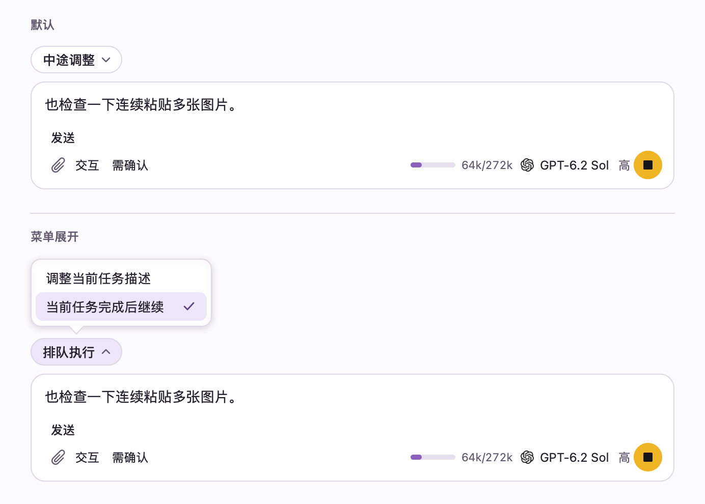

# 输入区发送方式上移

**定稿 r03 · 2026-11-19**

当前会话可使用运行控制时，把「发送方式」菜单放在输入框外、紧贴左上方。参考用户截图中输入框上方的轻描边胶囊。胶囊显示当前方式的缩略文案，展开菜单显示完整文案。

[英文设计稿](composer-send-mode-placement-r03-en.png)

| 发送方式 | 中文胶囊 | 中文菜单 | 英文胶囊 | 英文菜单 |
|---|---|---|---|---|
| `steer` | 中途调整 | 调整当前任务描述 | Steer | Change what you're doing. |
| `followUp` | 排队执行 | 当前任务完成后继续 | Queue | Do this next. |

## 布局与操作

- 胶囊左缘与输入框外缘对齐。底部与输入框上缘间距默认 8 pt，单行文字、1 pt 主题描边，复用 Pikachu 的明暗色、悬停与键盘焦点样式。选择后，胶囊显示对应缩略文案。菜单以勾选标识当前选项。
- 恢复草稿和队列提示排在胶囊上方。图片预览、编辑器、文件附件和运行中的次级「发送」在框内保持现有顺序。右下角继续承载「停止」或普通发送箭头。
- 胶囊沿用原运行中发送方式行的可见条件。正在停止时可沿用现有展示，由现有条件禁用发送。当会话空闲且队列清空时，或切换到不满足可见条件的会话时，胶囊随旧入口一起收起。队列未清空且原运行控制仍可用时保留胶囊。可见性独立于草稿是否为空。
- `steer` 把新消息作为补充交给正在运行的任务，也是新草稿的默认方式。`followUp` 将消息排进后续执行队列。
- 选项绑定当前所查看会话的草稿。切换方式只修改草稿。运行中点「发送」或按 `⌘↩` 时，按所选方式提交。会话切换或胶囊消失时关闭菜单，旧菜单操作不得作用于新会话。
- 保留「发送方式」辅助功能标签，读出当前方式的完整文案和选中状态。支持键盘打开、选择及 Esc 关闭。验证从编辑器开始的键盘路径可返回编辑器，从胶囊打开时关闭后可继续导航。

单胶囊延续当前菜单，同时明确显示当前选择。两项并排能直接看见所有选项，也会占用更多横向空间。上移单胶囊会增加运行中输入区高度，需验证底部消息的可见位置。

## 实施与验收

从 `SessionDetail` 的正常装配改动 `ComposerView`。把菜单移出带边框的输入卡片，按上表在 `sendModeTitle` 所在处提供胶囊和菜单的两组本地化文案。菜单宽度适配两条完整文案和选中标记。保留次级发送、快捷键，复用现有菜单与主题色。若需补充胶囊外形，优先把样式限定到这个触发器。沿用 `SessionController.mode`、`canSend` 判断、会话切换确认和运行时提交路径。若与[运行控制设计](session-run-timeline.md#运行控制)合入同一候选，先核对实际装配，按本稿放置胶囊并显示文案。

| 验收项 | 通过条件与证据 |
|---|---|
| SM-01 · 布局 | macOS 原生明暗外观、常规和最窄支持宽度下，左对齐的胶囊与输入框间距清楚。简体中文和英语下，胶囊与菜单各自显示指定文案，选项和勾选标记完整可见。带图片与文件、队列提示或恢复草稿时仍能操作。观察运行开始和结束时的对话底部及手动滚动位置。 |
| SM-02 · 发送 | 在同一会话运行时各选一次，用鼠标和 `⌘↩` 覆盖两种提交入口。用 Fake Runtime 及现有宿主回归核对请求模式、草稿状态、队列和停止路径。停止动作独立于发送。 |
| SM-03 · 状态与键盘 | 检查空闲、运行、停止中、队列未清空和切换会话。验证菜单与运行入口同步、旧菜单操作不影响新会话、发送禁用条件准确。用原生键盘与 VoiceOver 核对焦点、当前值和选择。 |

一个实现者负责布局和固定候选。独立审查核对生产装配、模式绑定、发送入口及会话切换。若有必改问题，由作者整改、原 reviewer 复查。原生验证需可用的 macOS 应用候选和隔离测试会话。当前依据为参考截图和项目源码。
