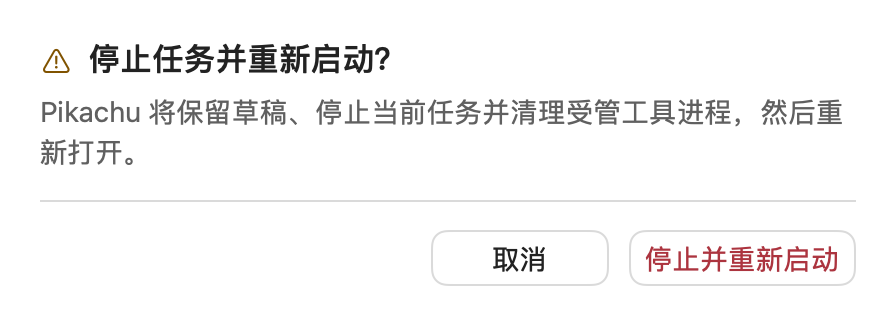

# 确认弹窗排版

**2026-11-20** · 适用于 [`FlatConfirmation`](../../Zivvi/DesignSystem/FlatConfirmation.swift) 的三个入口：退出 / 重启确认面板（[`AppDelegate`](../../Zivvi/App/AppDelegate.swift)）、设置里的语言重启提示、工作台内的会话确认（模型重试、替换草稿等）。


## 问题

退出确认面板使用透明标题栏的 `NSPanel`。`NSHostingView` 默认接受窗口安全区，标题栏的 32 pt 会整块加在内容上方，弹窗因此变成「顶部一条空白 + 底部挤在一起」：

- 内容实际高度 146 pt，但窗口被撑到 178 pt，顶部 32 pt 完全空白；
- 标题、说明、分隔线、按钮之间都用 14 pt 等距，说明文字紧贴标题，操作行与说明距离相同；
- 警告图标用 `caption` 字号，与 `title3` 标题的比例偏小，图标与标题间距偏大；
- 按钮宽度随文字长度参差不齐，「继续工作」与「停止并退出」的宽窄差异明显。

## 方案

1. **内容占满窗口。** [`ConfirmationPanel.make`](../../Zivvi/DesignSystem/ConfirmationPanel.swift) 统一创建面板，并设置 `NSHostingView.safeAreaRegions = []`，窗口大小直接等于内容 `fittingSize`。弹窗不再有标题栏空白带。
2. **建立竖向节奏。** 标题到说明、分隔线到操作行均用 `dialogItemGap`（8 pt）。说明到分隔线用 `dialogSectionGap`，四周保留 20 pt。说明使用 `body` 和 `lineSpacing(3)`，标题使用 `title3`。 [对话框间距](../../DESIGN_TOKEN.md#对话框间距)
3. **明确图标语义。** 破坏性确认用琥珀色 `exclamationmark.triangle`（`warningText`），非破坏性确认（如语言设置重启）用蓝色 `info.circle`（`infoText`），图标与标题按首行基线对齐。
4. **统一操作行。** 按钮相隔 10 pt。取消与确认等高，最小宽度为 88 pt。高度与最小宽度分别按字号缩放，由 `FlatConfirmation` 统一计算。默认取消时突出取消按钮。非破坏性确认在默认确认时使用突出样式。破坏性确认使用描边和错误色文字。取消与确认靠右，取消在前。 [共享确认组件](../../Zivvi/DesignSystem/FlatConfirmation.swift)
5. **键盘行为。** 提供取消按钮且启用 `defaultsToCancel` 时，Return 和 Esc 都执行取消。其他可取消的弹窗用 Esc 执行取消。只有非破坏性确认且 `defaultsToCancel` 关闭时，确认按钮才绑定默认 Return。独立确认面板通过 `runModal` 返回 `.OK` 或 `.cancel`。

| 场景 | 宽度 | 图标 | 强调 |
| --- | --- | --- | --- |
| 停止任务并退出 | 360 | 警告 | 「继续工作」为默认操作 |
| 停止任务并重新启动 | 448 | 警告 | 两个操作都是描边，确认使用错误色 |
| 语言设置重启 | 448 | 信息 | 重启会打断当前工作时默认「稍后」，其余情况默认「重新启动」。 [语言设置规则](settings-organization.md#通用) |




## 验证

尺寸用例检查独立面板与内容的尺寸一致，以及操作行随字号增高。首个用例会实际打开面板。获得当前任务的原生验收授权后，通过隔离脚本运行。 [尺寸用例](../../Tests/ZivviTests/FlatConfirmationTests.swift) · [项目验证规则](../../AGENTS.md#构建与验证)

```sh
Scripts/run-isolated-verify.sh --scheme Zivvi --action test \
  --only-testing ZivviTests/FlatConfirmationTests
```

获授权后，用实际弹窗核对分隔线到操作行的 8 pt 留白、大字号按钮和键盘结果。分别检查停止并退出、停止并重启及空闲或运行中的语言重启。按上文各场景的默认操作验证 Return，并确认 Esc 执行取消。本文截图来自早期 2× 面板渲染。
