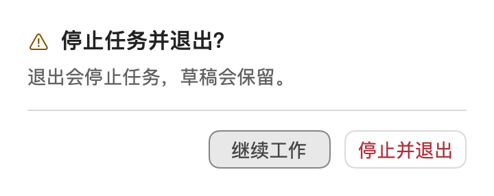
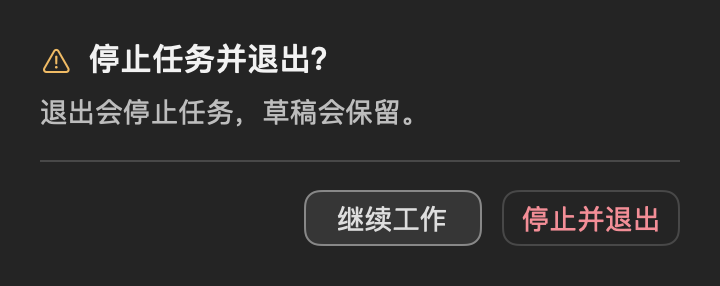
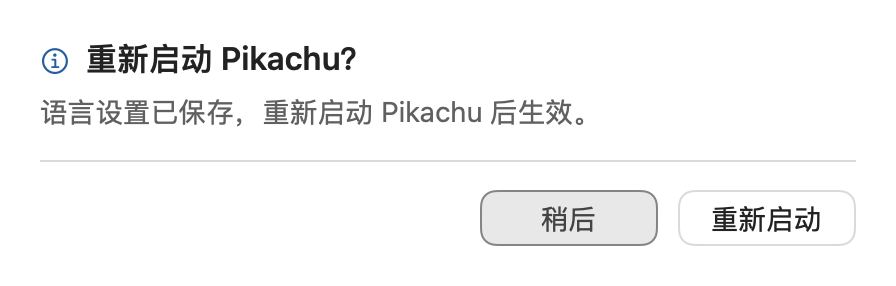

# 确认弹窗排版

**2026-11-20** · 适用于 [`FlatConfirmation`](../../Pikachu/DesignSystem/FlatConfirmation.swift) 的三个入口：退出 / 重启确认面板（[`AppDelegate`](../../Pikachu/App/AppDelegate.swift)）、设置里的语言重启提示、工作台内的会话确认（模型重试、替换草稿等）。




## 问题

退出确认面板使用透明标题栏的 `NSPanel`。`NSHostingView` 默认接受窗口安全区，标题栏的 32 pt 会整块加在内容上方，弹窗因此变成「顶部一条空白 + 底部挤在一起」：

- 内容实际高度 146 pt，但窗口被撑到 178 pt，顶部 32 pt 完全空白；
- 标题、说明、分隔线、按钮之间都用 14 pt 等距，说明文字紧贴标题，操作行与说明距离相同；
- 警告图标用 `caption` 字号，与 `title3` 标题的比例偏小，图标与标题间距偏大；
- 按钮宽度随文字长度参差不齐，「继续工作」与「停止并退出」的宽窄差异明显。

## 方案

1. **内容占满窗口。** [`ConfirmationPanel.make`](../../Pikachu/DesignSystem/ConfirmationPanel.swift) 统一创建面板，并设置 `NSHostingView.safeAreaRegions = []`，窗口大小直接等于内容 `fittingSize`。弹窗不再有标题栏空白带。
2. **建立竖向节奏。** 标题 → 说明 8 pt，说明 → 分隔线 16 pt，分隔线 → 操作行 14 pt，四周 `padding(20)`。说明改用 `body` 字号、`lineSpacing(3)`，与 `title3` 标题的比例更自然。
3. **明确图标语义。** 破坏性确认用琥珀色 `exclamationmark.triangle`（`warningText`），非破坏性确认（如语言设置重启）用蓝色 `info.circle`（`infoText`），图标与标题按首行基线对齐。
4. **统一操作行。** 按钮间距 10 pt，`FlatControlButtonStyle` 新增 `minimumWidth`，确认与取消至少 88 pt 宽且等高；高度与最小宽度按界面字号缩放（`max(26, body 字号 × 2)`）。安全操作使用 `prominent` 底、破坏性操作保持描边 + 错误色文字，取消与确认始终靠右、顺序为「取消 → 确认」。
5. **键盘行为不变。** `defaultsToCancel` 时取消按钮是默认键（Return 继续工作），另一个按钮为 `cancelAction`（Esc）；弹窗仍然通过 `runModal` 返回 `.OK` / `.cancel`。

| 场景 | 宽度 | 图标 | 强调 |
| --- | --- | --- | --- |
| 停止任务并退出 | 360 | 警告 | 「继续工作」为默认操作 |
| 停止任务并重新启动 | 448 | 警告 | 两个操作都是描边，确认使用错误色 |
| 语言设置重启 | 448 | 信息 | 「稍后」是默认操作，确认是普通主操作 |




## 验证

`Tests/PikachuTests/FlatConfirmationTests.swift` 用与入口相同的 `ConfirmationPanel.make` 创建面板，断言窗口与内容视图的高度都等于 `fittingSize`（旧实现会多出 32 pt），并检查操作行随界面字号增高而不裁切文字。本文截图为同一面板路径按 2× 渲染的结果。

```sh
xcodebuild -project Pikachu.xcodeproj -scheme Pikachu -derivedDataPath build \
  -only-testing:PikachuTests/FlatConfirmationTests test
```
