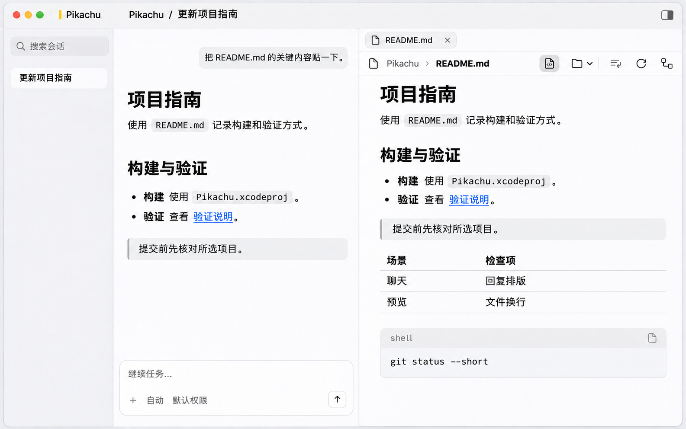

# 聊天与文件预览 Markdown 排版

**历史基线 · 单 Profile v1** · 2026-11-23

当前工作区的实现规格见 [双 Profile 排版系统](typography-profiles.md)。本页保留 v1 设计和概念图作为原始基线。

Zivvi 在聊天回复与文件格式预览中共用一套 Markdown 排版。同一段内容在两个入口使用相同的字号、字重、行距、间距和颜色。聊天阅读列与文件面板各自提供可用宽度，内容随宽度自然换行。

用户确认采用 [浅色并排稿 v1](zivvi-markdown-light-v1.png) 和本文的排版规则。采用范围为聊天回复和文件格式预览的 Markdown 正文。工作台导航、输入区、文件标签和工具栏以各自的项目规范为准。实现以本文中的 pt 参数和组件映射为准。

## 排版规则

下表使用默认字号档，单位为 pt。文字跟随 Zivvi 的四档界面字号。正文使用系统字体和现有文字颜色，等宽字使用系统等宽字体。

| 内容 | 视觉规格 |
|---|---|
| 一级标题 | 默认 22，粗体。字号取正文 + 8。同一内容区首块直接起排，其余一级标题前留 24，标题后留 10。 |
| 二级标题 | `title2` 18，半粗体。章节前留 22，标题后留 10。 |
| 三级标题 | `title3` 16，半粗体。标题前留 18、后留 8。 |
| 四至六级标题 | `headline` 14，半粗体。标题前留 16、后留 8。保留源文档中的标题级别。 |
| 正文与强调 | `body` 14，默认额外行距 5。紧凑／默认／较大／超大档的额外行距为 4／5／5／6。普通段间距 14。保留粗体、斜体和删除线。 |
| 有序与无序列表 | 标记和首行基线对齐。续行与条目正文左缘对齐。条目间 8，条目内多段间 8，嵌套在父条目正文起点再缩进一档。数字标记随字号和位数扩容。 |
| 行内代码 | 普通正文和表格用 `callout` 等宽字，标题内代码跟随标题字号。用 `selected` 中性底色，圆角 4。圆角底色逐行贴合代码片段，支持长路径换行并保留选取、链接和原始复制文本。 |
| 链接 | 可打开的链接使用主题的 `infoText` 和下划线。不可打开的目标以文本呈现，保留原有强调和行内代码底色。目标解析与点击行为沿用各入口的现有规则。 |
| 引用与分隔线 | 引用用细竖线和低对比 `mutedSurface`，内边距横向 12、纵向 8，正文沿用共享排版。分隔线用 `subtleDivider`，前后留 14。 |
| 围栏代码块 | `callout` 等宽字，`mutedSurface` 底、圆角 8，内边距 12。沿用语言标签与复制入口。保留空格和换行，过长时仅块内横向滚动。 |
| 表格 | 无外框，表头半粗体，行间使用细分隔线。横向列间距沿用 18，纵向单元格留白 8。保留列对齐，单元格优先换行。列宽不足时仅表格块横向滚动。 |

相邻块的竖向间距按规则取较大值，避免段距与标题前距相加。首块去掉前距，最后一块之后只保留容器留白。引用、代码块及表格与相邻普通内容的基准间距为 16。使用 [ZivviTypography](../../../Zivvi/DesignSystem/ZivviTypography.swift) 和 [ZivviTheme](../../../Zivvi/DesignSystem/ZivviTheme.swift) 的现有字号档、颜色和外观切换。

## 容器与状态

| 场景 | 规则 |
|---|---|
| 聊天 | 沿用与输入框对齐的居中阅读列，上限 800，窄窗每侧至少 24。已完成的回复使用完整排版，流式正文沿用原有输出路径。完成时由现有跟随与锚点逻辑处理高度变化。 |
| 文件预览 | 正文按滚动视口的实际可用宽度排版。320 pt 浮层每侧 16。停靠时，面板正文区宽度小于 560 pt 每侧 20，达到 560 pt 每侧 24。两列有文件树时按去除目录后的正文区宽度确定留白档位。源码、行号、标签、切换和刷新沿用文件面板规范。 |
| 窄列、长内容 | 正文、列表、标题和引用随列宽换行。代码块、宽表格可局部横滚。中英标点、长路径、连续缩进和宽表格都作为边界样本。 |
| 明暗和大字号 | 两处同时采用语义颜色和应用字号。代码背景与正文表面有可见区别，链接同时用下划线标识。正文和代码可选取，保留标题、表头、列表和复制按钮的辅助功能语义。 |
| 链接与不支持的内容 | 聊天中的文件链接继续走会话入口。文件预览按现有规则响应显式 Web 和邮件链接。原始 HTML、图片和未支持语法沿用当前解析与回退行为。 |

采用共同的排版规则后，两处更容易形成一致的扫读节奏。长回复的占高会增加，优先把额外空间用在章节前和行距上。列表内部、表格和代码块仍保持较高的信息密度。

## 实施与验收

1. 在共享的 [MarkdownContent](../../../Zivvi/Features/Transcript/MarkdownContent.swift) 内集中维护排版参数。复用现有解析结果、行内代码绘制和表格宽度计算。按字号计算字体和间距，在同一块层级应用相邻间距。解析缓存继续按内容与解析上下文复用。
2. v1 从聊天回复和当时的文件面板进入。同一渲染器使用各入口的真实正文宽度。现行入口及验收见[双 Profile 排版系统](typography-profiles.md)。
3. 授权后，用同一份合成 Markdown 在两个入口并排检查。覆盖正常宽度、320 pt 文件浮层、目录并排、深色及超大字号。检查标题间距、混排换行、代码底色、表格局部滚动，以及选取、复制、链接与键盘和 VoiceOver 阅读顺序。
4. 分别检查聊天出流到完成、向上阅读与贴底跟随，以及文件在源码／预览间切换和同文件刷新。长历史用同一份夹具对照现有候选，记录首个可见行、偏移和滚动表现。既有长历史性能问题沿用工作台文档中的状态。

## 设计稿场景

浅色工作台。聊天显示一条已完成的回复，右侧 `README.md` 处于格式预览。两处共用下面的合成片段，便于直接比对同一级标题、列表和行内代码的样式。右侧继续显示表格和代码块，体现两处共用的块样式。

```markdown
# 项目指南

使用 `README.md` 记录构建和验证方式。

## 构建与验证

- **构建** 使用 `Zivvi.xcodeproj`。
- **验证** 查看 [验证说明](https://example.com/verification)。

> 提交前先核对所选项目。
```



设计稿为 1585 × 992 px 的浅色静态概念图，由本任务使用 Vistra 0.1.5（产物契约 1）和内置图像生成工具制作并核对。第二轮补齐文件标签和预览状态，并移除表格外框。图中同一段 Markdown 可对照阅读，两处章节间距的细微差异以排版规则表为准。深色、窄栏、大字号与交互待原生验收。

<details>
<summary>设计稿生成提示词</summary>

初稿

```text
Create a single high-fidelity native macOS UI design mockup, wide landscape approximately 16:10, crisp 2x screenshot presentation. Use the attached Zivvi design as the chrome and brand reference only. It is the user's own app. Use current Zivvi light neutral surfaces, system SF/PingFang typography, quiet 1px separators, and macOS traffic lights. Fill the canvas with the app window. No outer board, floating callouts, annotation numbers, marketing headers, or extra decoration.

The point is to compare ONE shared Markdown typographic style in two live-looking surfaces. Three total columns: quiet narrow session sidebar (15%), active chat (41%), right file format preview (44%), file tree hidden. Preserve Zivvi's native structure with one top bar showing Zivvi and “Zivvi / 更新项目指南”, a sparse sidebar showing “搜索会话” and the selected “更新项目指南”, and the fixed chat composer at bottom with “继续任务…”. Right pane shows a selected “README.md” file tab and a slim “Zivvi › README.md” toolbar with just a few small existing file controls, including a selected source toggle icon. Keep menus closed. A small muted chat bubble reads “把 README.md 的关键内容贴一下。” The completed assistant response below and the file preview both show the exact same formatted sample:

项目指南
使用 README.md 记录构建和验证方式。
构建与验证
• 构建 使用 Zivvi.xcodeproj。
• 验证 查看 验证说明。
提交前先核对所选项目。

Render “项目指南” as H1 (~22pt bold) and “构建与验证” as H2 (~18pt semibold), each identically styled in both panes, with a distinctly larger gap ahead of the H2 than the gap below it. Body ~14pt with generous line spacing, clear left alignment and readable Simplified Chinese. Text “README.md” and “Zivvi.xcodeproj” in the body are inline monospaced code with snug light gray rounded backgrounds. “构建” and “验证” only are bold at the start of the bullets. “验证说明” is an understated blue underlined link. “提交前先核对所选项目。” is a single-line native-style block quote with a thin left rule and subtle gray surface, never wrapped in quotation marks. Keep this sample visually identical across columns. Add only in the right preview, below the quote, an understated two-column markdown table with headers “场景” and “检查项”, rows “聊天 | 回复排版” and “预览 | 文件换行”, followed by a subtle rounded fenced code block with small “shell” header, quiet copy icon and monospace “git status --short”. All UI copy is synthetic. Give both reading areas comfortable edges and preserve realistic app-level information density. Prioritize exact typography, visually accurate table, readable text and no stray characters. Do not show raw heading markers or Markdown source.
```

修订

```text
Make a localized correction to this existing Zivvi UI mockup. Preserve the whole landscape framing, macOS window, column widths, sidebar, chat, composer, titlebars, all documents and exact Simplified Chinese text, as well as the spacing and existing typography in both Markdown columns. The visual style of Markdown is already the right concept. Change only two regions on the RIGHT:
1. File chrome at the top of the right pane: add, in the existing app top row, only a small selected tab with a document icon and the exact label “README.md”, positioned above the existing “Zivvi › README.md” breadcrumb. In the breadcrumb row show these tools from left to right as small monochrome UI symbols: selected source-document icon (document outline with code glyph, neutral rounded active background), Finder split open button, muted line wrap icon, refresh icon, file tree button. Preserve the top right window panel toggle.
2. Markdown table beginning just below the gray quote: use the exact existing labels, keep two columns and three rows, and keep the alignment and spacing. Remove the enclosing border, rounded outline, shaded header fill, and vertical grid. Keep only thin pale horizontal lines between rows and retain semibold header labels. The table should feel like part of the document text. Keep the fenced code block just beneath it and preserve “shell” and “git status --short”.
Do not add other content, decorations, labels, or annotations. Keep the readable code chips, blue underlined link, section gap and quote in both columns. High fidelity native app screenshot, one image.
```

</details>
