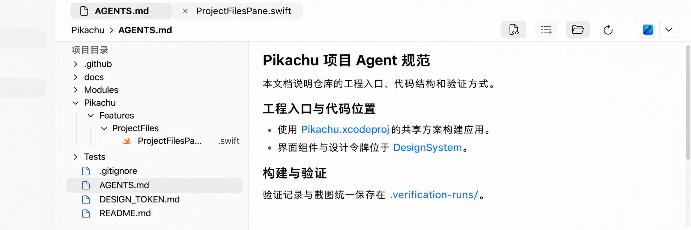

# 项目文件 · 文件面板体验优化

**第一批布局与视觉 · 已定稿 · 2026-11-23**

按本会话确认的宽窗方案交接。目录排在刷新前面，「打开方式」固定在最右，宽窗增加它与刷新之间的留白。

配图由 ImageGen 基于上一版设计稿调整，用于核对布局、顺序和留白关系。精确尺寸、图标资源和交互状态以本文规格为准。

## 目标

让用户在同一个工作台里更快认出文件、定位目录并阅读正文。两张实机截图显示，当前画面最值得改善的是文件面板分到的阅读宽度、目录树深层结构的辨识度，以及标签与工具栏之间的分隔感。参考图打开 Swift 源码，当前截图打开 Markdown。正文排版采用同一文件复核。

本方案承接 [v2.3 布局与工具栏定稿](project-file-preview-toolbar.md#v23--已定稿)。文件面板位于会话右侧，宽窗在面板内左侧显示目录，窄窗用同一个目录开关切换目录和正文。文件读取边界、按有效工作根隔离、只读预览、Markdown 切换按钮最左和外部打开校验均沿用现有规格。

## 第一批 · 布局与视觉

| 区域 | 方案 | 验收观察 |
|---|---|---|
| 窗口顶栏 | 右侧项目文件面板一打开，分支、领先提交和变更文件摘要合为一个「Git 详情」按钮，使用 Jannchie `git-pull-request`。这条规则适用于两列、单列停靠和浮层。点击按钮打开当前会话工作目录的详情浮层。面板关闭后，Git 摘要恢复按窗口可用宽度决定展开或收起。详见 [窗口顶栏规则](session-window-toolbar-v2.md#git-摘要收起状态)。 | 在足以展开 Git 摘要的宽度开关文件面板，核对摘要立即收起和恢复。窄窗与浮层核对图标、详情入口、当前工作目录和 VoiceOver 名称。 |
| 目录开关 | 「显示目录／隐藏目录」放在换行与刷新之间，使用 Jannchie `folder-open` 模板图标。宽窗显隐与窄窗切换共用此按钮。目录可见时用中性选中底色。窄窗目录页可返回已打开文件，按钮提示随动作切换为「返回文件预览」。点击区沿用 26 × 26 pt。参见 [指定图标](https://icons.jannchie.com/?icon=folder-open#folder)。 | 宽窗、单列和 320 pt 浮层均能识别目录按钮。核对显隐、返回、焦点描边、提示和 VoiceOver。窗口级「项目文件」开关仍控制整块文件面板。 |
| 面板宽度 | 两列停靠的默认偏好采用 640 pt。目录仍为 200 pt，增量给正文。按可用宽度限制在 600–780 pt，并给会话保留至少 500 pt。借用现有外侧拖拽和目录显隐给正文继续腾位。两列、单列停靠和浮层的现有切换阈值保留。 | 600 pt 可用宽度边界下两列仍可用。空间充足时正文增加约 40 pt，同时检查会话输入区。跨阈值、拖拽与隐藏目录时保留活动标签、目录展开及阅读位置。 |
| 目录树 | 树和正文共用 `PikachuTheme.surface`，以细竖线分隔。树行两侧采用约 8 pt 留白，保留 25 pt 最小行高，深层缩进从 12 pt 起试收紧至 10 pt。对展开的分支画细层级线，选中底色与键盘焦点描边分别表达当前文件和导航位置。 | 用根目录、四层以上展开的树和长文件名对照明暗外观。引导线在分页和折叠处正确收尾。树栏保持单行可扫读，当前文件和焦点位置均清楚。 |
| 类型与文件名 | 树行和标签共用少量文件类别图标，首批覆盖源码、Markdown、配置文件、图片及通用文件。目录继续用展开箭头，链接保留独立标识。树行长文件名优先截断名称主体，尽量保留末尾扩展名。点文件和无扩展名文件按完整名称处理，完整路径由提示与 VoiceOver 提供。 | 使用长名、同名异目录、点文件、无扩展名、未知类型和链接夹具。核对名称、后缀、路径提示及选中态，深层缩进下依然能辨认文件。 |
| 标签与工具栏 | 标签左侧使用同一个槽位显示类型图标或关闭按钮。常态显示图标，悬停或聚焦时切为 `×`，名称和点击区位置稳定。保留中性活动底色，弱化标签栏与路径行之间的横线。路径行下方保留分隔线，将文件操作与正文区分开。操作从左到右为 **Markdown 预览／源码 → 换行 → 目录 → 刷新 → 打开方式**。Markdown 格式预览时换行置灰。常规控件间距为 4 pt，宽窗两列模式下「刷新」与「打开方式」之间采用 8 pt。右端「打开方式」沿用拆分按钮，左半执行当前方式，右半选择应用。 | 用单文件和横向溢出的多标签对照。悬停、离开和切换焦点时文件名位置稳定。关闭后台标签时继续显示当前文件，重复打开活动文件会将其滚回可见区域。宽窗核对右端间距，窄窗核对全部固定入口可达。 |
| 刷新 | 从磁盘重新读取当前文件、项目根和已展开目录，用于查看外部保存、新增或删除，以及重试临时读取失败。源码视图尽量保留阅读锚点。保留固定入口，悬停提示改为「从磁盘重新读取当前文件和已展开目录」。 | 用外部保存、增删文件和恢复原工作根测试。核对正文、目录树、标签状态和源码阅读锚点。 |
| 正文 | Markdown 与原文沿用各自渲染。优先利用面板增量及目录显隐减少频繁换行。滚动条沿用 macOS 外观和显示偏好，验收用同一系统设置对照正文与目录滚动区域。 | 在同一窗口尺寸对照同一份长 Markdown 和同一份长行源码，验证换行、滚动、刷新锚点和可选文本。 |

面板多占用约 40 pt 的工作台宽度是第一批的主要取舍。优先保证会话最小宽度和目录按钮可达，再比较 600 pt 与 640 pt 对样本文档的阅读改善。树的底色减弱后，选中态仍应清楚可辨。

文件标签占用原生窗口顶栏的文件区，与会话区同排。会话区右端保留 Git 详情图标，过长的会话标题在该区内省略。见 [窗口顶栏规则](session-window-toolbar-v2.md#git-摘要收起状态)。

## 后续提案 · 在树内定位文件

- 在目录顶部用文件搜索替代静态标题。按文件名和项目相对路径搜索当前有效工作根，结果同时展示文件名和父级路径。搜索范围依赖当前工作根的读取权限，沿用后台读取、分页和目录边界。
- 搜索结果复用树行的图标及路径规则。方向键移动，Return 打开并复用现有标签。Esc 先退出搜索并恢复目录展开、滚动和焦点。切换项目或 worktree 时清空旧查询及结果。
- 用未展开目录、同名文件、无结果、快速输入和切换 worktree 验证结果绑定与键盘路径。搜索引入索引成本，按实际仓库规模衡量延迟和资源使用。

语法着色、Git 状态标记、行级操作和独立放大预览适合分别评估。语法着色需要确认支持范围和渲染成本。状态标记与行级操作需要先明确数据口径和动作含义。

## 实施与验收

1. 在 [ProjectFilesPane](../../Pikachu/Features/ProjectFiles/ProjectFilesPane.swift) 调整目录开关、树行和标签。复用 [Pikachu 设计令牌](../../DESIGN_TOKEN.md) 的图标尺寸和状态样式。新增 `folder-open` 时使用本地模板资源，同步 [第三方声明](../../THIRD-PARTY-NOTICES.md)。
2. 在 [WorkbenchView](../../Pikachu/Features/Workbench/WorkbenchView.swift) 调整默认面板偏好，检查原有宽度限制与拖拽。由 [WorkbenchTitlebar](../../Pikachu/Features/Workbench/WorkbenchTitlebar.swift) 将文件面板打开状态传给会话顶栏，复用现有 `GitPullRequest` 资源和 Git 详情浮层。树行和标签共用文件类别与完整名称展示逻辑，保留既有标签状态和读取边界。
3. 以固定 macOS 候选覆盖宽窗、单列、320 pt 浮层、明暗及较大字号。用同一套长路径、深目录、多标签、Markdown 和源码夹具做前后对照。重点回归目录显隐、面包屑定位、标题栏对齐、鼠标悬停、键盘、VoiceOver，以及根目录恢复后读取当前标签的行为。测试与原生验证按项目规则授权后执行。
