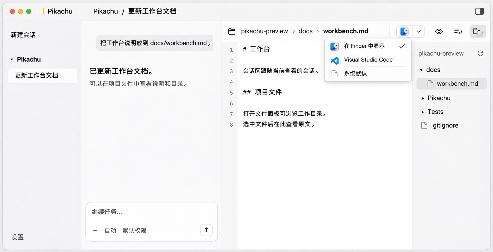

# 项目文件 · 预览布局与工具栏

**历史设计 · 旧版会话文件面板。** 现行文件操作见[工作台 2.0](project-file-preview.md#工作台-20)。

## v2.3 · 已定稿

文件面板继续停靠在会话右侧。宽窗的文件树位于面板左侧。文件标签与会话标题共用窗口顶栏，路径和文件操作位于标签下方。后续布局和工具栏调整见 [文件面板优化](project-file-preview-refinement.md)，会话标题与 Git 图标位置见 [窗口顶栏](session-window-toolbar-v2.md#git-摘要收起状态)。

```text
会话名称…         [Git] │ [× README.md] [  DESIGN.md]  ↔ [面板开关]
                         │ Zivvi › docs › README.md    [预览] [换行] [目录] [刷新] [打开 ▾]
───────────────────────────────────────────────────────────────
项目目录         │ 当前文件正文
```

示意中的 × 表示指针停在 `README.md` 标签上。实际界面使用 Zivvi 的图标按钮。横向箭头表示标签超出时可滚动。

### 布局与工具栏

- 按 [v2.1 的宽度规则](project-file-preview.md#布局与交互) 保留两列、单列停靠和浮层。两列保留 200 pt 左侧目录，正文在右侧。隐藏目录后正文占满面板。单列通过目录按钮切换目录和正文，两种状态都可使用顶部标签。跨宽度切换保留活动文件、标签顺序、目录展开和原有焦点规则。
- 路径右侧的操作从左到右为 **Markdown 预览／源码 → 换行 → 目录 → 刷新 → 打开方式**。选中 Markdown 文件时显示切换按钮，加载、空文件或错误时禁用。其他文件从「换行」开始。打开方式始终保留主按钮和下拉两部分。
- Markdown 首次打开显示源码和行号。源码状态的按钮用 `file-check-badge`，提示「预览 Markdown 格式」。格式预览状态在同一位置用 `file-code-badge`，提示「显示 Markdown 源码」，保留选中底色并将换行置灰。提示和 VoiceOver 名称随按钮动作切换。两个图标采用同一渲染尺寸及着色。参见 [file-check-badge](https://icons.jannchie.com/?icon=file-check-badge#file) 和 [file-code-badge](https://icons.jannchie.com/?icon=file-code-badge#file)。
- 移除「更多文件操作」。刷新移到固定工具栏，继续重读已展开目录和活动文件，并提供读取失败后的重试入口。关闭整块面板使用窗口右上角开关、「显示」菜单、⌥⌘B 或当前焦点允许时的 Esc。窄窗把空间优先留给操作，先缩短路径，折叠的中间目录以带名称的文件夹图标访问。完整路径可通过提示和 VoiceOver 读取。
- 「系统默认」保留标签，菜单项使用中性系统打开图标。系统默认、Finder、编辑器和自定义命令共享同一图标列、行高和选中勾位置。菜单图标采用 16 × 16 pt 渲染框，应用图标保持比例。工具栏主按钮与菜单使用对应图标，沿用 v2.2 的拆分按钮、可用性、选择与实际打开规则。面板局部调整继续独立于全局设置和会话文件链接。

### 文件标签

- 点击文件或在目录用 Return 打开标签。方向键在目录中移动焦点。标签按打开顺序排列。同一有效工作目录内，按项目相对路径去重，重新打开时激活原标签。标签显示文件名，长名中间截断。同名文件通过路径提示和辅助功能名称区分。
- 点击标签切换正文、路径及相关操作。活动标签复用 Zivvi 的选中态。标签超出可用宽度时单行横向滚动，打开或激活的标签自动进入可见范围。首个文件打开时顶栏显示标签，最后一个文件关闭后回到空标签区。
- 标签左侧预留关闭按钮的点击区域。指针进入该标签或键盘焦点进入标签及其关闭控件时显示 ×，字样位置保持稳定。关闭是独立操作，VoiceOver 可识别标签选中态、完整路径及「关闭〈文件名〉」。键盘和 VoiceOver 均可直接关闭，焦点移交到可操作的相邻控件。
- 关闭后台标签时活动文件和视图保持。关闭活动标签时优先选右邻，末尾选左邻。全关后两列显示目录和正文空态，单列回目录。已经停留在目录时，可以关闭标签并继续浏览目录。
- 每个标签记住该文件的 Markdown 源码／格式选择。换行设定由当前面板共享。刷新同一文件沿用既有阅读锚点；基于标签切换的阅读位置恢复留待后续。收起面板保留同根标签和活动项，释放预览内容，重开后重新读取。切换项目或有效工作目录时立即清空标签和预览。同一有效根的会话共享面板状态，应用重启后从空标签开始。
- 后台标签只保存路径和轻量界面状态。文件删除或不可读时，活动标签显示错误并可关闭或刷新。已绑定的工作目录被原路径下的另一个目录替换时，显示原有的目录不可用提示，等待原目录恢复。快速切换、关闭活动标签、切换工作根或关闭面板都使过期读取和外部打开请求失效。

### 实施与验收

1. 在 [ProjectFilesModel](../../Zivvi/Features/ProjectFiles/ProjectFilesModel.swift) 管理标签顺序、活动项及每标签正文模式。复用现有读取服务、根校验和异步取消检查。打开同一标签、关闭后台标签、关闭活动标签和关闭整个面板各有明确的状态转换。
2. [WorkbenchTitlebar](../../Zivvi/Features/Workbench/WorkbenchTitlebar.swift) 承载文件标签，在 `ProjectFilesPane` 接回目录焦点。`ProjectFilesToolbar` 管理打开方式的拆分按钮、菜单和图标。Markdown 使用 `file-code-badge` 和 `file-check-badge` 模板图标，来源见 [第三方声明](../../THIRD-PARTY-NOTICES.md)。在工作台实际入口复查顶栏对齐、会话输入焦点、宽度切换及辅助功能入口。
3. 一名实现者从现有文件预览候选与当前工作区的对照结果起步。独立审查使用固定候选，覆盖实际窗口装配、标签状态及外部打开身份校验。任何影响文件选择、读取和外部打开生命周期的整改，由作者处理后交给原 reviewer 核对相邻终态。若 320 pt 下控件不可达或键盘无法完成切换和关闭，回到布局与焦点方案处理。

| 条件 | 候选与证据 |
|---|---|
| FP-06 · 布局、顺序、可达性 | 原生 macOS 覆盖 320 pt 浮层、单列、两列及宽度切换。核对左侧目录、路径定位、最左预览、固定刷新、窗口关闭入口和目录开关。覆盖长路径、明暗外观、大字号和焦点返回。 |
| FP-07 · 正文模式 | Markdown 首次为源码和行号，按钮显示 `file-check-badge`。切换到格式预览后，同位置显示 `file-code-badge`，换行置灰。验证两个图标的尺寸、提示和 VoiceOver 动作名称。切换标签再返回时检查该标签的模式，复查自动换行、横向滚动和同一文件刷新锚点。 |
| FP-08 · 打开方式 | 在窄窗和宽窗从固定工具栏下拉直接打开菜单。明暗外观下核对「系统默认」、Finder、已安装的编辑器和已配置的自定义命令的图标、行高和选中勾。核对方向键、Return 选择、Esc 关闭及焦点回到下拉按钮。授权后用本地文件验证真实系统打开与 Finder 定位，并核对全局配置和会话链接。 |
| FP-09 · 标签 | 合成夹具覆盖去重、同名、溢出、逐个关闭、最后一个关闭、同根重开和异根清空。原生验证悬停 × 的位置、命中区、选中态及滚动。用键盘和 VoiceOver 分别验证切换、关闭、焦点回退和完整路径。 |
| FP-03／04 · 有效根和过期请求 | 用两个项目、一个 worktree 和可控延迟测试快速切换、关闭时的迟到结果、文件删除、根失效与恢复。独立复查首次及失败回退的后台身份检查，覆盖会话仍可输入、旧文件不会被打开或写回。 |

FP-01 至 FP-05 按上述布局、键盘和生命周期调整继续适用。原生验收和自动化验证需按项目规则获得授权。优先使用合成项目和 Fake Runtime。

## v2.2 · 已定稿

以第二张设计稿为底稿，将当前文件名与归属说明合并到一行面包屑，使正文顶部直接承接文件操作和目录导航。宽窗保留正文与目录并排，空间不足时沿用单列切换。本规格更新 v2.1 的预览标题、工具栏和正文模式。



图中打开方式菜单处于展开状态，用于说明拆分按钮。默认进入预览时菜单收起。

```text
项目或 worktree › 文件夹 › 文件名     [当前打开方式 ▾] [预览／源码] [换行] [目录]
```

### 工具栏与文件导航

- 窗口右上角的项目文件开关采用 `inset.filled.rightthird.rectangle`。窗口级开关控制整个面板。面板内最右侧的目录按钮只控制文件树。宽窗可独立显隐目录，单列中用它在目录和当前预览之间切换。没有文件选择时显示目录入口。
- 工具从右向左依次为「显示或隐藏目录」「开启或关闭换行」「Markdown 预览或源码」「文件打开方式」。目录展开时，目录按钮使用项目选中态的浅灰底。目录隐藏时恢复常规按钮底色。图标按钮有提示、VoiceOver 名称和选中状态。窄窗优先缩略中间的路径段，必要时把低频操作放入更多菜单。目录入口始终可操作。
- 面包屑首段显示项目或 worktree，末段显示文件名。中间目录可点击，展开文件树并定位对应文件夹。单列时进入目录，返回正文时恢复当前文件。最宽的目录名可通过提示和辅助功能读取完整路径。移除原先独立的两行文件头。
- 保留手动刷新和关闭。刷新放在目录工具区，隐藏目录时可从更多菜单使用。窗口级开关、更多菜单和适用时的 Esc 均可收起面板。保留现有输入焦点和面板宽度规则。

### 正文模式

- 源码和普通文本默认显示逻辑行号并自动换行。关闭换行后可横向滚动，行号保持可见。换行状态在同一面板浏览期间共享。刷新同一文件或切换换行时尽量保留原阅读位置。
- Markdown 文件默认显示源码和行号。Markdown 按钮在格式预览和源码间切换，其他文件隐藏该按钮。格式预览使用段落排版，隐藏行号，Markdown 按钮显示选中态，换行按钮置灰。回到源码时恢复先前的换行状态。复用 Zivvi 已有的 Markdown 渲染能力，先核对其链接、图片及原始 HTML 行为。预览由本地读取结果渲染，链接打开由用户动作触发。

### 打开方式

- 采用补图的拆分按钮。左半显示当前方式的图标并对当前文件执行一次打开。右半展开方式列表并标出当前项。选择菜单项只切换当前方式，下次点左半执行。
- 初始继承「设置 → 通用」中的文件打开方式。面板可临时选择 Finder、已安装的编辑器或系统默认方式。Finder 定位当前文件。已有自定义命令只在全局已配置时提供，继续走现有打开入口。选择限于本窗口的文件面板，退出后重新继承全局设置。会话链接继续沿用全局设置。
- 首次向外部应用交接及失败回退前，在后台核对预览所选文件和工作目录的身份。主线程在收到结果后确认打开请求和面板仍有效，再发起交接。加载、切换根、根失效、文件消失时更新按钮状态。不可用的编辑器给出清楚的状态。Finder、Launch Services 和编辑器通过路径接收文件，各应用自行解析收到的路径。

### 实施与验证

1. 调整 `WorkbenchTitlebar` 与 `ProjectFilesPane` 的控件、面包屑和目录定位，复用 Zivvi 的按钮、提示和选中态。
2. 将换行接入原生正文布局，为 Markdown 接入只读格式预览。继续使用现有文件打开配置和执行路径。
3. 使用固定 macOS 候选验证下表。保留 FP-01 至 FP-05 的既有验收要求，其中文件归属和相对路径由面包屑承载。

| ID | 验收观察 |
|---|---|
| FP-06 | 宽窗、单列和浮层中的控件顺序正确。目录展开有选中底色。面包屑显示项目或 worktree、目录及文件名，支持目录定位。截断时可读完整路径。核对键盘和 VoiceOver。 |
| FP-07 | Markdown 首次打开显示源码和逻辑行号。格式预览时隐藏行号，换行控件置灰。源码关闭换行后可横向滚动，行号仍可见。刷新或切换换行后尽量保留阅读位置。 |
| FP-08 | 拆分按钮左侧按当前方式打开文件，右侧展开菜单选择方式。核对 Finder、已安装编辑器和失效文件。面板临时选择后，全局设置及会话文件链接继续使用原配置。 |

两项审查整改沿用 v2.1 的行为约束。临时放大继续由原生阅读证据决定。

- [项目文件预览 v2.1](project-file-preview.md)
