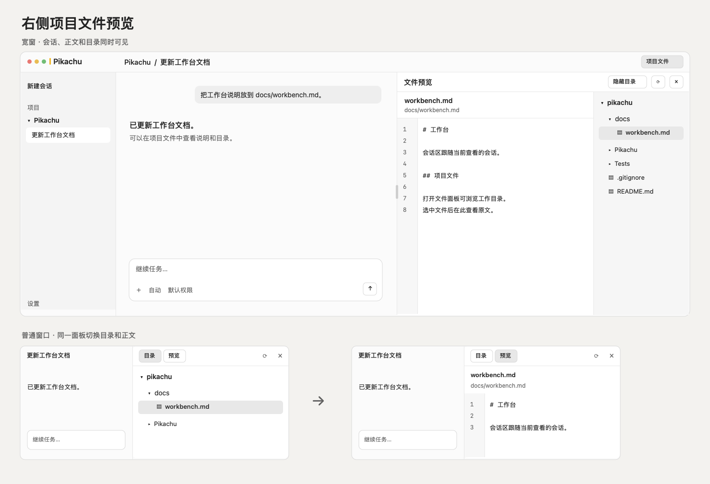

# 右侧项目文件预览

新布局、文件标签及工具栏见 [v2.3 定稿](project-file-preview-toolbar.md#v23--已定稿)。上一版的工具栏与正文模式见 [v2.2](project-file-preview-toolbar.md#v22--已定稿)。

## 首版需求

用户可以在工作台内查看当前会话的项目目录和本地文件，同时阅读会话和使用输入框。

- 工作台右侧提供可开关的文件面板。目录可逐级展开，列表包含尚未被 Git 跟踪的本地文件。
- 面板使用当前查看会话的有效工作目录。使用 worktree 的会话显示对应目录，普通会话显示项目根目录。缺少可用目录时给出提示。后台会话可以继续执行。
- 在面板中查看并复制源码、Markdown 原文和纯文本。预览显示文件名、相对路径及所属项目或 worktree 名。手动刷新可读取磁盘最新版本，并尽量保留同一文件的阅读位置。
- 面板只读取有效工作目录中的内容。读取失败和超出支持范围时给出状态提示。保留会话文件链接的现有打开行为。
- 图片和 PDF 内嵌预览、文件编辑和管理、全文搜索、Git Diff、会话链接直接进入面板留待后续评估。

## 验收条件

| ID | 验收观察 |
|---|---|
| FP-01 | 在常规和窄窗口中可开关右侧面板，并可继续操作会话及输入框。可展开嵌套目录并选中未跟踪文件。收起面板后草稿保留。 |
| FP-02 | 可按原文查看和复制源码、Markdown 和纯文本，并在预览中查看文件名和相对路径。同一文件手动刷新成功后，展示磁盘最新版本并保留原阅读位置。原行内容消失时回到最接近的可用位置。 |
| FP-03 | 面板指向当前查看会话的有效目录。正文标题区显示对应项目或 worktree 名，目录收起后仍可识别当前文件归属。切换目录时旧列表、名称和文件内容立即退场。后台执行会话的文件目录不会接管面板。无可用目录时有明确提示。 |
| FP-04 | 大文件、不可读或已删除的文件、二进制文件及越界符号链接有对应提示。处理这些状态时仍可操作会话和切换文件。预览操作不写入项目文件。 |
| FP-05 | 可用键盘开关面板、浏览目录并选择文件。VoiceOver 可识别开关、文件项、选中项和预览区域。既有会话文件链接仍按设置打开。 |

验收使用原生 macOS 工作台和合成项目。夹具覆盖两个项目、一个 worktree、同名文件、未跟踪文件及读取异常。

## 方案 v2.1 · 已定稿

宽窗中正文与目录并排，目录固定在最右列。预览和目录都利用完整高度，连续查看文件时可以保留展开位置。普通窗口在同一面板中切换目录和预览。v2.1 把刷新后保留阅读位置、显示项目或 worktree 名纳入首版。

正文标题中的项目或 worktree 名按下文的 v2.1 规则显示。

### 布局与交互

- 窗口工具栏右端设置「项目文件」开关，「显示」菜单和 ⌥⌘B 共用此开关。默认关闭。面板标题行提供刷新和关闭。无有效目录时，面板显示原因。
- 宽度按扣除左侧会话栏后的工作台内容区测量。以下数值是首版设计默认值，原生候选需核对可读性和工具栏可达性。

| 内容区可用宽度 | 布局和操作 |
|---|---|
| 至少 1,101 pt | 会话右侧停靠文件区。初始 600 pt，最右 200 pt 为目录，其余为正文。保留至少 500 pt 给会话和 1 pt 分隔线。外侧分隔线可拖动，文件区最大 780 pt，新增宽度优先给正文。点文件直接更新正文，目录保持展开和滚动位置。「隐藏目录」让正文占满文件区，「显示目录」恢复目录。 |
| 821–1,100 pt | 文件区仍停靠。面板宽度为内容区宽度减去 501 pt，上限 460 pt。「目录／预览」在同一位置切换。首次展开且无选中文件时打开目录。选中文件后进入正文，点「目录」回到刚才的目录位置。 |
| 小于 821 pt | 右侧以 320 pt 浮层承载同一套「目录／预览」交互。浮层暂时覆盖会话右侧，关闭按钮、菜单快捷键、面板内 Esc 或现有「聚焦任务输入」可回到完整会话。 |

- 两列模式中，正文与目录各自滚动，目录先展开根级并保留当前文件的选中态。各布局的正文标题区第一行显示文件名，第二行显示「目录归属 · 相对路径」，例如 `pikachu-preview · docs/workbench.md`。项目根目录使用项目显示名。会话使用独立 worktree 或其他已绑定目录时，使用该有效目录的末级名称。空间不足时优先截断相对路径，通过提示和 VoiceOver 提供完整的有效目录和相对路径。目录收起时正文标题区仍保留归属。
- 正文以等宽字体显示原文，显示逻辑行号，长行换行。复制只包含所选原文。
- 两列且未选中文件时，正文显示「选择文件以预览」。单列模式切回目录保留所选文件，用户可点「预览」直接返回。跨宽度切换保留同一文件、目录展开和滚动位置。两列收为一列时优先保留当前键盘焦点所在区域。没有面板焦点时，有选中文件则显示正文。重新变宽时显示两列，除非用户此前主动隐藏过目录。
- 方向键浏览目录，左右键展开或收起文件夹，两列中在文件行间移动可更新预览并保留目录焦点，Tab 可进正文。单列用方向键先定位文件，Return 或点击打开正文，返回目录时恢复所选行的焦点。键盘打开面板时进入当前可见区域，关闭时恢复原控件或开关。Esc 优先用于系统弹层或对话框。
- 除 `.git` 外，目录按磁盘内容列出，包含 `.gitignore`、`.github` 和未跟踪文件。文件夹先于文件，在各组内按名称排序。用户主动展开目录才列出其内容，每次显示 200 项，使用「显示更多」浏览后续项。刷新重新读取根目录、已展开目录和当前文件。
- 参考图中的多标签、项目文件名筛选、语法高亮、Git 状态和变更视图留待后续评估。首版保持单文件只读预览，沿用 Pikachu 的图标、选中态和配色。

### 文件归属与读取

- 面板使用当前查看会话的有效目录。会话间切换时，项目与有效目录均相同则复用当前面板状态。目录变化立即清空旧树、选择和内容后再读取；已关闭的面板不读取目录。关闭时保留当前根下的展开路径和选中路径，并释放文本及目录结果。重开后从磁盘读取。
- 目录和文件 I/O 在主线程外执行。首版按单个目录枚举、排序并逐批显示，展开下一层才读取下一层。首次读取显示加载状态。树为空时显示「文件夹为空」。未选文件时提示「选择文件以预览」。刷新和关闭使旧请求失效，更换目录、折叠文件夹和更换文件取消对应的读取。结果在发布前核对当前面板和根目录身份、请求批次及目录或文件路径，快速切换时只接纳最新有效结果。
- 同一文件手动刷新成功时，以替换正文前第一条可见逻辑行及邻近内容为锚点。文件前方有插入或删除时，优先定位到新版本中的原内容。遇到重复行时用邻近内容区分。无法定位原内容时，使用原逻辑行号并限制在新文件的有效行数内。尽量保持锚点在视口中的原位置。换文件或换目录时丢弃锚点。删除、读取失败和空文件沿用对应提示。
- 以已解析的有效根作为文件读取边界。子路径逐级从根打开，拒绝沿途符号链接，仅打开普通文件；符号链接保留在列表中，选择时显示「无法预览符号链接」。目录和文件的检查与打开使用同一受约束路径，从已打开句柄校验类型后再读取，覆盖目录或文件在读取前被换成链接的情况。面板不写入磁盘，也不把内容加入提示词、附件或日志。
- 预览首版上限为 512 KiB，读取过程也执行此上限。支持 UTF-8 和带 BOM 的 UTF-16。有效空文件显示「空文件」。二进制、无法解码、超限、权限不足、被删除、根目录不可用和符号链接分别显示对应提示。删除的文件在目录中移除，预览区暂时保留其名称和删除提示，直到用户选中其他项。刷新失败时显示错误，用户可重试。

### 取舍

推荐按宽度选择横向并排或单列切换。横向布局让长文档和深目录同时可见。上下排列也能同时展示两者，并节省横向空间，但目录和正文会争用高度。在默认 1,120 pt 窗口且左侧栏约 292 pt 时，按当前尺寸计算将使用单列停靠。此时换到另一个文件需要先回目录，代价是一次额外操作，正文和会话都保有最低宽度。隐藏左侧栏或扩大窗口时可进入并排布局。

临时放大预览留待原生验证后决定。先在默认窗口与较大字号下查看长行源码，观察频繁换行对阅读的影响。

### 实施顺序与范围

1. **工作台装配。** `WorkbenchView` 持有文件区开关、根目录归属和布局模式。用同一个面板状态管理并排、单列停靠和浮层。`WorkbenchTitlebar` 与窗口菜单共用开关。为工具栏预留按钮宽度，核对会话项溢出和原有运行控制。保持 `SessionDetail` 的会话身份与输入控件，避免切换布局时重建。
2. **文件面板。** 在 `Pikachu/Features` 添加目录、预览和导航状态。复用 `DesignSystem` 配色及操作尺寸。用独立本地读取服务处理路径约束、目录枚举和有限读取。核对 target 成员及中英文字符串目录。
3. **固定候选与独立审查。** 一名实现者负责端到端装配。独立 reviewer 检查实际工具栏和菜单入口、跨阈值布局与焦点、会话归属、关闭和重开、目录安全及刷新终态。原作者整改，原 reviewer 核对修复和相邻状态。原生验证中若无法同时满足会话可操作和正文可读，或读取边界无法可靠实现，回到设计。

### 验证计划

| ID | 候选证据 |
|---|---|
| FP-01 | 固定原生候选覆盖两列、单列停靠及浮层，核对 1,101 pt 和 821 pt 两个内容区边界。检查可拖宽度、目录显隐、切回目录的位置、展开与未跟踪文件、会话输入和草稿保留。覆盖默认窗口、860 × 620 pt、左栏隐藏、全屏、新会话和后台运行。 |
| FP-02 | 文件夹具包含源码、Markdown、无扩展名文本、UTF-16、空文件和长行。核对相对路径、原文、行号及跨行复制。原生候选中滚到文件中段，分别验证内容不变、前方增删行、阅读锚点被删除、文件缩短后的刷新结果。由外部原子改写文件，再手动刷新，核对新内容与视口位置。 |
| FP-03 | 使用两个项目、一个 worktree、同名文件与可控制的异步返回顺序。验证宽窗目录显隐、单列预览和窄窗浮层中的归属文字，以及提示和 VoiceOver 的完整路径。核对同根复用、异根切换、快速切换、关闭重开、无有效目录和后台运行互不干扰。 |
| FP-04 | 用纯本地夹具覆盖单层 10,000 项的目录、512 KiB 前后尺寸、二进制、无访问权限、删除、根目录移动和符号链接替换。测试读取边界和旧请求丢弃。原生候选验证加载期间仍能切换和输入，抽查错误与恢复状态，核对项目文件未被写入。 |
| FP-05 | 原生验证明暗外观、宽窄切换、方向键、Return、Tab、Esc 与恢复焦点。VoiceOver 检查面板开关、目录显示状态、文件选中态、预览区域及错误提示。回归已有文件链接按设置打开。 |

静态示意用于确认布局。交互和辅助功能结论以固定候选的原生 macOS 证据为准。验证优先使用合成项目和 Fake Runtime。验证阶段核对实际环境、系统授权和候选，避免模型调用。

## 项目依据

- [现有工作台顶栏和窄窗交互](session-window-toolbar-v2.md)
- [Pikachu 设计令牌](../../DESIGN_TOKEN.md)
- [窗口装配](../../Pikachu/Features/Workbench/WorkbenchView.swift) · [工具栏](../../Pikachu/Features/Workbench/WorkbenchTitlebar.swift) · [会话有效工作目录](../../Modules/OrchestrationCore/WorkspaceModels.swift) · [合成验证入口](../../Verification/README.md)
