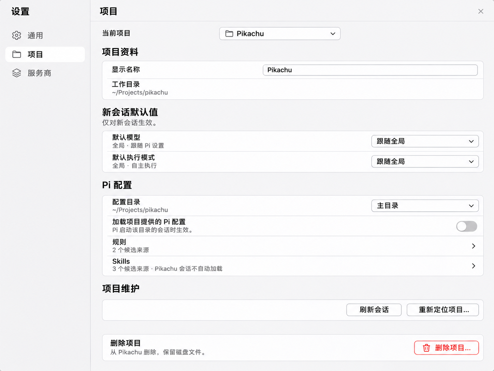

# 项目设置页设计

## 当前项目设置

ACP 工作台依次显示「项目资料」「项目资源」「项目维护」以及删除入口。项目资源列出规则和 Skills 的来源。新会话使用已启用的默认智能体，模型偏好在「设置 → 智能体」中管理。具体操作见[当前设置分组](settings-organization.md)。

## 历史设计稿

以下内容与配图记录内置 Pi 退役前的项目设置设计和验收条件。

2026-11-23 定稿（r03）。首版采用顶部项目选择器，新增「显示名称」「规则与 Skills 来源摘要」「删除项目…」。单项目多文件夹列入后续设计。

## 页面

| 位置 | 内容与行为 |
| --- | --- |
| 当前项目 | 在「项目」标题下固定显示「当前项目」和选择器，设置正文独立滚动。沿用工作台传入的优先项目，依次取侧栏明确筛选的项目、当前会话的项目、项目列表首项。菜单列出所有已登记项目，含尚无会话的项目。每项显示名称、路径和选中标记，按项目 ID 切换。切换时正文回顶，工作台的筛选和会话选择保持独立。 |
| 项目资料 | 「显示名称」可编辑。工作目录显示完整可复制路径，保留目录用途说明。窄窗允许路径换行。 |
| 新会话默认值 | 保留默认模型和默认执行模式，逐项显示来源和有效值。跟随全局与项目覆盖沿用现有逻辑。组标题旁保留「仅对新会话生效」。 |
| Pi 配置 | 先显示实际配置目录，再显示加载开关和现有行为说明。有可用 Worktree 时开放目录选择，从项目主目录开始。目录可切换，完整路径可复制。保留默认关闭、运行保护、加载状态和保存反馈。下方增加「规则」和「Skills」两行来源摘要。Pi 配置和摘要按实际目录呈现。 |
| 项目维护 | 保留「刷新会话」「重新定位项目…」，操作和反馈归发起时的项目。重新定位成功后更新路径，重新核对可用 Worktree。 |
| 页底删除卡片 | 放在项目维护卡片之后，留出分组间距。左侧为「删除项目」与「从 Zivvi 删除，保留磁盘文件。」右侧为描边按钮「删除项目…」，配红色文字和垃圾桶图标。 |

空项目库时显示「尚无项目」和「打开项目…」，打开后在设置内选中新项目。套用三页共用的侧栏、卡外分组标题、表单和控件样式，沿用现有设置窗口尺寸。窄窗下先缩短选择器摘要，再让表单说明和路径换行，必要时将右侧控件移到标签下方。菜单高度有上限，超出时可滚动。路径截断时仍通过帮助提示和辅助功能提供完整路径。 [共用视觉规范](settings-organization.md#共用视觉规范)

概念稿展示浅色正常态、可用 Worktree 和折叠的来源列表。图中的路径、来源数量、控件宽度、图标和精简文案为示例。实现沿用现有图标与主题，并按正文保留完整路径、目录用途和 Pi 行为说明。 [设置分组与交互设计](settings-organization.md) · [设计令牌](../../DESIGN_TOKEN.md)

### 显示名称

- 按项目 ID 保存一个可选的自定义显示名称。旧数据和新登记项目缺省沿用现有目录名称显示规则。自定义名称保留用户输入的大小写，去除首尾空白，拒绝换行。留空后保存可恢复默认名称。允许重名，通过路径区分。
- 有改动时在名称行显示「保存」「取消」。Return 保存，Escape 取消此行编辑。失焦暂保留草稿，切换项目可返回原项目继续编辑。关闭面板丢弃尚未提交的草稿。保存进行中禁止同项目重复提交，操作与反馈绑定发起时的项目 ID。
- 保存成功后，工作台标题、侧栏项目文字和项目选择菜单统一显示新名称。保存失败时沿用上次保存的名称，在原项目显示错误并保留本次输入，按现有存储错误恢复路径重试。
- 显示名称只影响界面。工作目录、项目 ID、会话归属和已有会话标题保持原有语义。重新定位保留自定义名称。使用默认名称时依照新目录更新。

### 规则与 Skills 来源

- 在 Pi 开关下显示「规则」和「Skills」两行。已完成扫描时显示找到的候选数。展开后列出文件或目录名称、来源（项目、父目录或用户级）和可复制路径。明细默认折叠，名称相同时保留不同路径。
- 「规则」检查选定工作目录、各级父目录和当前 Pi 用户目录中的上下文文件，例如 `AGENTS.md`、`AGENTS.override.md`、`CLAUDE.md` 及 Pi 文档列出的文件名变体。文件存在只标记为候选。即使项目 Pi 配置关闭，Pi 仍有独立的上下文文件发现规则。
- 「Skills」检查选定目录的 `.pi/skills`、仓库内从选定目录到仓库根的 `.agents/skills`，以及 Pi 用户目录的 `skills` 和用户级 `~/.agents/skills`。非仓库目录仅检查自身的项目 Skills 目录。首版展示上述位置中可核实的 `SKILL.md` 所在目录与路径，扫描范围在展开后可见。Zivvi 启动 Pi 时使用 `--no-skills`，摘要常驻说明「Zivvi 会话不自动加载」。
- 进入后在后台读取文件元数据。按实际配置目录和 Pi 用户目录计算结果。项目切换、Worktree 切换、重新定位或 Pi 用户目录变化时开始新查询，旧结果不得覆盖当前页。提供「刷新来源」入口。区分「正在检查」「未发现候选来源」「部分目录无法读取」和「无法检查」，检查结果受限时显示限制。递归遍历只限约定的 Skills 根目录，设置深度和条数上限并提示截断。符号链接不得把扫描扩展到约定根目录之外。
- 来源检查只读取本机文件元数据。首版范围为标准位置清单。设置文件显式路径、Pi 包、独立 Markdown Skills、插件、MCP、Token 预算以及实际会话加载状态留待有对应的运行时证据后评估。 [Pi 上下文文件与配置](https://github.com/earendil-works/pi/blob/v1.5.2/packages/coding-agent/docs/configuration.md#context-files) · [Pi Skills 来源](https://github.com/earendil-works/pi/blob/v1.5.2/packages/coding-agent/docs/skills.md#add-it-to-pi) · [Pi 启动参数](https://github.com/earendil-works/pi/blob/v1.5.2/packages/coding-agent/docs/cli.md#resources)

### 删除项目

- 首版删除范围为 Zivvi 内的项目登记、项目级偏好、该项目的会话条目和草稿。项目目录、Git Worktree、磁盘上的 Pi 历史文件和按目录保存的 Pi 授权继续保留。手动重新添加目录后，符合目录匹配规则的 Pi 历史可能重新出现。Zivvi 中被删除的草稿和项目偏好无法通过重新添加恢复。
- 点击「删除项目…」打开确认提示。显示项目名称、完整路径和 Zivvi 本地受影响的会话／草稿数量。正文写明「将移除此项目及其在 Zivvi 中的会话条目和草稿。项目文件和 Pi 历史文件会保留。重新添加时，仍可发现符合条件的 Pi 历史。」默认按钮为「取消」，危险动作使用「删除项目」。数量有变化时刷新确认信息后再允许提交。
- 项目有已连接会话、正在启动、执行、等待审批、处理队列或正在清理时阻止删除，提示通过现有入口结束任务并断开后重试。确认时按项目 ID 重新核对路径和操作状态。持久化期间阻止该项目新建、启动、发送、重连和导入更新。以一次已持久化的工作台快照事务删除项目和相关记录，成功后清理对应界面状态。失败时保留现有项目、会话和草稿，在原入口提示错误。
- 成功后，设置选中剩余列表首项，删除最后一个项目则进入空状态。工作台筛选指向被删项目时回到「全部项目」，当前会话被删时清空会话选择。其他项目的选择与记录继续有效。普通刷新只搜索仍登记的项目。保留源历史时，共用目录按现有历史归属规则处理。

### 后续支持单项目多文件夹

同一个 Zivvi 项目可以登记多个目录，供会话选择。项目名称和新会话默认值仍按项目管理。每个新会话绑定一个实际启动目录，该目录下的 Worktree、Git 状态和 Pi 授权继续独立核对。后续设计需确定主目录切换、目录去重、历史归属、失效目录及移除成员目录的行为。现有单根项目可以自然迁移为只有一个目录的项目。

## 参考项取舍

| 参考项 | 建议与理由 |
| --- | --- |
| 项目名称 | **首版新增显示名称。** 同名目录、迁移后的目录和临时 checkout 可以用容易辨认的名字显示。 |
| 默认模型 | **保留。** 已有逐项目覆盖和全局继承。 |
| 置顶、项目图标 | **按使用情况补充，置顶优先。** 项目列表变长后，再为多个项目选择器定义一致的排序。自定义图标的识别收益需要和导入、存储及失效处理的成本一起评估。 |
| 归档、移除或删除项目 | **首版加入从 Zivvi 删除项目，保留源文件。** 归档与磁盘历史清理各自保留为后续独立需求。 |
| 新会话默认工作区 | **随 Worktree 管理评估。** 当前输入栏已有按会话选择，新增项目默认值前需要定义何时选目录、失效目录如何提示及如何回退。 |
| 项目命令（Actions） | **延后。** 有明确的高频命令需求后，再设计运行目录、用户触发、确认、取消与输出。 |
| 多文件夹 | **列入后续。** 一个项目可登记多个目录。首版沿用单主目录与同仓库 Worktree。 |
| Checkout 自动分组 | **暂缓。** 后续多文件夹先采用用户显式登记。 |
| 规则与 Skills | **首版新增只读来源摘要。** 显示候选文件的来源、路径和当前自动加载策略。 |
| 插件与上下文用量 | **暂缓。** 编辑、启停和用量细分随运行时能力评估。 |

现状的常驻列表让一键切换和查看路径都很直接。上一轮参考中的左侧项目组也便于连续维护多个项目。顶部选择器需要先打开菜单才能换项目，但项目数量增长时，正文位置和侧栏栏目数都能保持稳定。优先优化从当前会话进入、修改一个项目设置的路径。

## 实施与验证计划

1. 由一个实现者分步交付。设置页和本地化归 `Zivvi/Features/Settings` 与 `Zivvi/Resources/Localizable.xcstrings`。先以项目页落实设置面板内的共用视觉组件，再在通用和服务商页复用。复用 `SettingsProjectState`、`ProjectSessionDefaultsView`、设置菜单和确认控件。重新装配后核对原列表的调用方，再清理已被替代的局部视图。
2. `OrchestrationCore` 负责显示名称字段和项目删除事务。复用 `WorkspaceController` 的暂存快照、串行保存、成功后发布路径。工作台负责筛选和会话选择恢复。覆盖旧快照、重新定位、删除竞态和会话回调归属。
3. `Zivvi/Services` 负责只读来源扫描，通过 App 装配接收配置目录和实际 Pi 用户目录，设置页消费结构化结果。扫描沿用现有项目边界，不引入 Pi 启动或解析会话历史文件的依赖。
4. 实现者交付固定候选与自测证据，独立审查者核对项目 ID、删除事务、历史文件归属、后台扫描边界、迟到结果和共享组件影响。原实现者整改，原审查者按差异复查相关验收项。

| 验收项 | 验证方法与通过条件 |
| --- | --- |
| PSL-01 · 项目选择 | 用零项目、单项目、多个项目、同名项目、无会话项目和长列表的原生 macOS 夹具。验证初始选择、菜单可达、选中标记、路径辨识、正文回顶，以及切换不改变工作台筛选或当前会话。 |
| PSL-02 · 显示名称 | 用 `WorkspaceTests` 和旧工作台快照验证读取、保存、清空恢复、重启和重新定位。注入保存失败并在保存期间切项目，验证已保存名称、错误和草稿的归属。在原生界面核对工作台标题、侧栏和选择菜单。 |
| PSL-03 · 设置与操作归属 | 用隔离存储、合成 Runtime 和实际临时 Git Worktree 验证模型／模式继承与覆盖；验证 Pi 开关按实际目录读取、根目录与 Worktree 间切换、运行保护、迟到查询，以及刷新与重新定位仍作用于发起项目。 |
| PSL-04 · 原生布局与可访问性 | 固定候选在原生 macOS 验证大窗和最窄支持窗、中英文、浅色／深色及大字号。用键盘和 VoiceOver 检查项目名称与路径、选中状态、菜单开合、名称编辑和关闭面板的焦点顺序。 |
| PSL-05 · 删除与数据边界 | 用隔离存储和合成历史验证取消、同名区分、删除当前／其他／最后项目、活跃会话和并发操作拦截、保存失败、重启及重新添加。字节核对项目文件、Worktree 和所有 Pi 源历史文件。确认仅删除目标项目的 Zivvi 条目和草稿，其他项目仍可使用，普通刷新无法重建被删项目。原生核对删除提示、数量、默认取消和键盘操作。 |
| PSL-06 · 只读来源 | 用合成目录覆盖用户级、父级规则、项目、Worktree、空目录、不可读目录、软链接和超长列表。验证路径与候选数、来源标记、刷新、切换目录时的旧结果隔离和 Skills 加载提示。原生核对折叠、展开与 VoiceOver。验证进入页面和刷新过程不启动 Pi、不修改文件，也不读取候选正文。 |
| PSL-07 · 共用视觉 | 用同一固定候选按共用视觉规范核对通用、项目、Pi 模型和 Pi 连接的分组层级、间距和控件。覆盖固定栏头、模型搜索和环境变量编辑，确认窄窗和大字号时说明及反馈仍可达，项目删除卡独立显示。 |

工程验证使用仓库 `Zivvi` scheme。需要固定候选或一次性夹具时使用隔离验证脚本，保留日志、截图和交互结果。本轮证据来自截图、源码和概念图。实际可用宽度、滚动、键盘和 VoiceOver 需要在原生候选上验证。 [隔离验证脚本](../../Scripts/run-isolated-verify.sh) · [验证入口](../../Verification/README.md)
