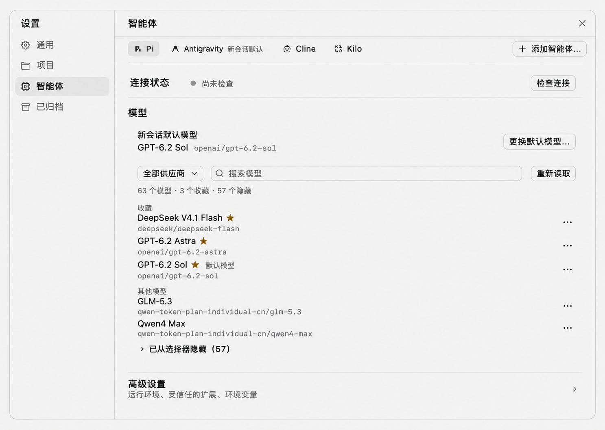

# 智能体设置 · 平铺布局与交互

**2026-11-25 定稿。** 设置栏目显示「智能体」，英文为 `Agents`。ACP 设置页按「连接状态 → 模型 → 高级设置」排列，正文平铺在统一的页面底色上。下图为确认的浅色宽窗视觉参考，使用早期 Pi 标签和目录示意。 [设置分组与交互设计](settings-organization.md)

当前工作区由 ACP 标签承载此布局。上图以定稿时的 Pi 标签为例。ACP 的高级设置包含运行环境、登录与登出、环境变量、客户端权限和管理。模型目录按当前智能体读取，提供搜索、收藏和隐藏分组。默认模型可以恢复为「跟随 Agent 默认」。

## 视觉规范

- 设置左侧栏目和当前智能体标签的选中底色复用工作台会话卡片的 `PikachuTheme.selected`。浅色为 `#E8E8E8`，深色为 `#363636`。选中项使用主文字色。标签上的「新会话默认」标记说明默认智能体，可与当前选中的标签分别识别。
- 左侧、标题栏、标签栏和右侧正文共用 `PikachuTheme.pageBackground`。浅色为 `#F4F4F4`，深色为 `#202020`。连接状态、模型和高级设置直接铺在背景上，组间以留白和 `PikachuTheme.subtleDivider` 分隔。去除正文分组卡片的底色、描边和阴影。按钮和搜索保留各自的控件边界。 [设计令牌](../../DESIGN_TOKEN.md) · [主题定义](../../Pikachu/DesignSystem/PikachuTheme.swift)

## 智能体标签与页内导航

- 标签固定在「智能体」标题下。每个 ACP 智能体使用一个标签，名称前显示 Logo。没有 Logo 时显示名称的字母缩写，辅助功能读出完整名称。
- 「添加智能体…」固定在标签栏右端。完成添加后打开新标签。移除完成时，仅在被移除的智能体仍为选中项时回退到其他标签。
- 正文共用同一个滚动区。页首是连接状态和检查动作，已启用的智能体显示模型区，底部是默认收起的高级设置。设置面板打开期间，各标签保留自己的搜索、折叠状态、环境变量草稿及模型保存反馈。
- 启动错误中的「打开连接设置…」选中对应标签并定位到连接状态。配置类自检失败的「查看配置」展开高级设置，并定位到对应字段。认证类失败提供「登录与登出」。

## 模型设置

- 模型区读取当前 ACP 智能体目录。顶部显示「新会话默认模型」及当前值。「更换默认模型…」列出可用模型及「跟随 Agent 默认」。已保存模型失效时，摘要保留原模型及不可用状态。
- 模型名为主信息，默认标记放在模型名称旁。ID 使用无底色的次级等宽文本，完整值可查看和复制。搜索匹配模型名称、来源和完整 ID。目录统计以返回模型与已保存引用去重后的记录为准。
- 目录按「收藏」「其他模型」「已从选择器隐藏」分组。隐藏组默认收起。输入非空搜索后自动展开命中的隐藏组，清空搜索后恢复搜索前的手动状态。隐藏的收藏保留星标。恢复可见性后，模型回到对应分组。
- 重新读取时保留搜索。读取失败保留上次目录和已保存偏好，目录状态显示为无法验证。成功读取后，未返回的已保存模型显示为当前不可用。通过行菜单解除失效模型的隐藏状态或取消收藏。
- 运行配置变化或环境变量保存成功后，旧目录失效。应用内登录和登出从尝试开始就使旧自检和目录失效，覆盖设置、会话连接及历史导入。终端清理未确认时，该智能体的连接自检和模型目录显示为无法验证。
- 同一个智能体的运行配置、认证与模型偏好写入互斥，关闭再打开设置也保留进行中的写入保护。不同智能体可各自保存默认模型。新会话等待目标智能体的默认模型保存后取值。旧请求的迟到结果不得覆盖当前版本。
- 模型偏好保存失败时，在操作行或默认模型区域显示错误。切页期间完成的失败仍保留在原智能体，可返回该标签查看。 [模型偏好和会话选择器规则](../../Modules/OrchestrationCore/WorkspaceModels.swift)

## 连接与高级设置

「连接状态」显示尚未检查、检查中、成功、失败、配置过期和停用状态。成功详情按需展开。检查失败时就地显示原因，并提供适用的恢复入口。只接受当前有效请求的自检结果。

「高级设置」收纳可执行文件、启动参数、工具搜索目录、启用和默认智能体、登录与登出、环境变量、客户端权限及移除。环境编辑沿用现有遮蔽和保存规则。修改草稿时清除上次的字段校验提示。 [ACP 设置实现](../../Pikachu/Features/Settings/ACPAgentSettingsView.swift)

## 宽窄布局

正文上限沿用 `880 pt`。搜索和重新读取同行，计数另起一行。较窄时将长路径和复杂控件下移。环境变量按可用空间在同行和上下排列之间切换，保留保存入口、草稿、遮蔽状态和错误反馈。长模型 ID 截断后仍可完整查看和复制。

## Pi 历史布局

2026-11-23 的 Pi 布局曾使用供应商筛选和「跟随 Pi 设置」。本页顶部的 r06 保留当时的页面视觉，只作为现行 ACP 平铺样式的参考。 [早期宽窗稿](provider-settings/pi-settings-wide-r05.png) · [早期窄窗稿](provider-settings/pi-settings-compact-r04.png)

## 会话模型选择

输入框浮层同步优化，按「Coding Agent → 模型 → 推理强度」排列。「收藏／全部」筛选当前 agent 的目录，推理强度采用分段滑块。宽窄布局沿用相同的选取顺序。 [会话模型选择设计与验收](session-model-picker.md)

## 实施与验收

ACP 实现复用现有主题、设置控件、模型目录和连接自检。工作台中的连接错误打开对应标签并定位到连接状态。自检发现配置问题时，「查看配置」展开高级设置并定位到问题项。需要认证时直接提供「登录与登出」。默认模型、收藏和可见性按当前智能体保存。 [智能体设置实现](../../Pikachu/Features/Settings/ACPAgentSettingsView.swift)

| 验收项 | 方法与证据 |
|---|---|
| PS-01 · 折叠与恢复 | 合成目录含仅隐藏、隐藏收藏和当前模型。核对默认折叠、计数、点击和键盘展开、搜索命中、清空恢复、重新打开设置和移组焦点。用宿主回归覆盖现有会话选择器规则与保存失败。 |
| PS-02 · 搜索与目录状态 | 使用同名及已下架的模型夹具，核对完整 ID、分组计数、搜索命中、重新读取成功和失败、目录为空及无结果。 |
| PS-03 · 实际窗口 | 原生 macOS 在 `860 × 620`、`1120 × 780` 和宽窗之间往返调整。核对统一底色、与会话卡片一致的选中态、平铺分组、滚动位置和焦点。覆盖中英文、深浅外观、大字号、长 ID、键盘与 VoiceOver。 |
| PS-04 · 连接配置 | 使用合成自检结果和遮蔽的环境变量，核对检查状态、过期提示、失败时展开并定位、宽窄切换时草稿与焦点保持，以及保存失败反馈。 |
| PS-05 · 智能体标签与直达 | 从设置齿轮进入，核对 Logo、选中标签、新会话默认标记及添加入口。分别从关闭和已打开设置的状态触发连接直达，核对目标标签、焦点、搜索、折叠状态及草稿。 |
| PS-06 · 新会话默认模型 | 核对「更换默认模型…」入口、切换模型、恢复智能体默认、当前默认模型失效和保存失败。核对模型区摘要与列表标记同步。 |

在固定候选上安排独立审查，核对设置齿轮、连接错误直达和会话模型选择器三个生产路径，以及改动的词条和分组来源。整改涉及筛选、焦点、偏好或连接状态时，由独立 reviewer 用修订候选复核受影响路径。验收优先采用合成夹具和无推理用例，宽度断点及原生交互须以实测为准。
