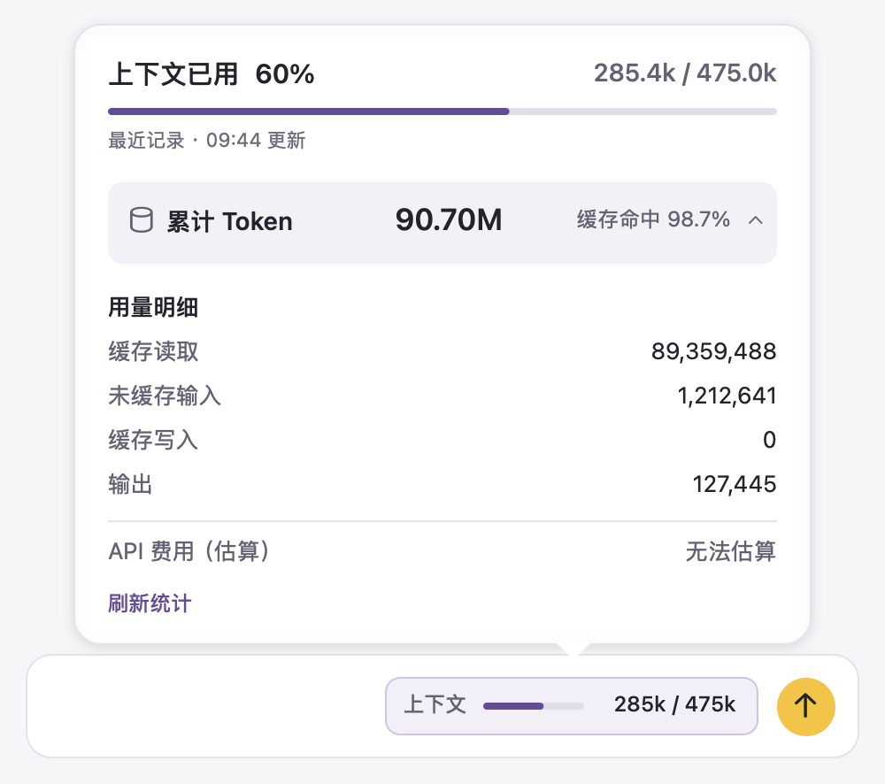

# 会话工作区 · 顶栏、时间与权限

**方案 v5 · 已确认 · 2026-11-19**

运行状态、停止入口和 Pika 摘要位置采用 [会话运行控制与时间线 v1](session-run-timeline.md) 的更新方案。

一套明色布局稿。顶栏参考附件中「项目 / 会话」的层级，对话与输入沿用 Pikachu 的居中阅读列。上方用户消息展示默认状态，下方展示悬停状态。时间及正文为示例。截图内的 T3 Code 对话及命令只用于理解版式。

## 布局

| 位置 | 方案 |
|---|---|
| 会话顶栏 | 左侧为连接状态图标和「项目名 / 会话名」。右侧依次显示分支图标与名称、commit 图标与数量、一个文件图标与绿色 +N、红色 −N 文件数量，以及执行操作入口。Git 明细支持悬停与键盘访问。会话名最醒目，点击项目名直接在当前会话所属项目下新建并打开会话 |
| 用户消息 | 气泡只显示正文。鼠标悬停在消息或其页脚时，气泡右下方显示「月日＋时间、编辑图标、复制图标」。默认隐藏页脚。按钮名称通过悬停提示和 VoiceOver 读取。排队、已拒绝或待核实等需注意的状态保持可见 |
| 模型回复 | 模型署名为「⚡️Pika」。一轮回复的首个可见模型文本上方显示「执行 2 分 18 秒 · 结束于 11月19日 09:44」。同轮含多段模型文本或工具组时只显示一次。执行中使用同一行显示「执行中」，终态后更新该行。仅有工具事件的一轮在对应过程组前显示摘要 |
| 消息输入区 | 控件顺序为「附件 → 模式 → 权限 → 模型」。模式按钮显示「模式·交互」等当前值。模型名称前显示对应供应商 Logo。权限按钮使用盾牌与简短值，点击查看现行或下次执行适用的规则。右侧为「上下文 → 发送」。上下文显示线性进度与已用／总量，点开查看会话用量明细。模式、权限、模型、上下文采用下述交互样式 |
| 工作区底部 | 移除常驻连接状态条。底部止于输入区或当前需要处理的消息，例如扩展请求、存储失败和提交恢复提示 |

连接状态图标绑定**查看中的会话**。已连接使用实心点，历史浏览或未连接使用空心点，连接和清理中使用进度形态，待核实使用警示形态。鼠标悬停和辅助功能提供完整状态说明，保留需处理问题的现有提示。执行和查看是同一会话时，「停止」及断开、清理操作移到顶部。查看其他会话或无选中会话时，顶部按需出现「执行中 · 项目 / 会话」一行，承载返回执行会话、停止和清理。等待扩展回复、正在停止、正在清理或结果待核实时显示对应文字与可用动作。保留全局快捷键 ⌘.，目标仍为实际执行会话。

保留项目现有 **860 × 620 pt** 最小窗口。连接、会话身份与 Git 摘要优先共用一行。长名称省略，悬停或聚焦后可读全称。空间不足时将 Git 摘要移到顶栏第二行，露出所有数量与停止等运行操作。输入控件拥挤时先缩短模型名称和上下文的数字格式，保留对应供应商标识。如果仍放不下，把上下文和发送成组移到输入框内的下一行右侧。窄窗仍可直接查看权限、进度和发送。原生实现在明暗外观使用系统对比度与焦点样式。

### 输入栏控件状态

| 状态 | 样式 |
|---|---|
| 默认 | 模式、权限、模型、上下文直接显示标签与图标。保留模型供应商标识、上下文的进度条和数值。四项均无单独的底色和边框 |
| 悬停与按下 | 只有当前控件出现浅色圆角底。按下时加深反馈 |
| 菜单或详情打开 | 触发控件持续显示选中底。鼠标进入弹层时保留，关闭后恢复默认或悬停态 |
| 键盘焦点与禁用 | 焦点使用系统焦点环。禁用态降强调并保留对应说明 |

建议采用这套样式。四个常驻底板会切分同一行。简化后，文字、图标和数值仍可扫读，发送保持明确的主按钮视觉。默认边界减弱后，模式和模型保留下拉箭头，上下文增加小箭头提示可展开。每个控件的点击区域、间距和位置固定，状态切换不推挤相邻控件。原生明暗外观和键盘焦点需用固定候选检查。

## 数据口径

### Git 图标与摘要

分支用 git-branch，旁边显示名称。commit 用 git-commit，旁边显示数量，图上无额外字段标签。文件变化使用一个中性 file-text，右侧依次显示绿色「+N」与红色「−N」。带符号的数字与图标作为同一个控件，打开变更总文件数及分类明细。VoiceOver 分别读出新增和删除的文件数。分支和 commit 各有对应详情。图标取自 [Jannchie Icons](https://icons.jannchie.com/?icon=file-text#file)。

- **分支**取所选会话工作目录所在的 Git checkout。分离 HEAD 显示短 SHA，未产生首个提交时仍可显示当前分支名。无仓库、目录丢失或读取失败显示对应状态。
- **变更文件数**是该 checkout 的当前改动文件数。包括暂存、未暂存和未跟踪文件，忽略文件排除。同一文件去重，识别出的重命名按一项计。顶栏两项分别统计新增和删除的文件数。将暂存、工作区和未跟踪状态按文件合并，最后归类一次。修改与可识别的重命名单列在详情中。已知为零显示 0，未知显示「—」，详情说明原因。
- **commit 数**建议采用「当前分支领先本地 upstream 的提交数」，比如图标旁显示 2，详情显示「领先 2 个提交」。详情写明上游名称和数据更新时间。缺少有效 upstream、分离 HEAD 或尚无提交时说明不可用的原因。确认读取成功后才显示 0。使用本地追踪引用，无需联网拉取。
- 顶栏展示**仓库状态**。同一 checkout 的不同会话看到相同数据。查询只读且异步，在打开或切换、项目重定位、应用重新获得焦点、手动刷新及该目录的一轮执行结束时合并刷新。过期响应按目录与查询代次丢弃。错误、加载和过期均有明确状态。

### 对话时间与消息操作

- 气泡和页脚共用悬停范围，指针移动到按钮时页脚保持可操作。键盘聚焦消息及其动作时，同样显示页脚，离开后收起。VoiceOver 可读发送时间并触发编辑和复制。页脚显隐不改变正在阅读的位置。
- **编辑**把历史消息载入当前会话的输入框。预填可恢复的原始文字和附件，已有草稿时先确认替换，取消保留草稿。编辑后通过现有发送入口手动提交新消息。被拒绝或待核实的消息仍需经过现有核对路径，避免绕过重复发送保护。
- **复制**复制该条消息的正文，成功后页脚短暂反馈「已复制」。键盘及辅助功能可获得等效反馈。

- **发送时间**取本地实际提交给 Runtime 的时刻。排队消息保留原提交时间。重试产生新的发送记录。旧历史显示可确认的原始消息时间。待核实或被拒绝仍显示这次真实提交尝试的时间及状态。草稿和发送前取消的内容无发送时间。
- **总执行时长**从该轮 Runtime 明确开始到可信终态。包括模型、工具、重试及交互等待，排除连接激活、排队和编辑草稿。使用单调时钟计时。结束时间取终态发生时的当地时间。用户消息发送时间和模型回复结束时间均显示月日及 24 小时制时分，同日也显示，例如「11月19日 09:46」。跨年时补年份。悬停和 VoiceOver 提供完整时间和时区。结束时间可能晚于最后一段模型文字输出。
- 把开始、终态、首个可见模型文本及工具输出关联到同一轮。补充输入仍属于原轮，后续队列启动时建立新轮。普通消息结束、收到首个字和连接断开都不能证明整轮完成。确认停止或失败时显示对应终态及可确认的时间。失联或资料不完整时显示待核实或「时间未知」，逐字段保留可确认的信息。
- 对以后记录的发送和执行时间，用稳定会话、消息／轮次标识恢复，采用向后兼容的可选字段或精简元数据。历史加载继续走现有读取路径。当前 Pi 投影未传递消息时间及整轮边界，实施时先核对已固定版本的日志结构、时间精度及关联能力。缺乏可靠映射的历史只显示可信字段。不得根据相同文本、文件修改时间或相邻消息推算。

### 模式、权限与模型

模式按钮按「模式·当前值」显示，例如「模式·交互」「模式·计划」「模式·自动」。继续使用现有模式菜单和变更限制。模型按钮复用 ComposerView 中的 ProviderLogo，按按钮当前所示模型的供应商选择标识。待应用模型的 Logo 与其名称一起更新并保留待应用标记。供应商标识不可用时使用通用芯片图标。VoiceOver 通过模型按钮获取供应商名称。

输入栏右侧紧接模式的按钮为独立的工具审批策略选择器（「每次审批」「工具审批」「无需审批」），与执行模式配合约束实际可用工具与审批提示：

| 执行模式 | 可选工具审批 | 默认审批 |
|---|---|---|
| 制定计划 | 每次审批 / 无需审批 | 无需审批（仅开放读取、搜索、查找与列目录） |
| 交互执行 | 每次审批 / 工具审批 / 无需审批 | 工具审批（修改文件或执行命令前逐次询问） |
| 自主执行 | 固定无需审批 | 无需审批（按当前 Pi 配置和所选扩展运行） |

空闲时切换模式或审批后，若需重连才生效，摘要标注「下次执行」。活跃运行、未清队列或待确认期间，回显已生效配置并遵守现有变更限制。查看历史时说明配置用于下次运行。

### 上下文与用量明细

- **输入区摘要**紧贴发送按钮左侧。横向排「上下文 → 进度条 → 已用 / 容量 → 展开箭头」，例如 285k / 475k。整个控件可点击、可聚焦，VoiceOver 读出比例、原始数值与最近更新时间。
- **展开详情**向上锚定该控件。第一组展示最近记录中的上下文占用百分比、精确用量、窗口容量及采集时间。第二组展示累计 Token，展开可读缓存读取、缓存写入、输入及输出。只有来源明确区分未缓存输入、推理 Token 或可计算缓存命中率时才用相应标签和数值。API 费用单独标记为估算，有可靠来源时显示美元估算。
- **数据归属**沿用 RuntimeUsage 和 ContextUsage。上下文占用绑定正在查看的会话和实际生效的模型。累计数据沿用已知会话统计的口径，历史可有累计用量而无当前上下文。窗口容量缺失或快照过期时显示具体状态及可确认的最近记录。没有可信占用时用中性轨道和「待更新」或「不可用」，确认占用为零时才显示 0。超过容量时轨道填满并保留真实数值与提示。
- **刷新与入口**沿用现有采集机制与刷新按钮。代理压缩、模型生效或会话切换后核对右侧摘要和弹层指向同一份快照。切换会话时关闭旧弹层。历史查看不会为查询占用而启动 Runtime。现有 ⇧⌘U 和侧栏方案中的统计入口打开同一个弹层，为同一会话服务。

## 实施与验证

建议由一个实现者完成。活跃的工作台刷新和已确认侧栏方案都涉及 WorkbenchView。实施前重新核对基线，限定本任务的装配改动。

1. **顶栏与运行反馈**。修改 WorkbenchView 中的 SessionHeader 和全局运行入口，保留选择对象与执行对象的区分。读 Git 元数据的服务负责目录归属、刷新合并、异步取消与降级。移除旧底部装配前审查空态、工作台菜单、快捷键、诊断标识和扩展入口。
2. **时间、消息操作与对话投影**。从 PiEventMapper、PiHistoryReader、RuntimeEnvelope 到 WorkspaceController、SessionController、存储及 transcript 投影梳理身份、时钟与终态。以最小可持久数据支持重载。通过 TranscriptView、NativeTranscript 更新受影响行，包括悬停与键盘焦点、复制与编辑动作、真实 assistant 行署名。编辑复用会话草稿与发送入口。检查单行交互、完成归组、历史与实时切换及用户暂停自动跟随时的视口锚点。
3. **输入权限、上下文与合版**。在 ComposerView 更新模式标签，复用模型按钮已有的 ProviderLogo，并装配权限摘要及详情。模式、权限、模型与 UsageView 的摘要按钮使用一致的输入栏状态样式，保留现有触发路径。配置从现有模式与执行实例取得。用 UsageView 替换输入栏原「会话用量」按钮的外观，复用现有用量控制器、刷新和弹层状态。核对切换会话和模型时的快照归属，以及菜单和侧栏的共享入口。固定候选后由独立 reviewer 检查下列入口和异常路径。作者整改，原 reviewer 复查候选差异及受影响断言。

| AC | 完成条件与证据 |
|---|---|
| SD-01 · 顶栏 | 原生明暗截图覆盖宽窗和最小窗，长项目名、会话名、分支名及空态。核对连接只显示状态图标，Git 显示分支名和三个数量。单个文件图标后显示绿色 +N 和红色 −N。键盘、悬停和 VoiceOver 可获取全名、数值含义、状态及顶部动作 |
| SD-02 · Git | 用隔离仓库验证有无 upstream、领先 0 与大于 0、分离 HEAD、无提交、无仓库、暂存与未暂存重复、未跟踪和忽略文件、重命名及快速切换。核对新增数、删除数、变更总数与分类明细。查询失败不冒用旧项目值 |
| SD-03 · 时间与滚动 | 可控时钟与 Fake Runtime 验证发送、排队、补充、后续执行、工具多段、重试、确认停止、断连、旧历史和重载。原生回放核对 Pika 署名、回复结束时间包含月日、时间行只显示一次，更新不破坏手动滚动、工具归组和跟随底部。长历史与实时流式样本按现有 M3 方法比较受影响行为 |
| SD-04 · 模式、权限与模型 | 宿主验证三个模式、未生效配置与已运行配置、已知和未知供应商、活动或未清队列的变更保护。原生核对「模式·当前值」、供应商 Logo 与模型一致、键盘顺序、可访问标签及窄窗。逐项验证默认、悬停、按下、打开、键盘焦点和禁用，切换时命中区及布局稳定。真实权限验证使用隔离目录与经授权的运行时 |
| SD-05 · 运行控制 | 原生验证空闲、连接、运行、查看其他会话、无选中会话、扩展等待和进程清理待核实。顶部动作与 ⌘. 始终指向实际运行对象，底部没有重复的连接状态入口。常用错误提示与输入区恢复功能仍可用 |
| SD-06 · 消息页脚 | 原生核对默认隐藏、悬停区域、日期格式、两枚纯图标、指针移到按钮、键盘和 VoiceOver，以及长消息、相邻消息和手动滚动锚点。验证复制内容和反馈、编辑旧消息、有草稿时的保留与替换、跨会话隔离及现有投递保护 |
| SD-07 · 上下文 | 宿主核对有值、零、部分缺失、过期、窗口变化及迟到反馈。用隔离的历史和 Fake Runtime 验证切换会话、压缩、执行结束、费用不可估算和手动刷新。原生核对最小窗仍在发送左侧、进度和展开箭头一直可见、打开和关闭时的控件底色、统计快捷键、键盘和 VoiceOver |

验收使用固定 macOS 候选。先用隔离数据、Git 夹具和 Fake Runtime，真实运行时与原生操作按实施／验收时的有效授权采集。当前证据为工作区源码、实际选用的图标和静态示意图。

## 项目依据

- [工作台分区与原交互](workbench-ui-refresh.md) · [侧栏 v2](sidebar-session-groups-v2.md)
- [工作台装配](../../Pikachu/Features/Workbench/WorkbenchView.swift) · [输入区](../../Pikachu/Features/Composer/ComposerView.swift) · [对话投影](../../Pikachu/Features/Transcript/TranscriptView.swift) · [会话用量](../../Pikachu/Features/Usage/UsageView.swift)
- [Pi 事件映射](../../Modules/PiRuntimeAdapter/PiEventMapper.swift) · [Pi 历史读取](../../Modules/PiRuntimeAdapter/PiHistoryReader.swift) · [工具策略](../../Modules/PiRuntimeAdapter/Resources/execution-policy.ts)
