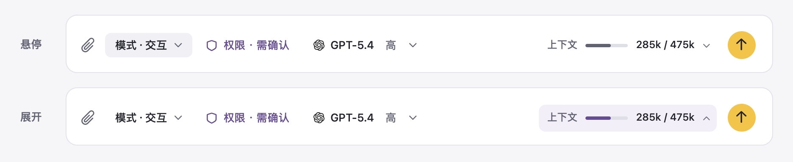

# 会话工作区 · 顶栏、时间与权限

**方案 v5 · 已确认 · 2026-11-19**

运行状态、停止入口和轮次摘要位置采用 [会话运行控制与时间线 v1](session-run-timeline.md) 的更新方案。

图为历史明色布局稿，其中权限选择器属于内置 Pi 时期。现行用户消息见下表和[品牌交互语言](../../DESIGN_TOKEN.md#品牌交互语言)。对话与输入沿用 Zivvi 的居中阅读列。

## 布局

| 位置 | 方案 |
|---|---|
| 会话顶栏 | 会话和编辑区使用独立标签。会话状态显示在标签和侧栏卡片上。Git 摘要可进入左侧 Git 视图。 [工作台 2.0](../../DESIGN_TOKEN.md#工作台-20-布局与功能组件尺寸) |
| 用户消息 | 已送达的用户消息沿用[阅读列与品牌样式](../../DESIGN_TOKEN.md#品牌交互语言)。正文和附件沿内边距左对齐。鼠标悬停或键盘聚焦时，消息下方靠左显示时间、编辑和复制。VoiceOver 读取用户角色和操作。排队、拒绝和待核实等状态保持可见。 |
| 模型回复 | 助手正文平铺。每轮使用一个独立轮次头，按现有运行边界原位更新品牌词、真实状态和可确认的耗时。结束时间在回复操作页脚呈现。轮次头落点见[会话运行控制与时间线](session-run-timeline.md#对话顺序与折叠)。 |
| 消息输入区 | 左侧依次为附件、Agent 提供的模式和工作目录。右侧依次为[上下文摘要](#上下文与用量明细)、智能体与模型、发送或停止。 |
| 工作区底部 | 输入与提示位于对话下方。窗口底部的全局状态栏负责设置、用量、升级和额度 |

等待回复、正在停止、正在清理或结果待核实时提供对应文字与可用动作。状态位置及操作归属见[运行时间线](session-run-timeline.md#顶栏与会话卡片)。原 v5 布局稿用实心点表示已连接，空心点表示历史浏览或未连接，进度形态表示连接或清理中，警示形态表示待核实。

输入控件拥挤时先缩短模型名称，保留对应供应商标识。如果仍放不下，把右侧控件成组移到下一行。

### 输入栏控件状态

| 状态 | 样式 |
|---|---|
| 默认 | 模式和模型显示各自的标签及图标。上下文沿用本页定义的圆环摘要。 |
| 悬停与按下 | 只有当前控件出现浅色圆角底。按下时加深反馈 |
| 菜单或详情打开 | 触发控件持续显示选中底。鼠标进入弹层时保留，关闭后恢复默认或悬停态 |
| 键盘焦点与禁用 | 焦点使用系统焦点环。禁用态降强调并保留对应说明 |

发送保持明确的主按钮视觉。每个控件的点击区域、间距和位置固定，状态切换不推挤相邻控件。原生明暗外观和键盘焦点需用固定候选检查。

## 数据口径

### Git 图标与摘要

会话标签栏的 Git 摘要显示项目分支名和变更文件总数。有足够空间时可点击，跳到该项目的侧栏 Git 视图。侧栏显示文件状态、行数与提交入口，编辑区展示相应 Diff 或提交详情。 [会话标签栏](../../Zivvi/Features/Workbench/WorkbenchTabBar.swift) · [项目 Git 视图](../../Zivvi/Features/Sessions/ProjectNavigatorGitView.swift)

- **变更文件数**合计项目 checkout 的暂存、未暂存和未跟踪文件，按文件去重。识别出的重命名作为一项。忽略文件排除。
- **分支与状态**来自本地 Git 查询。摘要无可用数据时隐藏，详细错误或加载状态由项目 Git 视图提供。

### 对话时间与消息操作

- 正文、附件和页脚共用悬停范围，指针移动到按钮时页脚保持可操作。键盘聚焦消息及其动作时，同样显示页脚，离开后收起。VoiceOver 可读发送时间并触发编辑和复制。页脚显隐不改变正在阅读的位置。
- **编辑**把历史消息载入当前会话的输入框。预填可恢复的原始文字和附件，已有草稿时先确认替换，取消保留草稿。编辑后通过现有发送入口手动提交新消息。被拒绝或待核实的消息仍需经过现有核对路径，避免绕过重复发送保护。
- **复制**复制该条消息的正文，成功后页脚短暂反馈「已复制」。键盘及辅助功能可获得等效反馈。

- **发送时间**取本地实际提交给 Runtime 的时刻。排队消息保留原提交时间。重试产生新的发送记录。旧历史显示可确认的原始消息时间。待核实或被拒绝仍显示这次真实提交尝试的时间及状态。草稿和发送前取消的内容无发送时间。
- **总执行时长**从该轮 Runtime 明确开始到可信终态。包括模型、工具、重试及交互等待，排除连接激活、排队和编辑草稿。使用单调时钟计时。结束时间取终态发生时的当地时间。用户消息发送时间和模型回复结束时间均显示月日及本地短时间（遵循系统 12/24 小时制），同日也显示，例如「11月19日 09:46」。跨年时补年份。悬停和 VoiceOver 提供完整时间和时区。结束时间可能晚于最后一段模型文字输出。
- 把开始、终态、首个可见模型文本及工具输出关联到同一轮。补充输入仍属于原轮，后续队列启动时建立新轮。普通消息结束、收到首个字和连接断开都不能证明整轮完成。确认停止或失败时显示对应终态及可确认的时间。失联或资料不完整时显示待核实或「时间未知」，逐字段保留可确认的信息。
- 用稳定的会话、消息和轮次标识恢复已记录的时间。ACP 回放和本地历史按实际可用字段显示。时间或轮次边界缺失时，只展示可确认的信息。

### 窗口内的阅读位置

- 首次进入会话时从最新内容开始。离开时仍贴底的会话，返回后继续跟随最新，贴底容差为 4 pt。
- 阅读历史时，默认滚动视图在布局完成后记录视口顶部实际可见的消息和行内偏移。切回会话后，等历史就绪、目标行进入视口，再补齐剩余偏移。消息被合并时定位到所属组，被删除时尝试相邻行。历史中有重复消息 ID 时，用出现次序区分各行。重复点击同一导航入口后仍保留实际阅读位置。
- 用户主动滚动、点击消息导航或选择「回到最新」会取消待执行的恢复。记录随窗口关闭而释放。
- 回归验收在相同字号和窗口尺寸下连续执行会话往返，以同一段文字的屏幕纵坐标偏差不超过 3 pt 为准，覆盖短消息及读到中段的长消息。

### 模式、权限与模型

模式按钮显示 ACP Agent 提供的当前模式。运行或保存期间禁用切换。模型按钮显示当前模型与可用的供应商标识，并提供智能体、模型和推理强度入口。审批卡片展示 Agent 返回的选项。文件读写和终端等客户端权限在智能体设置中独立配置。 [智能体设置](provider-settings.md) · [审批界面](tool-approval-dialog/README.md)

### 上下文与用量明细

- **输入区摘要**使用位于智能体与模型按钮左侧的圆环。点击圆环或用键盘激活可打开详情。辅助功能读出可确认的比例、数值和最近更新时间，缺失时读出相应状态。 [用量环尺寸](../../DESIGN_TOKEN.md#品牌与状态)
- **展开详情**向上锚定该控件。第一组展示最近记录中的上下文占用百分比、精确用量、窗口容量及采集时间。第二组展示累计 Token，展开可读缓存读取、缓存写入、输入及输出。只有来源明确区分未缓存输入、推理 Token 或可计算缓存命中率时才用相应标签和数值。API 费用单独标记为估算，有可靠来源时显示美元估算。
- **数据归属**沿用 RuntimeUsage 和 ContextUsage。上下文占用绑定正在查看的会话和实际生效的模型。累计数据沿用已知会话统计的口径，历史可有累计用量而无当前上下文。窗口容量缺失或快照过期时显示具体状态及可确认的最近记录。没有可信占用时用中性轨道和「待更新」或「不可用」，确认占用为零时才显示 0。超过容量时轨道填满并保留真实数值与提示。
- **刷新与入口**沿用现有采集机制与刷新按钮。代理压缩、模型生效或会话切换后核对右侧摘要和弹层指向同一份快照。切换会话时关闭旧弹层。历史查看不会为查询占用而启动 Runtime。现有 ⇧⌘U 和全局状态栏的统计入口打开同一个弹层，为同一会话服务。

## 实施与验证

验收依据当前工作台装配及本页数据口径。历史顶栏截图与当时的验证记录另见[顶栏 v2](session-window-toolbar-v2.md)。

1. **顶栏与运行反馈**。检查双标签和全局运行入口的当前装配，保留查看对象与执行对象的区分。 [窗口工具栏](../../Zivvi/Features/Workbench/WorkbenchTitlebar.swift)
2. **时间、消息操作与对话投影**。从 ACPEventMapper 到 WorkspaceController、SessionController、存储及对话投影核对身份、时钟与终态。默认对话由 SwiftUITranscript 渲染，编辑复用会话草稿与发送入口。检查单行交互、完成归组、历史与实时切换及用户暂停自动跟随时的视口锚点。
3. **输入与上下文**。在 ComposerView 核对 Agent 模式、智能体与模型以及 UsageView 的摘要入口。核对切换会话和模型时的快照归属，以及菜单和全局状态栏的共享入口。

| AC | 完成条件与证据 |
|---|---|
| SD-01 · 顶栏 | 原生明暗截图覆盖宽窗、最小窗、长名称及空态。核对会话标签、编辑区标签、Git 摘要和侧栏 Git 跳转。用键盘、悬停和 VoiceOver 核对全名、数值及操作。 |
| SD-02 · Git | 用隔离仓库验证有无 upstream、领先 0 与大于 0、分离 HEAD、无提交、无仓库、暂存与未暂存重复、未跟踪和忽略文件、重命名及快速切换。核对新增数、删除数、变更总数与分类明细。查询失败不冒用旧项目值 |
| SD-03 · 时间与滚动 | 可控时钟与 Fake Runtime 验证发送、排队、补充、后续执行、工具多段、重试、确认停止、断连、旧历史和重载。原生回放核对轮次品牌词、回复结束时间包含月日、时间行只显示一次，更新不破坏手动滚动、工具归组和跟随底部。长历史与实时流式样本按现有 M3 方法比较受影响行为 |
| SD-04 · 模式、权限与模型 | 核对 Agent 模式、运行期间的变更限制、已知与未知供应商、审批选项及客户端权限。原生核对键盘顺序、可访问标签、窄窗，以及模式和模型菜单的默认、打开、焦点及禁用状态 |
| SD-05 · 运行控制 | 原生验证空闲、连接、运行、查看其他会话、无选中会话、扩展等待和进程清理待核实。按运行时间线核对输入区停止、全局快捷键、后台会话返回与进程恢复的操作归属。 |
| SD-06 · 消息页脚 | 原生核对默认隐藏、悬停区域、日期格式、两枚纯图标、指针移到按钮、键盘和 VoiceOver，以及长消息、相邻消息和手动滚动锚点。验证复制内容和反馈、编辑旧消息、有草稿时的保留与替换、跨会话隔离及现有投递保护 |
| SD-07 · 上下文 | 宿主核对有值、零、部分缺失、过期、窗口变化及迟到反馈。用隔离的历史和 Fake Runtime 验证切换会话、压缩、执行结束、费用不可估算和手动刷新。原生核对最小窗圆环可达、浮层数值可读、开合状态、统计快捷键、键盘与 VoiceOver。 |

验收使用固定 macOS 候选。先用隔离数据、Git 夹具和 Fake Runtime，真实运行时与原生操作按实施／验收时的有效授权采集。当前证据为工作区源码、实际选用的图标和静态示意图。

## 项目依据

- [工作台分区与原交互](workbench-ui-refresh.md) · [侧栏 v2](sidebar-session-groups-v2.md)
- [工作台装配](../../Zivvi/Features/Workbench/WorkbenchView.swift) · [输入区](../../Zivvi/Features/Composer/ComposerView.swift) · [对话投影](../../Zivvi/Features/Transcript/TranscriptView.swift) · [会话用量](../../Zivvi/Features/Usage/UsageView.swift)
- [ACP 事件映射与历史回放](../../Modules/ACPRuntimeAdapter/ACPEventMapper.swift) · [会话编排](../../Modules/OrchestrationCore/WorkspaceController.swift) · [默认对话渲染](../../Zivvi/Features/Transcript/SwiftUITranscript.swift)
