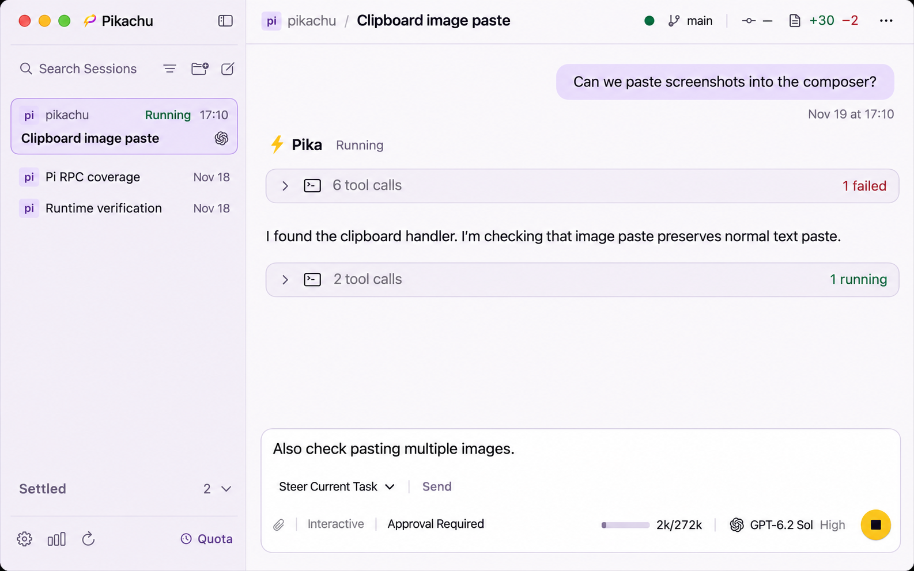
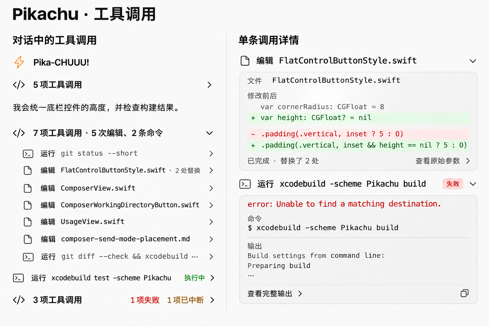

# 会话运行控制与时间线

**方案 v1 · 已确认 · 2026-11-19**。采用明色设计稿 r01，覆盖会话顶栏、消息输入区、侧栏 Open 卡片和对话区。

主图的顶栏状态点和局部图的工具行样式均为历史示意。现行状态位置见[顶栏与会话卡片](#顶栏与会话卡片)，工具行见[工具调用展示](#工具调用展示-v1)。主图中的会话卡片为简化占位。当前 ACP 会话的发送与停止行为见下节。

## 运行控制

输入区右下角保留同一个主按钮位置。当前查看的会话正在运行时，圆形按钮使用中性细描边，发送闪电换成实心方块，辅助功能标签为「停止」。停止操作使用 `WorkspaceController.stop()`，点击时复核会话归属。启用条件沿用控制器的 `canStop` 和工作台忙碌状态，草稿内容和附件数量不参与判断。停止开始后保留同一位置，显示禁用的停止按钮及「正在停止」提示。确认停止或自然结束且队列清空后恢复发送闪电。对正在重试、压缩、等待输入和仍有可回收队列的状态，沿用现有停止能力。进程待核实或清理失败时，沿用提示及独立的「结束受管进程」恢复动作。

ACP 会话运行时仍可编辑草稿、附加文件或停止本轮。当前适配器未提供 `queuedPrompts`，因此编辑区保持全宽，保留草稿到本轮结束后发送。支持队列的测试运行时另有[发送方式布局](composer-send-mode-placement.md)。

普通停止入口位于输入区，顶栏按条件保留进程清理入口。输入区的「停止」和菜单快捷键 `⌘.` 都作用于当前查看的会话。当前会话可以停止时，快捷键才可用。要停止后台任务，先通过跨会话运行提示返回目标会话，再点击「停止」或按 `⌘.`。智能体发起的权限请求在审批面板中处理。

## 顶栏与会话卡片

- **会话标签栏**显示会话标题、会话状态及 Git 入口。可用的进程清理操作在会话菜单中。跨会话运行提示单独标明实际执行对象。
- **项目内会话卡片**首行显示标题和活动操作，次行依次显示状态、按需显示的项目名，以及模型或 Agent 标识。就绪与普通历史会话省略状态。悬停或键盘聚焦时可使用快捷操作。VoiceOver 提供状态与操作名称。

## 对话顺序与折叠

目标 Agent 接受接力后的首条消息时，在该消息前显示「已切换至」标记。展开标记可以查看交接内容和历史范围。旧段能够独立加载，活动段的流式更新继续使用既有轮次和消息投影。 [会话接力](session-agent-handoff.md)

图 5 记录了旧投影的行为。旧版先找同段第一条助手正文，并在该行正文前绘制摘要。有工具先于正文时，摘要就会落在工具之间。

独立轮次头按[品牌交互语言](../../DESIGN_TOKEN.md#品牌交互语言)呈现运行反馈。结束后在同一行更新品牌词、终态及最终耗时。结束时间在回复操作页脚提供。

普通提交确认开始后，轮次头紧跟触发它的用户消息，位于第一条工具或助手正文之前。用稳定的轮次 ID 支撑行复用。连续工具或通知、空助手占位移除、流式正文出现或消失时，已有轮次头保持唯一。补充输入沿用原轮次。后续任务开始后各有独立轮次头。队列提前显示或输入归属无法可靠关联时，以该轮第一个可确认的执行位置为锚点。助手正文、通知和工具活动保留原始相对顺序。

实时绑定优先用控制器确认的提交项 ID 与运行边界，区分启动、补充和后续任务被实际消费。开始事件先到时可暂用首个执行位置，到达可核对的归属后按同一行 ID 更新。恢复活动段时使用 ACP 回放或工作台缓存的消息与轮次信息。接力前的内容从该段已保存的冻结快照读取。历史缺可靠起点时在首个已知执行事件前显示一次摘要，缺失的时长与时间沿用未知态。投影新增的行与关联可由当前数据推导，默认沿用现有持久化格式。

历史终态使用运行时提供的终态或可唯一关联的本地轮次记录。可用关联包括已确认的提交 ID、工具调用 ID，以及原始本地助手消息中记录的结束时间。只有历史正文或匹配有歧义时，保留中性的无品牌词轮次头，显示「历史结果未记录」。冻结快照保留这一标记，旧快照仍可读取。历史恢复期间沿用现有实时通知边界。

有可靠关联的终态、耗时和文件改动来自同一轮记录。离线缓存和冻结快照也保留用户消息的送达状态。旧缓存若仍有对应的待处理提交记录，使用该记录的送达状态。

同一轮内连续的工具调用组成一组，执行期间即合并显示；正文、用户消息、可见通知及轮次边界分隔工具组。组内工具结束或中断后仍留在原组，保留原始顺序。单项过程可直接展开详情。待处理审批和用户提示沿用独立入口。

示例顺序为「用户消息 → 轮次头 → 工具活动 → 助手进度正文 → 后续工具活动 → 最终答复」。各段工具保留在对应说明附近。连续段的 ID 取首项显示 ID，单项用自己的显示 ID。增量追加及运行转终态时保留手动展开。暂停跟随时，展开、追加或高度改变后保留可见位置，跟随时继续贴底。沿用现有行身份，仅在展开时构建详情。实时追加、工具状态变化和新行插入只更新受影响的行。输出增量更新仅影响对应已展开工具，折叠视图关注计数与状态变化。

模型调用失败后，失败提示旁提供「重试」；确认后以原发送模式重新发送上一条消息，本轮已执行的操作不撤销。仅在会话已连接、空闲、无待交互请求和排队输入，且原提交已确认时出现。

### 工具调用展示 v1

2026-11-20 确认。两栏为设计示意。实际对话沿用单列布局，详情在工具行下方展开。图中的失败输出为模拟示例。

- 组标题按类显示总数、编辑、命令、读取、内容搜索、列目录、文件查找和写入数量。混合组增加「其他」，纯其他组只显示总数。组标题图标跟随组内正在执行的工具；并行时取对话顺序最后一个仍在执行的工具，无工具执行时恢复通用图标。异常计数留在右侧。窄窗优先留出总数、异常计数和箭头。工具组及单条工具行默认以浅灰显示并隐藏箭头；悬停或键盘聚焦时恢复常规文字颜色并显示右侧箭头，不改变行底色。连续工具调用在执行期间就组成一组；只有一条工具调用时，该行同时作为组标题，完成后保留展开状态。组内有工具执行时，仅组标题播放原地放电动效，不受展开状态影响；首次放电立即出现。无障碍摘要读出与当前图标对应的工具。每 1.65 秒分两拍随机生成 2–4 道短促的金色或淡蓝色电弧，位置、角度和亮起时机随机；每道电弧原地消散，不横向移动，文字和图标不变色。启用「减少动态效果」时不播放。成功状态放入详情，执行中、失败和中断在工具行显示文字与语义色。
- 当前轮次的工具已全部结束、仍在执行且尚未继续输出正文时，最后一个工具组下方显示 `loading-grid` 和「等待回复」。有实际思考内容时显示可展开的「思考中」。九宫格圆点沿对角线依次脉动；新工具开始、正文继续或离开执行状态时移除。启用「减少动态效果」时图标静止。
- `bash` 和 `zivvi_bash` 显示「运行」与命令首行。`edit` 和 `zivvi_edit` 显示「编辑」、文件名和替换数。`read` 和 `zivvi_read` 显示「读取」、文件名与可用的行范围，详情展示完整路径。`grep` 显示「搜索」和内容匹配模式，`ls` 显示「列出目录」和目标目录，`find` 显示「查找文件」和文件匹配模式，`write` 显示「写入文件」和文件名（正文不进入摘要）。这些工具的 `zivvi_` 别名使用相同展示。其他调用与无法解析的参数沿用原工具名和可用摘要（写入正文除外）。可见行和原生无障碍摘要共用展示解析。
- 详情使用浅底和细描边。编辑按完整路径、逐处行级差异和结果排列。未成功的调用标为「请求的修改」。命令失败时，先显示可识别的诊断，再显示命令和输出。原始参数按需展开。
- 命令正文行和输出标题行的右端分别提供复制按钮，复制完整命令和原始保留输出。输出预览最多 8 行。长行可横向滚动，更长的内容使用会话内的原生面板，展示打开时已保留的输出。运行时已截断时，入口为「查看已保留输出」，并提示截断。切换会话关闭面板。单次调用的开始时间与耗时留待后续。

## 实施与验收

运行信息由 `WorkbenchTitlebar`、`ComposerView`、`SidebarSessionCard` 和对话轮次及工具调用视图承担。轮次摘要和工具行采用紧凑行距。轮次头的失败与待核实分别使用 `errorText` 和 `warningText`。工具运行状态使用 `runningText`。可用的发送按钮使用 `lightningYellow`，卡片复用 `selected`、`mutedSurface` 和现有描边。工具及折叠组直接平铺。单条工具的展开箭头位于右侧。文字沿用 macOS 系统字体和本地化。[主题资源](../../Zivvi/DesignSystem/ZivviTheme.swift)

| 验收项 | 主要路径与通过条件 |
|---|---|
| SR-01 · 停止与发送 | 从 `SessionDetail` 的正常装配验证 `ComposerView` 主按钮原位切换和运行中编辑区的发送快捷键。Fake Runtime 检查运行、等待、队列、重复点击、自然结束、失败及切换会话。确认停止不会提交草稿，停止回执后草稿和附件保留，补充与后续执行指向正确会话。原生核对鼠标、键盘和 VoiceOver。查看空闲会话 A 且 B 在后台运行时，`⌘.` 禁用。返回 B 后按 `⌘.`，确认只停止 B，A 的执行状态和草稿保持原状。 |
| SR-02 · 顶栏与会话状态 | 在原生窗口检查明暗、有无 Git 分支、窄窗和侧栏收起。核对顶栏随查看对象更新会话身份和 Git 摘要，清理入口仅在适用时出现。展开侧栏核对待处理卡片中的状态标记与实际会话对应，悬停和 VoiceOver 可获取状态名称。 |
| SR-03 · 会话卡片 | 原生检查卡片默认、选中、悬停、离开、键盘聚焦与打开提醒菜单。运行标签始终位于时间／操作槽左侧，动作替换时间时标题和状态不位移，最窄宽度可读且按钮可达。验证筛选、分组和 VoiceOver 操作。 |
| SR-04 · 过程折叠 | 用连续和被正文分隔的命令、并行工具完成前后、混合终态、旧历史、实时追加与长输出检查分组、两级展开和视口锚定。在明暗外观及窄窗验证摘要、差异、失败诊断、截断说明和输出面板，核对横向滚动、跟随、键盘、VoiceOver 与逐字复制。 |
| SR-05 · 轮次摘要位置 | 用图 5 的事件顺序做脱敏夹具。回放普通、工具先行、仅工具、无正文、多个用户输入、补充、排队后续、同时间戳历史、重载和缺锚点历史。核对普通轮次首行、每轮唯一、结束后原位更新，手动浏览及回到最新无跳转回归。 |

顺序实施。先改 `WorkbenchView` 装配、`ComposerView`、`SessionSidebar` 及对应文案，并核查 `ZivviApp` 菜单与交互面板。再改 `TranscriptDisplayRow` 投影、`SessionController` 与历史段归属，最后接入 `TranscriptView` 和 `NativeTranscript` 的身份、行高、展开与滚动机制。范围覆盖生产会话、历史浏览和现有测试装配。

由一个实现者准备固定候选和回归证据。独立 reviewer 核对运行操作的唯一目标、旧入口和文案消费者、旧历史以及展开和滚动生命周期。若发现回归，由作者整改并由原 reviewer 复查。原生验收使用隔离工作区、Fake Runtime 或脱敏历史，在 macOS 明暗和最小窗口验证。现有滚动回放覆盖展开合拢和流式追加。涉及真实会话的复现需另行核对可用测试数据与授权。当前以源码及附件为设计证据。

本方案更新既有设计中的停止位置、状态位置、Open 卡片操作与运行标签，以及工具折叠和轮次摘要位置。[统一窗口顶栏](session-window-toolbar-v2.md) · [侧栏会话分组 v4](sidebar-session-groups-v4.md) · [会话工作区 v5](session-detail-ui-v5.md) · [工作台分区与界面](workbench-ui-refresh.md)
