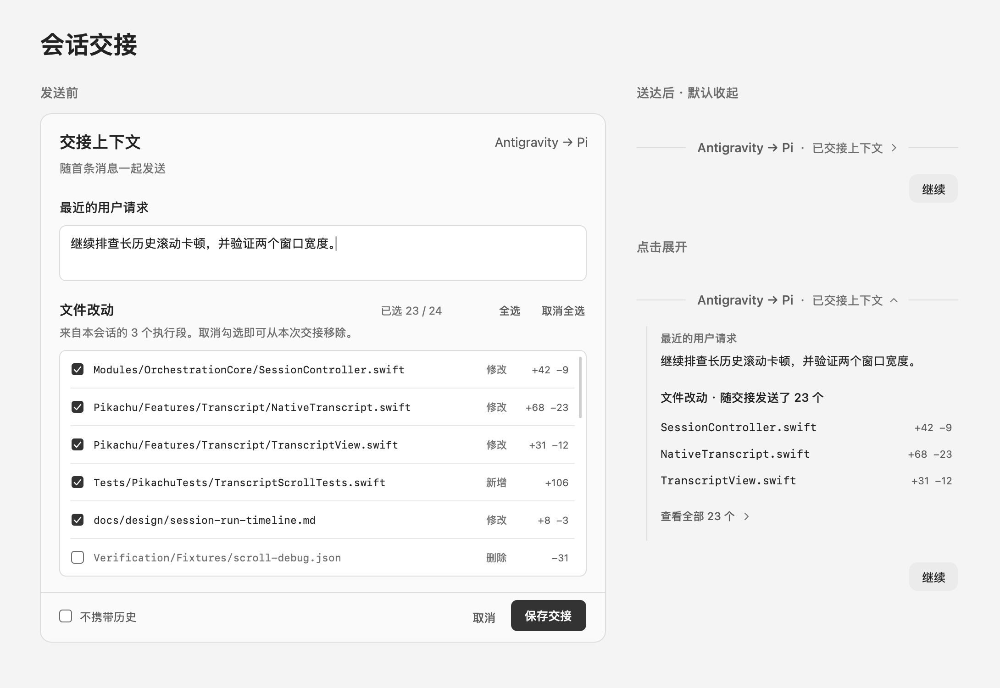

# 会话切换与交接展示

2026-11-25 · r03 · 已确认

送达后展开态采用后续确认的 [r07 设计](session-switch-presentation/delivered-context-r07.md)。

同一条对话用居中的细分隔线标出智能体或模型变化。用户可以看出下一条由谁执行、交接是否送达，以及目标智能体收到了哪些历史内容。

样式参考用户提供的三张截图。模型切换采用「原名称 → 新名称」。交接状态沿用居中主文案、两侧细线和较弱的辅助文案。r03 浅色样稿示例中，24 个文件默认全部勾选，用户取消其中一项后保存，送达记录显示实际携带的 23 个。 [四种场景总览](session-switch-presentation/states-r01.png)

## 四种场景

| 场景 | 位置与示例 | 触发与交互 |
|---|---|---|
| 同一智能体换模型 | 时间线 · `GLM-5.3 → V4.1 Flash` | 在首次确认使用新模型的轮次前记录一次。发送前连续改选只记录最终实际使用的模型。选择待应用或配置失败时，反馈留在输入区。首次运行和仅调整推理强度不新增分隔行。 |
| 换智能体，待首次发送 | 输入区上方 · `下一条由 Pi 执行 · 查看交接 ›` | 保存目标后显示。点击打开现有交接预览，可核对目标与工作目录，编辑内容或选择不携带历史。首次发送进行中改为「正在向 Pi 发送」，并随现有提交状态限制编辑或改选。 |
| 首条消息已送达 | 首条用户消息前 · `Antigravity → Pi · 已交接上下文 ›` | 收到接受回执或经现有入口确认送达后，写入一条稳定的历史记录。点击居中的文字区原位展开，再点收起。若同时更换模型，合用这一条，已确认的目标模型可在详情查看。 |
| 首条发送异常 | 输入区上方 · `交接未送达 · 编辑草稿` 或 `送达待核实 · 核对送达` | 确定失败时进入现有草稿恢复或编辑入口。结果不明时进入现有核对流程，遵循原有发送限制。迟到回执与人工确认走同一条送达记录。只在确认送达后写入成功分隔行。 |

没有交接正文时，提示改为「未携带历史」。已送达行仅在有详情可读时显示展开指示。工作目录、供应商和推理强度按需在现有预览或详情中出现。两个模型显示同名时，补充足以区分的供应商或模型标识。

## 发送前预览与送达后详情

- **最近的用户请求。** 发送前在预览中单独提供可编辑的多行字段，默认填入最近可读的用户请求。用户可以把「继续」改成明确的任务和约束。编辑只影响待发的交接正文，原历史与输入框里的本轮消息保留各自的原文。
- **文件改动。** 汇总同一条 Pikachu 对话各轮已记录的文件改动，涵盖当前执行段和以往智能体的历史段。默认全选。文件行显示相对路径、改动类型和已有的增删行数。多轮改动同一路径时合并成一项，保留已有的变更记录和可确认的重命名路径。统计为已记录改动的累计量，缺少记录时显示未知。
- **移除与恢复。** 文件清单可滚动，显示「已选 N / M」。取消勾选会从本次发送的文件改动清单移除该项，重新勾选可恢复。提供全选和取消全选。编辑中的勾选状态可随待发交接保存，重新打开时恢复。正文若另有相关文件的描述，用户可在预览中直接编辑。
- **发送范围。** Pikachu 不设文件数量或交接正文的固定上限。交接发送选中的文件级改动摘要，包含路径、操作和可用的增删统计。目标智能体可按路径读取仍可访问的文件，历史补丁取决于工作区保留的内容。若目标运行时拒绝过长请求，显示返回原因，保留草稿和勾选供调整。
- **送达后详情。** 默认收起，点击原位展开。展开区先显示最近的用户请求，再显示文件数量和前三个文件名。结构化文件行补充已保存的增删行数。「查看全部」打开完整的只读清单。「查看完整交接正文」显示并可复制当时实际发送的文本，包含回复、进展、未完成事项及文件操作序列。旧版交接沿用同一布局，文件区显示「相关文件」及原文可识别的路径，增删统计以原记录为准。只有自由文本时显示简短预览。
- 源历史部分可读或不可读时，在详情交代范围。文件名便于扫描，完整路径可查看和复制。只展示此次交接携带的引用。
- 用户气泡、复制和编辑使用原文及本轮附件。例如「继续」显示一次作为本轮消息。对旧记录，优先用已关联的本地提交恢复原文。缺少可靠关联时，避免根据「继续」等短文本猜测归属。发送给运行时的包装留在发送层。

改动清单以各轮保存的文件变更记录为依据。当前可核实的采集入口来自 Pi 回合快照。预览区分已采集且没有改动的回合与缺采集记录的回合，并提示覆盖不全。工作区当前状态无法证明哪一轮或哪条对话做了改动。

## 组件与交互

- 居中文字使用现有 `callout` 字号和次要文字色。辅助状态使用 `caption`。两侧分隔线使用现有边框色。失败和待核实沿用错误与警示色，并保留文字状态。
- 有交互的居中文字区是一个完整按钮。可用 Tab 聚焦、回车或空格触发，VoiceOver 可读出智能体、状态以及展开或收起。箭头和横线不单独占用焦点。无交互的模型分隔行作为静态事件朗读。
- 窄窗口优先缩短两侧线段，长名称换行仍可读取。展开正文左对齐到阅读列内，与消息气泡有不同的层级。展开状态按时间线条目 ID 保存，列表复用和流式更新应保持已展开的行与阅读位置。切换会话后按默认收起打开。
- 预览中只有文件列表滚动。最近的用户请求、已选数量和保存动作保持可见。文件行用复选状态表达是否携带，VoiceOver 可读出路径、改动类型和勾选状态。窄窗保留文件名与改动类型，完整路径可按需查看。

## 实施范围

1. **编排与记录。** 在 `WorkspaceController`、`SessionController` 核对首条提交回执和实际模型来源。交接复用既有接力 ID、原文与送达记录。模型变更需要可选的轮次记录及稳定锚点，覆盖活跃、重放和冻结时间线。旧记录缺少可核实的模型变化时省略事件。
2. **时间线与输入区。** 由 `TranscriptDisplayRow` 投影已生效事件。 `TranscriptView`、`NativeTranscript` 负责分隔行、展开与滚动锚点。 `WorkbenchView`／`ComposerView` 显示当前输入状态，接入现有交接编辑器和送达核对。更新对应 target 的本地化。
3. **改动记录与编辑。** 由 `SessionHandoff`、`WorkspaceController` 读取当前轮次记录和冻结快照。合并时记录来源段和轮次，删除项仍参与汇总，仅在有明确关联时合并重命名路径。`HandoffContextEditor` 编辑请求与文件勾选，按保存后的选择组装正文。旧版自由文本交接沿用原阅读和待发送编辑入口。
4. **大清单与发送。** 解除现有 8 路径自动预填及 16 KiB 交接正文限制，使展示、保存、重开和提交使用同一份完整选择。长清单按需渲染，避免每次流式更新都重读历史。评估大正文和改动列表的持久化体积与加载耗时，沿用现有交接事务、草稿恢复及送达核对。

本轮推荐一个组件方向。统一分隔线便于扫描。等待和异常留在输入附近，可直接操作，同时减少历史噪声。已生效的模型变化改为独立事件行，方便定位切换边界，代价是实际频繁切换时会增加行数。

## 验收

| 条件 | 证据 |
|---|---|
| SW-01 · 模型与发生位置 | 合成运行时覆盖首次运行、连续改选、应用失败、仅调推理强度，以及成功的模型变化。核对分隔行锚定到首次实际使用的轮次，重开和旧记录处理正确。 |
| SW-02 · 交接状态及动作 | 用正常工作台装配核对待发送、等待回执、接受、拒绝、结果不明、迟到回执和重启。核对已送达项只出现一次。失败和待核实接到原有恢复及核对入口。 |
| SW-03 · 正文与原文 | 将预填的「继续」改为明确任务，取消勾选一项后保存、重开、发送。用合成提交核对已选改动、实际请求及送达后详情一致，原历史与本轮消息保留原文。覆盖无选中文件、空交接、自由文本、附件和历史回放。 |
| SW-04 · 视觉与可访问性 | 在原生 macOS 明暗外观、最小窗口和大字号核对分隔线、长名称、默认收起与点击展开。核对键盘、VoiceOver、流式更新和长历史中的视口位置。原生验收需当前任务明确授权。 |
| SW-05 · 整场会话与长清单 | 用跨智能体、跨轮次且超过 8 个文件及 16 KiB 的合成历史核对默认全选、全部可访问、移除后实际提交及读回。覆盖重复路径、新增、删除、重命名、部分历史、运行时拒绝大请求及恢复。测量预览和展开的加载耗时。 |

实施时由单一作者维护数据与视图的装配。独立审查固定候选，重点核实实际模型归属、交接回执、旧数据及无重复投影。涉及本轮问题的整改由作者完成，原 reviewer 复查关键路径。

[会话接力](session-agent-handoff.md) · [模型选择](session-model-picker.md) · [运行时间线](session-run-timeline.md) · [设计令牌](../../DESIGN_TOKEN.md)
