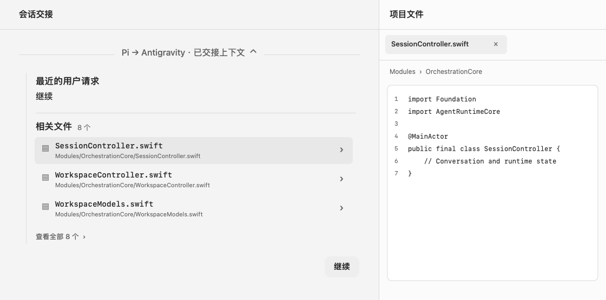

# 会话交接展开态 · r04

2026-11-25 · 待整体确认

会话交接保留 [r03 的发送前编辑器和时间线位置](../session-switch-presentation.md)。本轮调整送达后的展开区，突出最近请求和文件清单。用户可以直接进入右侧项目文件预览。

## 内容与操作

- 交接分隔行默认收起，位于首次送达的用户消息前。点击原位展开。「最近的用户请求」和「相关文件」／「文件改动」使用同一级 `headline` 和主文字色，小节之间以留白和细分隔线区分。请求正文使用 `body`，在窄窗内可换行。标题右侧的文件数量使用次要字色。
- 文件区显示前三项。每行上方为文件名，下方为相对路径。结构化记录右侧显示已有增删统计。旧记录显示已有路径。「查看全部 N 个」沿用只读列表，并在相同规则下支持逐项打开。各行可查看和复制完整路径。
- 可打开项整行响应点击和键盘操作，使用文件图标、悬停底色和右侧箭头表达动作。右侧面板收起时自动打开，已有同路径标签页时切换到该页。查看全部列表中的文件打开成功后收起列表。打开的是会话工作目录中的当前文件内容。
- 已知删除的项显示「已删除」。已知在工作目录外或路径无法确定的项显示「无法在项目文件中打开」。这些行提供完整路径与复制路径。点击后发现文件不存在、权限失效、格式不支持或工作目录不可用时，在操作位置提示原因并保留交接展开状态。打开动作以右侧项目文件面板为目标。
- 移除展开区中的「查看完整交接正文」和相应弹层。已发送的交接内容继续作为历史送达数据。无法从旧记录可靠还原字段时，显示简短文本预览。最近请求缺失时，有可识别回复则显示回复摘要。发送前依照 r03 编辑请求、勾选整场会话中已记录的改动并保存。

## 实施方案

`TranscriptView` 负责展开区、文件行及打开状态。沿用同一文件行组件表达摘要、完整路径和可打开状态，覆盖冻结段、活跃段及旧文本记录。只在展开时构造摘要，完整列表按需加载。以当前对话绑定的工作目录为根，使用记录的完整路径定位。重命名按最后记录的目标路径查找。路径规范化、工作目录归属与读取沿用 `ProjectFilePath` 和 `ProjectFilesReader` 的验证。

`NativeTranscript`、`WorkbenchView` 与文件面板模型复用现有右栏打开、标签页选中和请求取消逻辑。普通对话文件链接的现有入口可回退外部应用。交接文件入口须在同一栏处理成功及失败，按实际结果在原操作位置反馈。只有当前会话、当前工作目录中的最新请求可以激活右栏、更新标签页和提示。开始实施时固定包含此前 r03 视觉整改的新候选，对受影响应用词条和已经失去调用方的交接弹层同步清理。

交接入口使用右栏专用结果处理。用户能在原对话旁查看文件，打不开时也可看到原因。实施时补齐右栏无法预览时的行级反馈。

## 验收与分工

| 条件 | 证据 |
|---|---|
| SW-04 · 阅读层级 | 原生明暗、窄窗和大字号核对同级标题、相对路径、前三项和完整列表。核对默认收起、列表复用、键盘和 VoiceOver。 |
| SW-06 · 右栏打开 | 合成夹具覆盖面板收起／已打开、已有标签页、摘要与完整列表、旧记录、重命名及带空格路径。测试正常工作台装配成功打开当前文件，交接行和阅读位置可继续使用。 |
| SW-07 · 失效与切换 | 覆盖删除、文件移动或消失、无权限、工作区外、符号链接、文件格式不支持和工作目录切换。核对相邻同名文件、连续点击和迟到结果。核对失败提示、现有预览保留及完整正文入口移除。 |

单一作者实施，并以固定候选交原独立 reviewer。复审重点为普通文件链接与交接文件入口的调用区别、当前工作目录绑定及失效终态。宿主测试核对路径解析和工作台组装。原生 macOS 交互与视觉按项目要求另获当前任务授权。示意图采用一套浅色方向，显示从摘要选中文件后右栏打开的状态。

本方案待整体确认。确认后提交独立的阶段交接，再由用户决定是否进入 code。
