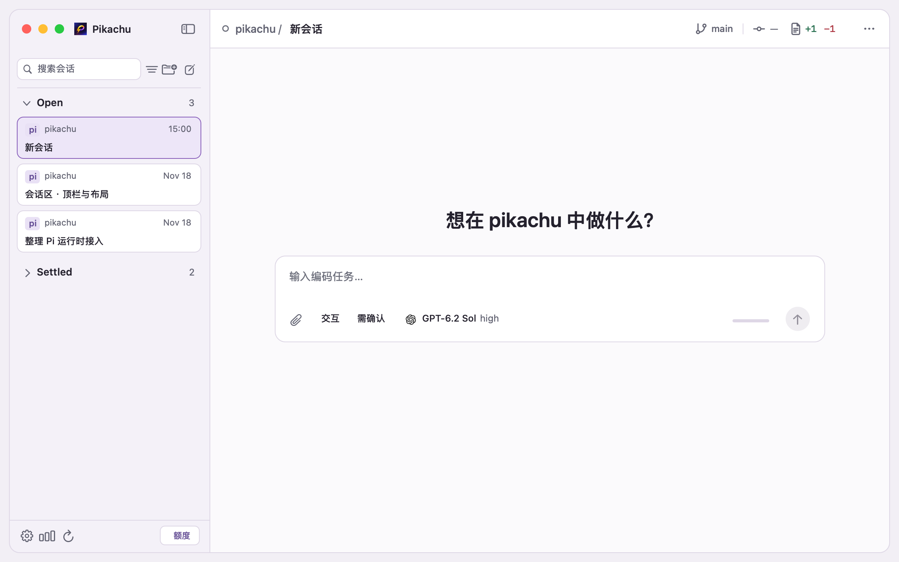

# 会话工作区 · 统一窗口顶栏与新会话布局

**方案 v1 · 待确认 · 2026-11-19**

一张明色示意图，展示有项目的新会话。参考图用于确定顶栏对齐及空态构图。草稿入口使用 Pikachu 自己的控件、项目绑定和配色。分支、计数和模型为样例。

## 窗口顶栏

- 同一行左侧放原生窗口按钮、Pikachu 标识和侧栏开关。右侧从分栏线之后开始放「连接状态点 → 项目 / 会话」，靠右放 Git 摘要和会话操作。项目详情沿用现有入口。展开和隐藏侧栏时，会话标题均随右侧可用宽度重新布局，侧栏开关保持可达。
- 会话身份和 Git 控件由窗口工具栏承载，移除对话区内的常驻会话顶栏装配。对话或空态紧接一条工具栏分隔线。无选中会话时，右侧会话和 Git 控件随选择清空。正在执行的其他会话仍可从需要时出现的全局运行提示返回、停止或清理。
- 在现有 **860 × 620 pt** 最小窗口和最大侧栏宽度下保持单行。先省略长名称，悬停和 VoiceOver 提供全名。空间继续缩小时，将 Git 摘要收进会话操作菜单中的 Git 详情入口。连接、所看会话和必要的执行控制保留可见。等待输入、待核实或清理异常保留可见提示和实际执行归属。
- 宽窗继续显示已有分支、领先本地 upstream 的数量和文件变更摘要。任一字段读取失败或未知时沿用现有口径。切换会话、变更项目目录或关闭窗口时，工具栏绑定当前选择，旧异步结果不覆盖新项目。

## 新会话

右侧面板中部略偏上，将短提示语和可编辑输入框作为一个整体水平居中。默认文案采用「想在 pikachu 中做什么？」并替换为当前项目名。空态输入框建议以 **704 pt** 为最大外宽，窄窗保留现有边距后缩放。提示可换行，附件及较长草稿沿用现有输入区高度与横向布局约束。工作目录和分支从顶部读取，输入区主控件采用当前已实现的精简样式。

| 场景 | 布局和交互 |
|---|---|
| 真正的新会话 | 当前项目存在，且会话是尚无对话的本地新建会话时使用居中布局。首次打开已存在的历史、缺失历史和恢复待核实提交沿用其各自状态。空白时发送按现有规则禁用。打字、编辑草稿、添加附件或配置模型时，输入框留在中部 |
| 第一次发送 | 激活、连接或停止确认期间沿用当前草稿与提示。首条用户消息进入 transcript 后，提示消失，输入框回到底部。使用同一个 ComposerView 实例及控制器，避免重建焦点、重置草稿或重复发送。发送前失败且未生成消息时保留草稿与恢复入口 |
| 有内容或打开历史 | 对话继续使用自适应宽度和右边缘滚动条，输入框在底部。加载、历史为空、历史故障、待核实提交和恢复草稿状态使用相应提示及入口。切换会话时，各自草稿和界面状态按已有会话标识恢复 |
| 没有项目或没有当前会话 | 使用对应的项目选择或新建入口。发送继续依赖已经验证的项目和会话。仓库操作和权限提示依赖本应用已有的数据与能力 |

首发后用离散状态布局，重点验证首条消息可见、键盘焦点连续和「回到最新」行为。窗口收窄时优先让标题换行并复用输入区已有工具行排版。确实容纳不下时，让空态区域可滚动，输入及发送仍可达。

## 实施与验证

推荐保留现有 AppKit 窗口工具栏及侧栏分隔线，在右侧承载复用的会话控件。与维持两行相比，统一行释放正文高度，也使左侧标识和右侧会话归属一眼可辨。代价是窄窗的 Git 明细多一次操作，且原生工具栏项要验证压缩和弹层锚点。如果原生托管项无法在真实窗口中满足宽度或控制可达性，回到设计处理容器，保留同一行约束。

1. **窗口装配**。由一名实现者顺序调整 App/PikachuApp、WorkbenchTitlebar 和 WorkbenchView。将 SessionHeader 中已存在的身份、Git、运行控制和弹层动作移到工具栏装配。以当前选择和实际运行实例驱动视图。复查原工具栏项、内容区旧标题、主窗口、全屏、侧栏开关和快捷键，排除重复装配与过期回调。工作台与侧栏样式存在并行改动，实施前和固定候选前分别核对共享文件与归属。
2. **空态及首发切换**。在 SessionDetail 以显式的新会话条件选择布局。复用同一输入组件、草稿控制器和发送入口。TranscriptView 保留滚动和已有历史状态处理。会话选择、草稿编辑、提交记录和 Runtime 生命周期沿现有路径，不引入单独的首发发送流程。
3. **审查及验收**。在固定候选上由独立 reviewer 核对生产装配、关闭或切换时的状态释放、Git 和运行操作归属、旧标题替换与消息首发。发现问题由原作者整改，原 reviewer 复查相关路径及相邻状态。

| 验收 | 方法 |
|---|---|
| TW-01 · 一行顶栏 | 以固定 macOS 候选检查明暗、宽窗、最小窗、长标题、侧栏隐藏和全屏。原生截图核对左右控件在同一行及对话区紧邻工具栏。键盘和 VoiceOver 核对侧栏、状态、名称、操作菜单与压缩后的 Git 详情 |
| TW-02 · 会话及运行归属 | 以多项目及 Fake Runtime 覆盖无项目、移走项目、快速切换、背景运行、停止、等待回复、清理和读 Git 失败。核对窗口拖动、浮层锚点、工具栏显示对象及操作对象。原生核对停止及恢复入口始终可达 |
| TW-03 · 新会话首发 | 用隔离 fixture 验证明暗及宽窄窗的居中布局。检查输入、附件、配置、草稿恢复、连接失败、发送待核实、成功插入首条消息、加载旧历史、切回草稿。通过键盘及原生画面核对焦点、首条消息和输入框落位。已有长对话仍有贴边滚动条和稳定的跟随行为 |

静态图用于确认布局方向。运行证据以绑定固定候选的原生验证为准。测试优先使用隔离数据及 Fake Runtime，有关真实项目和 Runtime 的检查按当时有效授权执行。

## 项目依据

- [会话工作区 v5](session-detail-ui-v5.md) · [工作台分区设计](workbench-ui-refresh.md) · [侧栏 v2](sidebar-session-groups-v2.md)
- [窗口工具栏](../../Pikachu/Features/Workbench/WorkbenchTitlebar.swift) · [会话装配](../../Pikachu/Features/Workbench/WorkbenchView.swift) · [对话区](../../Pikachu/Features/Transcript/TranscriptView.swift) · [输入区](../../Pikachu/Features/Composer/ComposerView.swift)
- [会话发送与选择](../../Modules/OrchestrationCore/WorkspaceController.swift) · [消息插入](../../Modules/OrchestrationCore/SessionController.swift)
