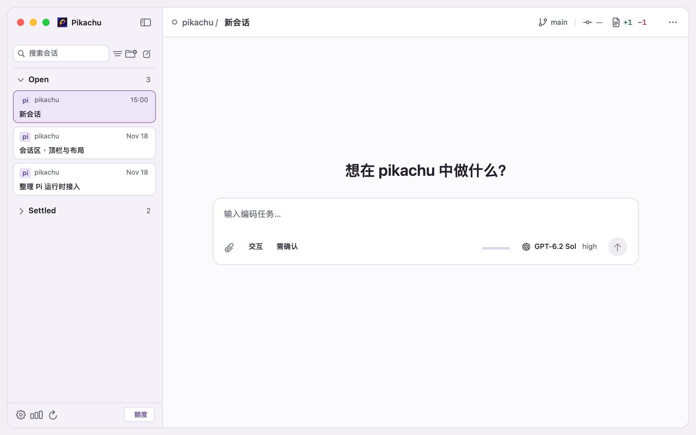
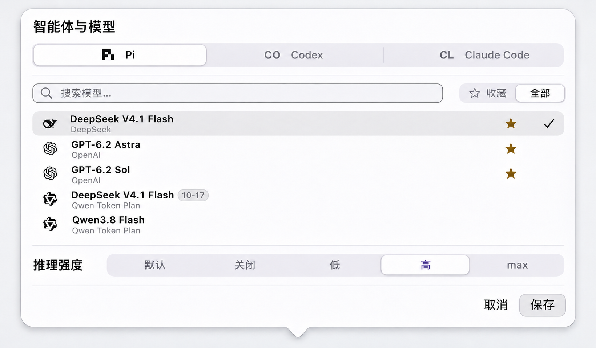

# 会话工作区 · 统一窗口顶栏与新会话布局

**历史顶栏方案 v2 · 2026-11-19**

双栏标签与编辑区采用[工作台 2.0 装配](project-file-preview.md#工作台-20)。本文保留旧顶栏和当时的验收基线，对话滚动见对应章节。

会话状态色点及停止入口采用 [会话运行控制与时间线 v1](session-run-timeline.md) 的更新方案。

两张明色示意图展示有项目的新会话及模型选择展开状态。图中顶栏为旧版布局。分支、计数和模型为样例。

## 窗口顶栏

- 同一行左侧放原生窗口按钮、Zivvi 标识和侧栏开关。竖向分栏线之后显示项目徽标、项目名及会话标题。会话状态显示在待处理卡片的项目名后。点击项目名直接在当前会话所属项目下新建并打开会话，不弹出工作目录详情或项目选择器，也不改变侧栏的展开状态。悬停提示显示完整项目名及项目路径。展开和隐藏侧栏时，会话标题均随右侧可用宽度重新布局，侧栏开关保持可达。
- 会话身份和 Git 控件由窗口工具栏承载。对话及空态直接承接工具栏，移除工具栏下方的水平分隔线及旧会话顶栏。无选中会话时，右侧会话和 Git 控件随选择清空。后台会话返回、停止和清理沿用[运行控制](session-run-timeline.md#运行控制)。
- 在现有 **860 × 620 pt** 最小窗口和最大侧栏宽度下保持单行。先省略长名称，悬停和 VoiceOver 提供全名。空间继续缩小时，将 Git 摘要收起为顶栏「Git 详情」按钮。所看会话和必要的执行控制保留可见。等待输入、待核实或清理异常沿用对话区提示。
- 右侧项目文件面板关闭且窗口空间充足时，显示分支、领先本地 upstream 的数量和文件变更摘要。任一字段读取失败或未知时沿用现有口径。切换会话、变更项目目录或关闭窗口时，工具栏绑定当前选择，旧异步结果不覆盖新项目。

### Git 摘要收起状态

打开右侧项目文件面板时，Git 摘要立即收起为单个「Git 详情」按钮。两列、单列停靠和浮层都采用此规则。关闭面板后，Git 摘要按当前窗口可用宽度恢复展开或保持收起。见 [文件面板优化定稿](project-file-preview-refinement.md#第一批--布局与视觉)。

面板打开后，窗口顶栏沿着文件面板边缘分成两段。会话区的右端固定显示「Git 详情」，会话标题按该区的剩余空间在末尾显示省略号。文件区的标签与会话标题同排，面板开关仍在窗口最右侧。面包屑与文件操作直接位于标签下方。极窄浮层下，按当前字号和语言为 Git 详情和可用的进程清理入口预留宽度，文件标签用剩余空间横向滚动。

「Git 详情」按钮使用用户指定的 [Jannchie `git-pull-request`](https://icons.jannchie.com/?icon=git-pull-request#git) 模板图标。按钮沿用现有尺寸、着色、悬停提示和 VoiceOver 名称，点击打开当前会话工作目录的 Git 详情浮层。图标来源见 [第三方声明](../../THIRD-PARTY-NOTICES.md)。

## 新会话

右侧面板中部略偏上，将[新会话品牌标题](../../DESIGN_TOKEN.md#品牌交互语言)和可编辑输入框作为一个整体水平居中。输入区沿用[共用阅读列](../../DESIGN_TOKEN.md#阅读列与消息组)。标题可换行。附件与较长草稿沿用输入区的高度和横向布局约束。当前项目由顶栏显示。

| 场景 | 布局和交互 |
|---|---|
| 真正的新会话 | 当前项目存在，且会话是尚无对话的本地新建会话时使用居中布局。首次打开已存在的历史、缺失历史和恢复待核实提交沿用其各自状态。空白时发送按现有规则禁用。打字、编辑草稿、添加附件或配置模型时，输入框留在中部 |
| 第一次发送 | 激活、连接或停止确认期间沿用当前草稿与提示。首条用户消息进入 transcript 后，提示消失，输入框回到底部。保持 ComposerView 的视图身份及控制器，保护焦点、草稿及发送归属。连接过程产生会话文件时继续居中。发送前失败且未生成消息时保留草稿与恢复入口 |
| 有内容或打开历史 | 对话使用自适应宽度，输入框悬浮在对话底部。加载、历史为空、历史故障、待核实提交和恢复草稿状态使用相应提示及入口。切换会话时，各自草稿和界面状态按已有会话标识恢复 |
| 没有项目或没有当前会话 | 使用对应的项目选择或新建入口。发送继续依赖已经验证的项目和会话。仓库操作和权限提示依赖本应用已有的数据与能力 |

窗口收窄时优先让标题换行并复用输入区已有工具行排版。标题、扩展状态及输入区的总高度超过可用空间时，空态整体可垂直滚动，可滚到输入框及发送按钮。首发后复用同一输入组件，重点验证首条消息可见、键盘焦点连续和「回到最新」行为。

## 对话滚动与消息定位

- 第一页及跳转目标在顶部留出可读空间。**待原生复测。** 原设计要求消息在视口顶部短距渐隐，并随系统减少透明度关闭渐隐。核对正常外观和减少透明度下的实际可见结果，再决定是否保留该条款。
- 输入框悬浮在滚动内容上方。滚动到最新消息时，末条消息可在输入框上方完整显示。细滚动条贴对话区右边缘，颜色区分明暗与系统高对比度。
- 扩展状态展开后，过长的详情在面板内滚动，收起按钮留在详情上方。首条消息发出后，仍可收起展开的状态并继续阅读对话。
- 对话左侧每条用户消息对应一个短标记。悬停显示消息摘要及可用时间，纯附件消息显示附件名。点击滚动到对应的消息，并可用「回到最新」恢复自动跟随。标记较多时可单独滚动。

## 输入栏与模型浮层

2026-11-23 确认的智能体、模型和推理强度选择流程见 [会话浮层定稿](session-model-picker.md)。

- 空态和有对话时共用同一排列。控件顺序与[上下文摘要](session-detail-ui-v5.md#上下文与用量明细)沿用会话工作区规格。模型显示供应商 Logo、模型名、推理强度及必要的待应用状态。窄窗先缩短模型名称，空间继续缩小时将右侧控件成组移到下一行。
- 点击模型按钮或使用 ⇧⌘M 打开锚定浮层。它与 Agent 模式菜单复用平面配色、圆角、悬停与选中态。浮层优先向上展开，在窄窗内约束尺寸并可滚动。选中行有勾选标识和键盘状态。关闭时焦点回到触发按钮或原输入位置。
- 浮层内依次选择智能体、模型与推理强度。模型目录支持搜索、收藏筛选和滚动。推理强度按选中模型显示分段选项，空间不足时使用菜单。保存走现有流程。取消、Esc 或点外关闭时丢弃浮层内的临时选择。保存进行中避免重复提交或意外关闭，失败时在浮层内提供原因及重试。
- 模型目录、推理强度、保存和应用均绑定打开时的会话。切换会话或关闭窗口时关闭旧浮层，丢弃迟到的目录与强度结果。沿用已有当前模型、待应用配置、活动运行和队列限制。输入区一次打开一个菜单或浮层。审批、其他运行时交互及需要阻断操作的确认提示优先。权限入口见[会话模式与权限](session-detail-ui-v5.md#模式权限与模型)。

## 实施与验证

推荐保留现有 AppKit 窗口工具栏及侧栏分隔线，在右侧承载复用的会话控件。与维持两行相比，统一行释放正文高度，也使左侧标识和右侧会话归属一眼可辨。代价是窄窗的 Git 明细多一次操作，且原生工具栏项要验证压缩和弹层锚点。如果原生托管项无法在真实窗口中满足宽度或控制可达性，回到设计处理容器，保留同一行约束。

1. **窗口装配**。由一名实现者顺序调整 App/ZivviApp、WorkbenchTitlebar 和 WorkbenchView。窗口工具栏承载会话身份、Git 与可用的进程清理入口。普通停止沿用[输入区运行控制](session-run-timeline.md#运行控制)。以当前选择和实际运行实例驱动视图。复查原工具栏项、内容区旧标题、主窗口、全屏、侧栏开关和快捷键，排除重复装配与过期回调。工作台与侧栏样式存在并行改动，实施前和固定候选前分别核对共享文件与归属。
2. **空态及首发切换**。在 SessionDetail 以显式的新会话条件选择布局。复用同一输入组件、草稿控制器和发送入口。TranscriptView 保留滚动和已有历史状态处理。会话选择、草稿编辑、提交记录和 Runtime 生命周期沿现有路径，不引入单独的首发发送流程。
3. **模型选择迁移**。在 ComposerView 将模型移到右侧。把 ConfigurationSheet 的目录、强度、校验和保存逻辑迁入可复用浮层内容。映射 WorkbenchView 现有按钮与菜单请求到同一会话锚点，梳理旧配置 sheet 与 WorkbenchModal 的调用方；扩展请求及其他需要模态确认的入口沿用各自装配。
4. **审查及验收**。在固定候选上由独立 reviewer 核对生产装配、关闭或切换时的状态释放、Git 和运行操作归属、旧标题和模型 sheet 替换、模型浮层生命周期与消息首发。发现问题由原作者整改，原 reviewer 复查相关路径及相邻状态。

| 验收 | 方法 |
|---|---|
| TW-01 · 一行顶栏 | 以固定 macOS 候选检查明暗、宽窗、最小窗、长标题、侧栏隐藏和全屏。原生截图核对左右控件同排、项目徽标紧邻项目名、工具栏下方无横线。面板打开时检查文件标签与会话标题同排，拖动面板时检查分界和 Git 图标位置。关闭面板后核对 Git 摘要按宽度恢复。收起时检查 `git-pull-request` 图标及 Git 详情浮层。键盘和 VoiceOver 核对侧栏、状态、名称、操作菜单与 Git 详情入口 |
| TW-02 · 会话及运行归属 | 以多项目及 Fake Runtime 覆盖无项目、移走项目、快速切换、背景运行、停止、等待回复、清理和读 Git 失败。核对窗口拖动、浮层锚点、工具栏显示对象及操作对象。原生核对停止及恢复入口始终可达 |
| TW-03 · 新会话首发 | 用隔离 fixture 验证明暗及宽窄窗的居中布局，最小窗展开长扩展状态后可滚到发送按钮。检查输入、附件、配置、草稿恢复、连接失败、发送待核实、成功插入首条消息、加载旧历史、切回草稿。通过键盘及原生画面核对焦点、首条消息和输入框落位 |
| TW-04 · 模型浮层 | 原生核对新会话和已有对话的右组顺序为上下文、模型、发送或停止。覆盖明暗、窄窗、侧栏切换、按钮与 ⇧⌘M 锚点、键盘、VoiceOver 和焦点恢复。宿主覆盖目录失败或为空、模型强度加载、快速切换、保存成功或失败、待应用、取消及运行限制。核对迟到结果和会话归属。 |
| TW-05 · 对话滚动与定位 | 在明暗外观的长对话中核对滚轮及内嵌横向内容、浮动输入框下方的滚动内容、贴边细滚动条，以及回到最新后末条消息的可见性。核对普通及纯附件消息的标记、悬停预览、点击定位、多标记滚动及键盘可达性。在最小窗口展开长扩展状态，检查首发前后及已有对话均可滚动详情、收起面板和继续输入。 |

**单独诊断。** 在明暗外观中记录对话顶部的实际表现，覆盖系统减少透明度的开启与关闭。复测后决定渐隐条款的去留，再更新验收条件。 [顶部渐隐待复测条款](#对话滚动与消息定位)

静态图用于确认布局方向。运行证据以绑定固定候选的原生验证为准。测试优先使用隔离数据及 Fake Runtime，有关真实项目和 Runtime 的检查按当时有效授权执行。

## 项目依据

- [会话工作区 v5](session-detail-ui-v5.md) · [工作台分区设计](workbench-ui-refresh.md) · [侧栏 v2](sidebar-session-groups-v2.md)
- [窗口工具栏](../../Zivvi/Features/Workbench/WorkbenchTitlebar.swift) · [会话装配](../../Zivvi/Features/Workbench/WorkbenchView.swift) · [对话区](../../Zivvi/Features/Transcript/TranscriptView.swift) · [输入区](../../Zivvi/Features/Composer/ComposerView.swift) · [模型配置](../../Zivvi/Features/Settings/ModelConfigurationPanel.swift)
- [会话发送与选择](../../Modules/OrchestrationCore/WorkspaceController.swift) · [消息插入](../../Modules/OrchestrationCore/SessionController.swift)
