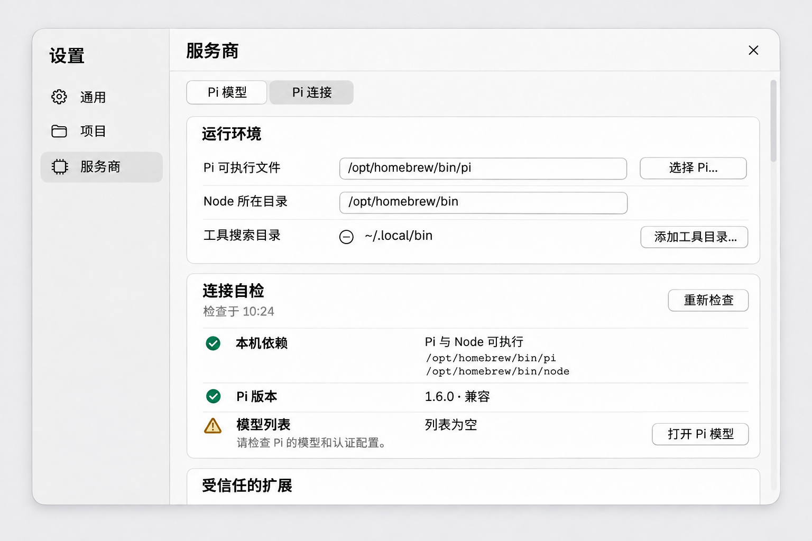
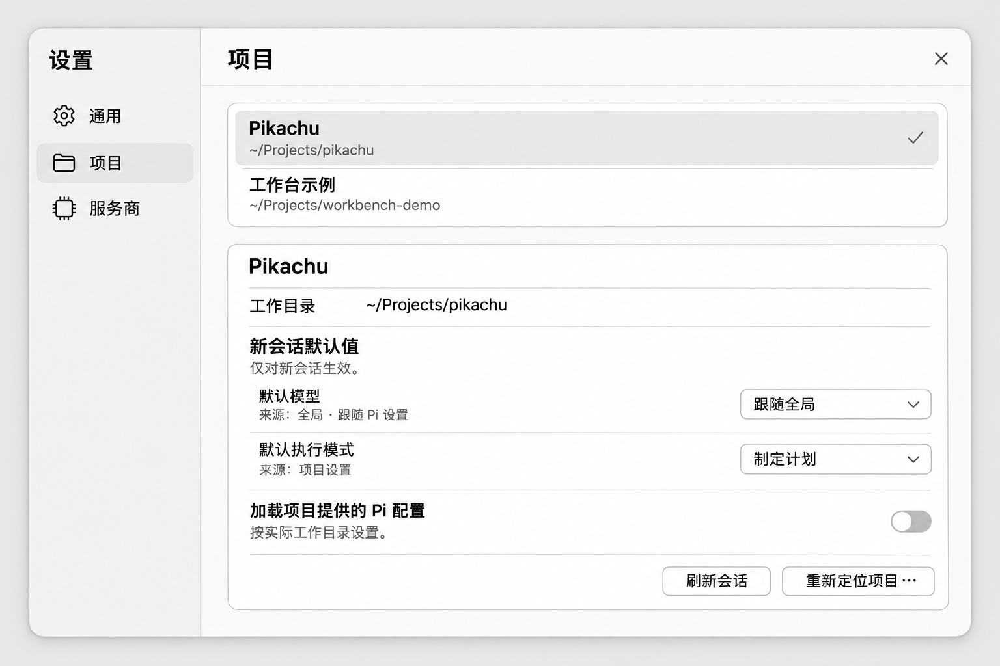
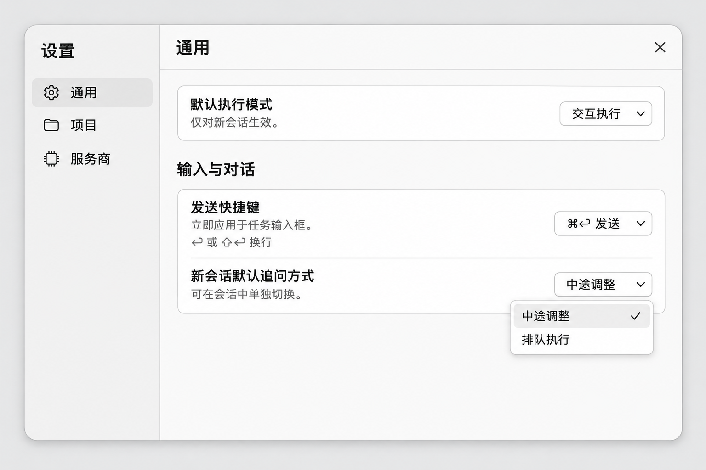

# 设置功能对照与下一版设计

**历史方案。** 本页保留内置 Pi 时期的功能对照、交付顺序和静态稿。现行入口与连接自检见 [设置组织](settings-organization.md) 和 [智能体设置](provider-settings.md)。

## 设置功能对照

「已实现」包括已经在工作台或系统菜单提供的能力。「部分」表示已有相邻能力，未覆盖单独列明的配置或入口。「缺失」表示当时的工作区未找到面向用户的入口。参考列中的时间为录屏位置。Zivvi 状态依据记录时的源码与使用说明，录屏中加载中或空白的页面只确认入口可见。[Zivvi 使用说明](../../README.md#使用工作台) · [现有设置设计](settings-organization.md)

| 类别 | 设置项 | 录屏可见参考 | 当时的 Zivvi | 后续 |
| --- | --- | --- | --- | --- |
| 应用与外观 | 界面语言、时间格式 | T3、Codex | **已实现**界面语言和跟随系统。**缺失**应用内时间格式选项。 | 时间格式按需求 |
| 应用与外观 | 明暗、主题、字体、对话宽度、对比度 | 四款均有外观设置，T3 还可分别调整界面与等宽字体 | **部分**。已有跟随系统外观及全局字号。用户级明暗覆盖、独立代码字号和主题定制缺失。 | P1 明暗与代码字号。主题编辑按需求 |
| 应用与外观 | 文件打开方式 | Codex 00:09 | **已实现**系统默认、Xcode、VS Code 和自定义命令。项目文件也可临时选择打开方式。 | 沿用 |
| 应用与外观 | 快捷键查找、改绑与设置搜索 | 四款均有快捷键入口。T3、Copilot、Codex 有设置搜索 | **部分**。系统菜单已有快捷键。集中速查、改绑和设置搜索缺失。 | P1 快捷键速查。设置栏目增长后再做搜索 |
| 应用与外观 | 无障碍偏好 | Copilot 00:14 的缩放、色觉、高对比度与读屏。T3 00:11 的播报级别 | **部分**。已有字号、键盘入口和 VoiceOver 标签。播报级别、色觉模式和应用内高对比度缺失。 | P1 先核对审批、失败与运行状态播报 |
| 应用与外观 | 更新、版本、许可与更新渠道 | T3 00:59、Copilot 00:00、Antigravity 00:02、Codex 00:11 | **部分**。侧栏已能手动与自动检查更新并打开发布页。缺少集中版本与更新偏好，以及渠道选择。 | P2 版本、最近检查结果与自动检查开关 |
| 应用与外观 | 菜单栏、开机启动、关闭确认、防休眠 | Copilot 00:00–00:07、Antigravity 00:02、Codex 00:10、T3 00:55 | **部分**。已有菜单栏任务入口和安全退出行为。缺少登录启动、防休眠和同类确认偏好。 | P2 仅评估活跃任务防休眠，涉及耗电 |
| 通知与会话 | 完成、失败、审批、提问与声音 | 四款均可调任务提示。T3 区分系统与应用内，Codex 区分事件类型 | **部分**。已有后台系统通知、权限状态及审批／完成／失败提示。缺少按事件配置和跨会话前台通知偏好。 | P1 通知分级 |
| 通知与会话 | 侧栏分组、排序、待处理与暂缓提醒 | T3 00:01、00:34–00:37 | **部分**。已有待处理／已处理、项目筛选、搜索、运行标记和暂缓提醒。缺少跨环境分组、排序偏好、自定义提醒间隔与自动归整。 | P2 按会话规模评估 |
| 通知与会话 | 会话归档、恢复、保留与清理 | T3 01:01、Copilot 00:05–00:07、Codex 00:40–00:49 | **部分**。「已处理」可恢复为「待处理」。独立归档库、保留规则和批量清理缺失。 | P2 先做存储概览和清理预览 |
| 输入与阅读 | 发送键、默认排队／中途调整 | T3 00:10、Antigravity 00:00、Codex 00:12 | **部分**。现为 ⌘↩ 发送，运行中可按会话切换发送方式。两项应用级偏好缺失。 | **P0 ③** |
| 输入与阅读 | 纯文本／富文本编辑、预测、工具输出详略、数学公式 | T3 00:05–00:11、Copilot 00:05、Codex 00:11–00:12 | **部分**。已有文本输入、Markdown 展示和工具调用折叠。编辑模式切换、预测、输出显示级别和公式排版缺失。 | P2 按长对话反馈评估输出显示级别 |
| 输入与阅读 | Diff 布局、忽略空白、颜色、文件默认展开、代码换行 | T3 00:07–00:13、Copilot 00:14 | **部分**。已有变更可视化、项目文件预览及单次换行控制。缺少全局换行和 Diff 偏好。 | P1 默认换行。Diff 偏好按需求 |
| 输入与阅读 | 听写、语音、麦克风、词典与录音 | 四款均展示语音或听写设置 | **缺失**。 | 暂缓 |
| 输入与阅读 | 主动捕获窗口、浏览器录屏、屏幕活动上下文 | T3 00:29、00:39，Codex 00:57–00:59 | **部分**。已有图片粘贴和视频文件引用。窗口捕获、录屏参数和活动上下文缺失。 | 暂缓 |
| Runtime 与模型 | Runtime 路径、版本、认证／启动状态、工具诊断 | T3 00:30–00:33、00:57，Codex 00:22–00:24 | **部分**。已有 Pi、Node、工具目录和环境变量设置，版本检查在 Runtime 启动链路，会话顶栏有连接状态。设置页缺少独立自检。 | **P0 ①** |
| Runtime 与模型 | 全局默认模型、收藏、可见性、推理强度 | T3 00:33–00:35、Copilot 00:28、Antigravity 00:12、Codex 00:11 | **已实现**默认模型、收藏、可见性与会话级推理强度。**缺失**独立的推理等级筛选。 | 沿用，筛选按需求 |
| Runtime 与模型 | 新会话模型与执行方式按项目覆盖 | T3 00:34、Copilot 00:05、00:33 | **部分**。默认模型和执行模式当前全局生效。项目级覆盖缺失。 | **P0 ②** |
| Runtime 与模型 | 审批、执行模式、OS 沙箱与网络规则 | Copilot 00:33–00:34、Antigravity 00:00、Codex 00:22–00:24、T3 00:34 | **部分**。已有三种执行模式和会话工具审批。独立的 OS 沙箱、目录／网络权限配置缺失。 | 随 Runtime 强制执行能力设计 |
| Runtime 与模型 | 多后端、自定义服务商、备用模型、编排与执行模型 | T3 00:30–00:35、Copilot 00:28、Antigravity 00:12 | **部分**。当前以 Pi 提供的模型为来源。独立服务商配置、跨后端路由与备用策略缺失。 | 子任务模型随编排设计，多后端随 ACP 设计 |
| Runtime 与模型 | 用量、费用、额度、套餐、积分及耗尽处理 | T3 00:24、00:37，Copilot 00:03，Antigravity 00:12，Codex 00:07–00:08 | **部分**。已有会话 Token、估算费用、上下文占用、本机 Codex 账户额度及刷新。缺少项目汇总和其他账户来源。 | P2 先做项目汇总。账单、额度自动续跑暂缓 |
| 项目与 Git | 项目工作目录、刷新、重新定位、名称、图标、侧栏显隐、多文件夹 | T3 00:44、Copilot 00:33、Antigravity 00:18 | **部分**。已有工作目录、刷新和重新定位。缺少独立名称／图标设置、仓库显隐和多文件夹项目。 | P2 按项目管理反馈评估 |
| 项目与 Git | 项目配置授权、规则、Skills、MCP、插件发现及预算 | Copilot 00:33–00:49、Antigravity 00:18–00:39、Codex 00:28、00:50、01:05 | **部分**。已有按实际目录的 Pi 配置信任开关、可信扩展及 Pi 的上下文规则。缺少资源来源与有效状态的集中视图、资源预算和图形化 MCP 管理。 | P1 先做来源与状态摘要，编辑随 Runtime 能力推进 |
| 项目与 Git | Worktree 选择、创建位置、分支规则、复用、保留与清理 | T3 00:49–00:50、Copilot 00:35、Codex 01:16 | **部分**。已有选择、基准提交／分支／路径创建和按目录配置。缺少根目录／分支前缀偏好、集中管理及清理。 | P1 工作树管理与手动清理预览 |
| 项目与 Git | 仓库脚本、默认基准分支、稀疏检出、启动开发服务器 | Copilot 00:34–00:47、T3 00:44 的项目操作入口 | **部分**。新建 Worktree 可手选基准，缺少相应默认值与生命周期脚本管理。 | P2 先评估基准分支默认值 |
| 项目与 Git | Git 托管与工单、提交／PR 指令、合并方式、自动审查 | T3 00:46–00:48、Copilot 00:30–00:41、Codex 01:12–01:15 | **部分**。已有本地 Git 摘要及变更检查。缺少专门的托管账号、工单、PR 和自动审查偏好。 | 暂缓，单独按项目协作需求立项 |
| 数据与维护 | 本地磁盘分类、目录浏览、压缩、清理、导入及导出 | T3 00:55–00:57、Copilot 00:00、Codex 00:38–00:49 | **部分**。可发现 Pi 历史并恢复会话和草稿。缺少存储概览、压缩、可预览清理和跨应用导入导出界面。 | P2 先做只读存储概览 |
| 数据与维护 | 全局指令、记忆与个性化 | Copilot 00:05–00:06、Antigravity 00:18、Codex 00:25–00:28 | **部分**。项目上下文沿用 Pi 规则。缺少全局指令编辑入口、应用记忆与个性化面板。 | 先做规则来源可见，记忆暂缓 |
| 数据与维护 | 帐号、联系人、隐私、分享链接、密码及账户数据 | Copilot 00:03、Codex 00:01–00:08、00:47–00:52、T3 00:54 | **部分**。认证复用 Pi。应用账户、共享访问、家长控制、密码库等缺失。 | 暂缓 |
| 浏览器与设备 | 浏览器配置、档案、下载、历史、站点权限、电脑操作及模拟器 | T3 00:38–00:42、Copilot 00:25、Antigravity 00:15、Codex 00:54–01:04 | **缺失**独立设置入口和相应内置操作面板。 | 随对应产品能力设计 |
| 浏览器与设备 | 远程配对、SSH、云端环境、共享与定时任务 | T3 00:43、00:51–00:54、Copilot 00:30、Antigravity 00:02、Codex 01:08–01:11 | **缺失**对应设置及托管入口。 | 暂缓 |
| 其他 | 实验功能、移动伴侣、Mini、宠物 | T3 00:58–00:60、Copilot 00:30、Codex 00:29 | **缺失**面向用户的对应配置。 | 暂缓 |

### 后续排序

| 顺序 | 交付范围 | 排序依据 |
| --- | --- | --- |
| **P0 · 首批定稿** | ① Pi 连接自检 → ② 项目级新会话默认值 → ③ 发送键与追问偏好 | 先解决新会话能否启动，再解决用什么配置启动，最后补高频输入习惯。三项都能复用已有连接、会话创建或发送路径。 |
| **P1 · 下一批** | ① Worktree 管理 → ② 通知分级 → ③ 项目规则和工具来源摘要 → ④ 明暗、代码字号、默认换行、快捷键速查 | 并行会话已经可用，目录混淆和漏看待处理事件的影响最大。规则摘要随后补足配置可见性。外观与快捷键优先选择日常用得上的少数选项。 |
| **P2 · 有数据再扩展** | ① 本地存储概览 → ② 项目用量汇总 → ③ 应用更新偏好与其他会话维护 | 先让用户看到空间与用量的来源，再评估保留期、批量清理和账户来源。 |

首批页面复用设置卡片、细分隔线、描边按钮和现有菜单。导航、标题及服务商页签固定，正文可以滚动。自检状态同时使用文本和图标。项目默认值与输入偏好使用相同的行布局，标签及说明在左，控件在右，较窄时允许说明换行。[设置组件](../../Zivvi/Features/Settings/SettingsPanel.swift) · [主题颜色](../../Zivvi/DesignSystem/ZivviTheme.swift) · [设计令牌](../../DESIGN_TOKEN.md)

以下三张浅色静态稿使用示例路径和版本。控件尺寸、页签选中样式和范围外控件沿用现有组件，原生交互按各节验收标准验证。

## 1. Pi 连接自检

### 入口与范围

「设置 → 服务商 → Pi → 连接与运行环境」。自检位于路径和工具目录设置上方。连接失败时沿用「打开连接设置…」入口。

以下为首批 Pi 自检视觉记录。

初始状态为「尚未检查」。用户点击后启动一次检查，同一时间只运行一次。关闭设置时检查继续，再打开可查看进度或结果。结果展示检查时间和当时生效的路径，保留至本次 App 退出。Pi、Node、工具搜索路径或已生效的环境配置变化后，旧结果标记为「配置已变更，请重新检查」，迟到的旧结果不得覆盖新状态。环境变量按已保存的配置检查。存在未保存编辑时，旁边标明检查使用已保存的值。

| 步骤 | 检查与显示 | 失败后的入口 |
| --- | --- | --- |
| 本机依赖和配置 | 显示当前生效的 Pi 可执行路径、Node 可执行路径。核对可执行性和环境读取／装配结果。 | 定位到 Pi、Node、工具目录或环境变量字段。 |
| Pi 版本 | 显示识别到的版本，并按当前正式启动使用的兼容规则判定。当前工作区接受规范的 Pi 1.x 版本。 | 选择受支持版本，或重试。 |
| 模型列表 | 通过隔离的 Pi RPC 探测读取列表。结果分别显示「读取成功 · N 个模型」「列表为空」「读取失败」及相关的下一步。列表为空时提示检查 Pi 模型和认证配置。 | 重新检查，或选择「打开 Pi 模型」定位同页模型列表。 |

旧方案的检查结论覆盖本机依赖、Pi 版本和模型列表读取。探测使用与正式启动相同的配置装配，在隔离目录中查询模型元数据，并使用有界等待和进程清理。模型请求与账户服务的实际可用性在正常会话中体现。

### 验收标准

| 验收项 | 通过条件 |
| --- | --- |
| PI-01 · 原生入口与成功 | 新启动首次打开显示「尚未检查」。通过按钮和连接错误入口均可到达正确位置。正常夹具一次检查显示有效路径、兼容版本、模型数和完成时间。 |
| PI-02 · 可诊断失败 | 分别注入 Pi 和 Node 路径错误、配置读取失败、不支持版本、版本超时、模型列表为空、RPC 失败及超时。显示对应步骤和下一步，前置失败时后续步骤显示「未检查」。 |
| PI-03 · 配置一致性 | 覆盖 Finder 启动、工具目录自定义和已保存环境覆盖。探测取值与下一次正式启动一致。检查中改设置、重复点击、关闭后重开，结果归属于正确配置且只运行一个探测。 |
| PI-04 · 隔离与清理 | 用合成 Pi 夹具核对只有版本和模型元数据查询。成功、失败、超时和应用退出均清理探测进程；真实项目、会话历史、队列、草稿和活跃任务无改动。界面及日志检查无凭据或变量值。 |
| PI-05 · 可操作与可读 | 原生 macOS 中英文验证键盘和 VoiceOver 可触发检查，并能读出检查进度、结果与修复入口。检查进行时设置面板仍可响应。 |

## 2. 项目级新会话默认值

### 入口、默认值与生效范围

「设置 → 项目 → 选中项目 → 新会话默认值」。位置在工作目录之后、按目录的 Pi 配置区域之前。两个字段独立继承，显示当前有效值和来源。

| 字段 | 选项 | 缺省行为 |
| --- | --- | --- |
| 默认模型 | 跟随全局、从 Pi 模型列表选择一个模型 | 跟随「服务商 → Pi → 默认模型」的值。全局为「跟随 Pi 设置」时，创建的草稿显示该来源，首次连接时由 Pi 选择。 |
| 默认执行模式 | 跟随全局、制定计划、交互执行、自主执行 | 跟随「通用 → 默认执行模式」。首次安装的全局默认仍为交互执行。与模式对应的工具审批沿用现有默认规则。 |

逐字段遵循「会话手动选择 → 项目覆盖 → 全局默认」，只有模型在全局选择跟随 Pi 时继续由 Pi 决定。启动前在现有模型及执行模式控件的详情显示「来自项目设置」或「来自全局设置」，手动覆盖后显示「会话设置」。

- 按项目 ID 保存。项目重新定位时保留偏好，同名项目相互独立。项目主目录和它的各 Worktree 共用两个默认值。Pi 配置授权仍按实际目录管理。
- 成功保存后，在创建新会话时读取。打开新项目自动创建首个会话、普通新建、在已绑定会话切换工作目录时派生的新会话都走同一规则。已经创建的草稿、正在运行或等待审批的会话、导入与恢复的历史，继续使用各自设置。未绑定草稿直接切换目录时仍是原会话。
- 模型按服务商和模型标识保存。模型收藏与可见性沿用现有语义。若已设模型失效，设置行保留原选择并显示「模型当前不可用」。新会话尝试发送时暂停提交并保留草稿，待用户在该会话选定可用模型后，由用户重试。用户也可以回到项目设置，为今后新建的会话改回「跟随全局」。模型列表查询失败时显示「无法验证」并提供重试。
- 保存期间显示进度。与保存同时发起的新会话等待结果。失败时恢复上次保存的设置，提示重试。已有会话的审批选择和正在进行的任务不受影响。

项目常用配置只需设置一次，全局偏好仍是所有未覆盖项目的共同入口。权限范围由现有执行模式和会话审批决定。项目页这两项控制新会话采用的初始设置。[新会话创建](../../Modules/OrchestrationCore/WorkspaceController.swift) · [项目与会话数据](../../Modules/OrchestrationCore/WorkspaceModels.swift) · [执行模式与默认审批](../../Modules/AgentRuntimeCore/Runtime.swift)

### 验收标准

| 验收项 | 通过条件 |
| --- | --- |
| PRJ-01 · 继承与覆盖 | 建立两个同名项目，分别验证只覆盖模型、只覆盖模式、全部覆盖、全部继承。改变全局默认后，新会话逐字段取正确值，控件显示正确来源。模式对应的默认审批与现有规则一致。 |
| PRJ-02 · 创建入口与 Worktree | 覆盖打开项目、侧栏／快捷键新建、已绑定会话切目录派生会话、未绑定草稿切目录。新会话按项目 ID 取值，原草稿切目录保留原值。按目录的 Pi 配置授权独立。 |
| PRJ-03 · 持久化与旧数据 | 重启后保留覆盖。重新定位后按项目 ID 保留，旧工作台没有覆盖时按全局创建。导入的历史、已创建的草稿和运行中会话保留原值。 |
| PRJ-04 · 失效模型 | 覆盖列表暂时读取失败、模型隐藏、模型从 Pi 移除和选回可用模型。隐藏只改变选择器可见性。失效时发送路径保留草稿、指出原因，仅用会话明确选定的可用模型发送。 |
| PRJ-05 · 保存失败与切换 | 模拟保存失败、保存中切换项目及立即新建。错误和恢复后的值归属正确项目。新会话读取已确认值或显示此次创建失败，可安全重试。 |

## 3. 发送键与追问偏好

### 入口、默认值与生效范围

在「设置 → 通用」增加「输入与对话」分组。两个偏好分别保存。

| 偏好 | 选项与默认值 | 生效范围 |
| --- | --- | --- |
| 发送快捷键 | **⌘↩ 发送（默认）**，↩ 或 ⇧↩ 换行。**↩ 发送**，⇧↩ 换行，⌘↩ 仍可发送。 | 即时作用于所有会话的任务输入框。按钮帮助和 VoiceOver 提示与实际键位同步。工具审批、扩展输入框及其他表单沿用各自快捷键。 |
| 新会话默认追问方式 | **中途调整（默认）**，将补充发给当前任务，生效时机由 Runtime 决定。**排队执行**，等当前任务完成后继续。 | 创建会话时为草稿设置初始发送方式。在已有会话使用输入框左侧「发送方式」胶囊单独切换。该会话之后沿用自己的选择。空闲首条消息照常开始任务。 |

无已保存偏好的安装沿用当前键位和追问默认值。两项都在本机保存。绑定目录的会话切换 Worktree 并带草稿新建时，随草稿保留发送方式，模型和执行模式仍按该项目的新会话默认值初始化。已排队、等待核对、失败待重试和已恢复的旧消息保留记录中的发送方式。

选项只改变任务输入框的按键映射或新草稿的初始方式。键盘发送和发送按钮共享现有提交校验，按提交时显示的方式封存本条消息的选择。输入法有候选文字时，回车先交给输入法。[现有发送方式设计](composer-send-mode-placement.md) · [任务输入键盘处理](../../Zivvi/Features/Composer/ComposerImagePaste.swift)

### 验收标准

| 验收项 | 通过条件 |
| --- | --- |
| IN-01 · 键位与即时生效 | 原生 macOS 逐档验证 Return、数字键盘 Enter、Shift 和 Command 组合。切换设置后，现有会话下一次输入即按新映射处理。重启后仍使用所选档。按钮帮助与 VoiceOver 读出的快捷键一致。 |
| IN-02 · 输入法与提交保护 | 中文候选选择和提交、英文输入、多行粘贴、附件消息分别验证。候选确认、长按回车、空白草稿、阻塞态和未聚焦时不触发意外提交。审批、停止和扩展输入等原有按键路径通过回归。 |
| IN-03 · 追问默认与会话覆盖 | 两档各新建一个会话。用合成 Runtime 检查空闲首条启动、执行中补充、排队执行。胶囊显示正确初始值；手动选择只影响当前会话，切换会话或重启后保留各自值。 |
| IN-04 · 旧消息和目录切换 | 设置变化前已有的草稿、已排队消息和恢复记录保持其方式。切换 Worktree 并转移草稿时保留稿件、附件和发送方式。确认不会因设置变化重排、重发或重新解释已提交消息。 |

## 录屏索引

- T3 Code — 录屏2026-11-21 23.58.35.mov
- GitHub Copilot — 录屏2026-11-22 00.00.10.mov
- Antigravity — 录屏2026-11-22 00.01.22.mov
- Codex — 录屏2026-11-22 00.02.17.mov
