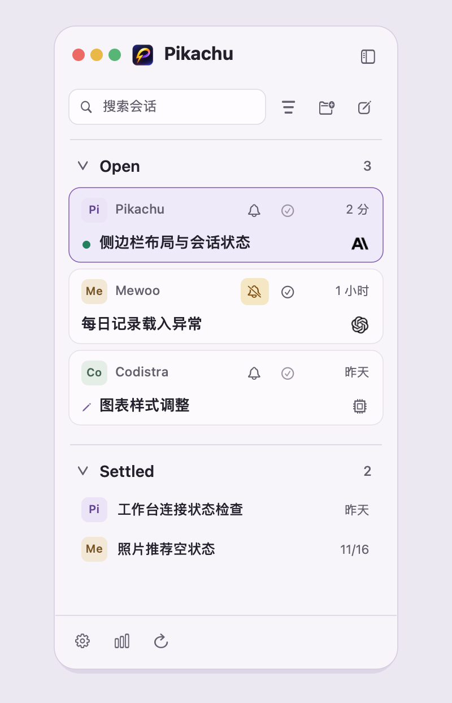

# 侧边栏会话分组与卡片设计

**方案草稿 · 待整体确认 · 2026-11-19**

工作台侧栏从按项目展开，改为按会话的处理状态展开。项目仍显示在卡片上，可用于搜索、筛选和创建会话。参考图用于确定信息位置与密度。视觉使用 Pikachu 的品牌图标、原生窗口控件和项目既有强调色。

示意使用样例数据和明色外观。Settled 在图中展开以显示单行卡片。实际布局、系统外观及窗口控件的对齐需在 macOS 候选上验证。

## 布局与操作

| 位置 | 设计 |
|---|---|
| 第一行 | 原生关闭、最小化、全屏按钮右侧显示 Pikachu 图标与产品名。侧栏开关排在右侧，保留原有快捷入口。展开、隐藏和全屏时核对标题与原生控件的间距 |
| 第二行 | 从左到右为搜索、筛选、新建项目、新建会话。搜索匹配会话标题和项目名。筛选从「全部项目」或一个项目中选择，显示已应用状态。项目详情、重新定位、项目级刷新从筛选菜单内的「项目操作」进入，覆盖无会话项目 |
| 列表 | Open 在上，Settled 在下。各自可折叠，标题显示匹配数。同组按最近活动排序，查看会话时保持排序。列表滚动，工具栏和底栏固定 |
| 左下角 | 设置打开现有连接设置。统计切换当前会话的用量区域，无选中会话时禁用。刷新发现所有已登记项目的历史，并更新正在查看的只读历史，沿用活跃运行的读取保护。刷新中禁用重复操作，失败时保留列表并反馈 |
| 新建与切换 | 新建项目沿用选择本地目录和初始化空会话流程。新建会话优先使用明确筛选的项目，其次使用当前会话的所属项目，否则弹出项目选择。菜单与快捷键采用同一目标规则。新建后选中会话并确保卡片可见 |

保留 205 pt 侧栏最小宽度和 860 × 620 pt 最小窗口。正常宽度下 Open 使用完整项目标识，窄到名称无法舒适显示时改用缩略标识。Settled 始终使用缩略标识。缩略图标由项目名的前两个可见字符组成，单字符用一个，保留原大小写。符号重复的项目以完整名称、路径和稳定项目 ID 区分。工具提示与辅助功能提供完整名称，颜色仅辅助识别。窄栏优先给会话名留空间，搜索框弹性收缩，操作按钮、模型 Logo 和时间保持可达。

| 卡片 | 行 | 内容 |
|---|---|---|
| Open | 第一行 | 项目标识 → 暂缓提醒按钮 → 标记已处理按钮 → 最近活动时间 |
| Open | 第二行 | 会话名称及必要的运行／待核对／草稿提示 → 会话模型 Logo |
| Settled | 单行 | 缩略项目标识 → 会话名称 → 最近活动时间。「移回 Open」放在右键菜单和可访问操作里 |

使用有资料支持的会话模型及对应提供方 Logo。已连接会话读已生效的模型，已提交历史读可确认的会话快照或历史元数据。未应用的配置不参与展示；只有提供方已知时可以显示其 Logo 并说明模型未知。无资料或无对应图标时显示通用模型图标，悬停或 VoiceOver 提供可确认的模型信息。项目名、会话名截断时保留完整提示。选中样式随系统强调色，和运行、草稿或到期提醒的语义独立。

## 分组、折叠和提醒

- **Open** 表示会话仍需处理，包括新建、仍在执行、等待输入、待核对或尚未收尾。用户点击「标记已处理」后进入 **Settled**，选中项随会话迁移。运行、等待输入、队列未清、结果待核实、清理未确认或有未提交草稿的会话暂时禁用该操作，提示具体原因。一次运行自然结束后，已有 Open 会话继续留在 Open。
- **Settled** 仍可查看历史。用户可以显式「移回 Open」。产生新草稿或继续提交时打开该会话。浏览历史不改变分组。显式标记已处理时清除暂缓提醒。
- **旧记录初始归组（建议）**：有已确认历史、且无草稿、恢复项、未决提交或中断证据的旧会话，以及符合这些条件的新发现历史，初始放到 Settled。其他旧会话进入 Open。这个规则只初始化缺少处理状态的记录，不能据历史推断实际完成。用户可移回 Open，刷新保留已经存储的选择。
- **折叠**：首次 Open 展开，Settled 收起。每组独立保存折叠状态。收起时只渲染属于该组、且符合当前筛选条件的选中会话。无选中项时只显示组标题与计数。选中项移到另一个收起组时，卡片在目标组标题下可见。搜索或项目筛选开始时临时展开有匹配的组，期间仍可手动收起，清除条件后恢复原展开状态。筛选排除当前会话时，右侧详情与运行状态继续保留。
- **暂缓提醒（建议）**：Open 卡片第一行的提醒菜单提供「1 小时后」「明天 09:00（本地时间）」及「取消暂缓」。暂缓期间会话仍留在 Open，显示暂缓图标；到点出现侧栏提示，直到处理、取消提示或再次暂缓。保存到期时间，重启时重新计算到期。首版范围为应用内提醒。
- **时间（建议）**：使用最近可核实的会话活动时间。新会话以创建时间开始，实际提交及运行结束更新；发现的历史取可信的最后活动时间。旧记录无可靠来源时沿用旧最近查看值作迁移时的近似时间，提示注明来源。之后仅查看会话时不再改变该值。同一时间按稳定会话 ID 排序。

## 实施顺序与所有权

1. **会话元数据**。一个实现者负责 `WorkspaceModels.swift`、`WorkspaceController.swift` 和必要的历史适配。为处理状态、暂缓截止时间和活动时间添加向后兼容字段，保持现有 SwiftData 记录及 Pi 源历史。旧记录须在冷启动清理中断标记前保留用于初始归组的证据。通过控制器统一检查运行、等待和未保存状态。沿用现有带 revision 的串行保存链路。保存失败显示现有失败提示与重试入口。刷新按工作区合并发现请求，复用现有去重和项目路径核对，避免逐项目重复扫描同一历史库；同一路径无法唯一归属时保留现有绑定并反馈。
2. **侧栏装配**。同一实现者负责 `PikachuApp.swift`、`WorkbenchView.swift` 和侧栏视图。复用现有设置、用量、项目管理、会话选择和 Logo 资源。移除被替换的项目式侧栏入口前，核对交互、菜单快捷键及验证脚本对控件标识的依赖。列表投影用稳定会话 ID 和实际选择驱动。跨组移动、筛选、刷新和标题变化保持焦点与选中状态可解释。避免在渲染卡片时逐条读取历史或让流式正文刷新整列。
3. **候选与验证**。实现者记录实际入口和回归结果，固定涉及本任务和必要装配的候选。独立 reviewer 核对分组迁移、活动保护、保存和历史刷新、选中与执行归属，检查真实入口与旧入口替换。发现必做问题由原作者整改，原 reviewer 在新候选上复查相邻状态。工作台界面任务仍有独立复审，实施前核对共用文件基线；两次交付分别固定候选。

现有产品设计对侧边栏的约定见 [DESIGN.md](../../DESIGN.md#4-信息架构与交互)。本提案涉及标题、导航、项目操作与用量入口，承接 [工作台分区设计](workbench-ui-refresh.md) 中的对应部分。会话查看与执行分离、草稿隔离、运行控制、对话滚动和模型配置沿用现有入口。

## 验收

| 验收点 | 证据与方法 |
|---|---|
| SB-01 · 窗口和入口 | 原生 macOS 在普通窗、最小窗、全屏和明暗外观核对品牌与三色按钮位置，搜索、筛选、两个新建入口和底栏可达，侧栏开关与菜单快捷键可用 |
| SB-02 · 处理状态与存储 | 宿主测试覆盖新建、旧索引、导入、自然运行结束、手工处理、再次打开、保存失败重试和重启。以 Fake Runtime 覆盖与运行、待回复、未核对提交、待清理及草稿的交错。确认观看另一会话时执行归属稳定 |
| SB-03 · 折叠与查找 | 宿主验证投影及稳定 ID。原生操作验证两组各展开或收起、选中与无选中、跨组移动、过滤排除、清空搜索、空结果和搜索到 Settled |
| SB-04 · 卡片、提醒与无障碍 | 明暗截图覆盖两行和单行密度、宽窄项目标识、长中文标题、相同缩写、未知 Logo 和时间。可控时钟验证提醒到期与重启。键盘和 VoiceOver 验证卡片选中、折叠、可用的行按钮、全称及状态 |
| SB-05 · 底栏、刷新和回归 | 从底栏核对设置和选中会话统计。用隔离样本验证无项目、历史刷新、部分失败、快速重复点击、刷新期间切换会话、成功但无新历史、活跃会话保护与大列表滚动。确认选择历史不会启动运行时，正文流式输出期间侧栏仍可交互 |

先使用隔离索引和 Fake Runtime 验证。原生证据绑定固定 macOS Release 候选，由获得相应授权的执行者采集。设计稿和源码核对可用于检查范围，布局、交互、VoiceOver 与性能仍需原生证据。真实模型、运行时和实际项目目录仅在已有授权覆盖时使用。

## 关键取舍与确认

推荐由用户处理动作控制 Open 和 Settled。仅按实时执行状态分组可以省去存储和迁移，但回复刚结束就可能从 Open 消失，也无法长期表达「已处理」和「稍后看」。采用会话处理状态会增加旧数据初始归组和持久化实现，换取稳定浏览体验。

待整体确认的默认值包括旧历史的初始归组、应用内暂缓提醒、统计指向当前会话和上述搜索／折叠行为。视觉稿的间距和色彩为验证参考，以原生控件、系统强调色和实际最小尺寸的验证结果为准。
