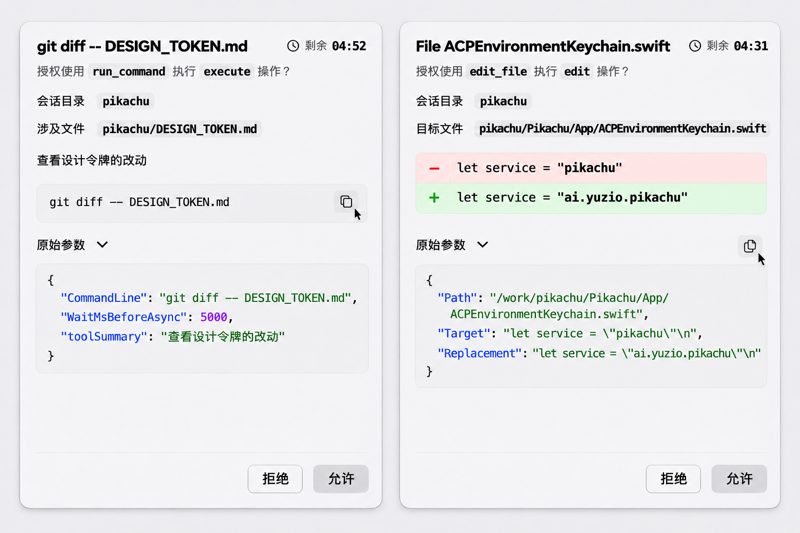

# 工具审批弹窗

**设计已定稿** · 2026-11-25 · r06

采用范围为 macOS 工作台的执行命令和编辑文件审批。先核对操作和作用范围，再查看命令或逐文件差异。底部保留本次请求的审批选项。



并排图尺寸为 1536 × 1024 px。两张图使用示例数据，等高只用于并排对照。产品默认折叠「原始参数」，弹窗高度按各自内容计算。

## 布局与样式

| 区域 | 定稿规则 |
| --- | --- |
| 标题区 | 主标题使用本次工具调用的 `title`。副标题为「授权使用 run_command 执行 execute 操作？」这类句式。工具名和操作类型使用无引号的半粗等宽字及浅灰行内代码背景。剩余时间靠右，保留时钟图标和「剩余」标签，只加粗等宽数字。倒计时区域沿用面板底色。 |
| 操作范围 | 每个弹窗都有「会话目录」。命令审批收到 `locations` 时，在下一行显示「涉及文件」，下方依次为摘要和命令框。编辑审批在每组差异上方显示「目标文件」。目录和文件路径值使用与副标题一致的行内代码样式，左侧标签使用次要文字颜色。 |
| 命令 | 使用等宽字和弱边框代码框。长命令自动换行，保留命令原有空格和换行。标准 `content` 文本和原始参数中的摘要以普通正文显示在命令之前。相同摘要只显示一次。 |
| 编辑差异 | 按文件分组，在同一块差异区域内直接显示代码行。移除行使用红色 `−`，新增行使用绿色 `+`，标记与代码基线对齐。行背景使用对应语义色的淡色层。末尾换行发生变化时标明两侧的行尾。缺少旧内容的新建文件仅显示新增行，原文件内容为空时仍按编辑处理。 |
| 原始参数 | 使用「原始参数」折叠行。展开后用等宽字显示格式化 JSON，区分键、字符串、数字和标点。保留所有值，路径分隔符显示为 `/`，JSON 必需的转义保留。 |
| 操作区 | 与正文之间使用细分隔线。二元示例左「拒绝」、右「允许」。其他可用选项随本次请求提供，提交所选 `optionId`。 |

## 路径与复制

| 路径 | 显示示例 |
| --- | --- |
| 会话目录为项目根目录 | `pikachu` |
| 会话目录为项目内的子目录 | `pikachu/Verification` |
| 文件在项目内 | `pikachu/Pikachu/App/ACPEnvironmentKeychain.swift` |
| 文件在项目外 | `/private/tmp/approval-example/workspace/approval-probe.txt` |

「会话目录」取会话的 `cwd`。项目内的目录及文件以项目根目录名开头，后接相对该根目录的路径。项目外显示绝对路径。涉及文件读取各自的 `locations[].path`，目标文件读取所属差异的 `content[].path`。按路径的原始 UTF-8 字节分组和去重。

显式命令工作目录与会话目录的 UTF-8 字节不同时，活跃和过期审批都单独显示「工作目录」。相对文件路径以会话目录为基准；即使过期详情省略重复的目录行，复制值仍为完整绝对路径。

鼠标悬停会话目录、命令、涉及文件、目标文件或原始参数时，在对应区域右侧显示复制按钮。按钮获得键盘焦点时同样可见。路径按钮复制完整绝对路径，命令复制全文，原始参数复制完整的有效 JSON。复制按钮的出现保持文本位置稳定，复用现有图标尺寸和悬停反馈。

## 尺寸与组件

- 命令弹窗沿用 `640 pt` 和 `700 pt` 宽度档，ACP 编辑弹窗沿用 `640 pt` 首选宽度。工作台较窄时，宽度上限为可用宽度减去两侧各 `24 pt`。弹窗高度跟随内容，达到可用高度后正文可滚动，底部操作区保持可见。 [ApprovalSheetLayout](../../../Pikachu/Features/Composer/InteractionView.swift)
- 标题采用 `title2` 半粗样式，正文、次要文字和等宽字体沿用现有字号档。行内代码使用 `selected` 中性底。命令和 JSON 使用 `mutedSurface`，边界与分隔线使用 `border` 和 `subtleDivider`。差异用 `errorText` 和 `runningText` 区分减少和增加。 [字号](../../../Pikachu/DesignSystem/PikachuTypography.swift) · [主题](../../../Pikachu/DesignSystem/PikachuTheme.swift)
- 展开行复用 `FlatDisclosureStyle`，底部按钮和复制按钮沿用 `FlatControlButtonStyle`。宽度不足时，正文可换行，长路径仍可读取和复制。 [设计令牌](../../../DESIGN_TOKEN.md) · [展开控件](../../../Pikachu/DesignSystem/FlatDisclosureStyle.swift) · [按钮样式](../../../Pikachu/DesignSystem/FlatControlButtonStyle.swift)

## 实施与验收

1. ACP 审批按 `ToolCallUpdate` 读取标准字段，忽略 `toolCall.args`。保留 `rawInput` 的完整 JSON。在同一会话内按 `toolCallId` 关联 `session/update`。命令审批收到 `execute` 和可显示的命令后启用允许选项。编辑审批收到带路径的差异后启用。类型缺失且只有原始参数时继续等待。选项、回复 ID 和截止时间来自当前请求。字符串请求 ID 按原始字节关联回复和取消。已展示的操作内容发生字节变化时取消旧审批。过期后保留最后显示的详情。 [ACP v1 审批请求](https://agentclientprotocol.com/protocol/v1/tool-calls#requesting-permission)
2. 工程验证覆盖命令和单文件编辑报文、仅含 `toolCallId` 的审批，以及省略 `locations` 的多文件差异。核对分批详情的到达顺序、请求 ID、目标变化、过期快照、摘要与命令顺序、目标路径和行尾标记。
3. 获得原生验收授权后，检查浅色、深色、窄窗和超大字号。核对原始参数展开时的高度变化、倒计时、悬停复制、键盘焦点、完整复制结果和底部选项可达性。

用户于 2026-11-25 确认采用 r06 的命令和编辑两种弹窗。图稿由 Codex 使用 Vistra 0.1.5（产物契约 1）和内置 ImageGen 制作，并进行静态自检。定稿交付包括图稿和本文。原生交互及无障碍行为待实施后验证。

<details>
<summary>r06 生成提示词</summary>

```text
Use case: precise-object-edit. Make one tiny local visual edit to the supplied Pikachu macOS approval mockup. Keep the same image, geometry, copy, and pixel alignment. In both sheets only, remove the gray filled rounded rectangle behind each countdown and remove any shadow beneath each countdown. The pixels around those text and icon elements now have exactly the surrounding light sheet surface, with neither a badge outline nor a fill. Keep the same clock glyph, Chinese label 剩余, and DO NOT change the bold weight, dark color, size, or exact values of the monospaced time digits: 04:52 left and 04:31 right. Keep the countdowns aligned top right at the same coordinates. Repaint only these two small areas. Keep both outer sheet shadows and the other gray inline code backgrounds. Freeze every other item including title, unquoted subtitles, involved file immediately below session directory, command hover copy, compact two-line red minus/green plus diff, expanded correctly syntax-colored JSON, right-side raw JSON hover copy, both sets of buttons and the full complete sheet boundaries. No text outside the original image.
```

</details>
