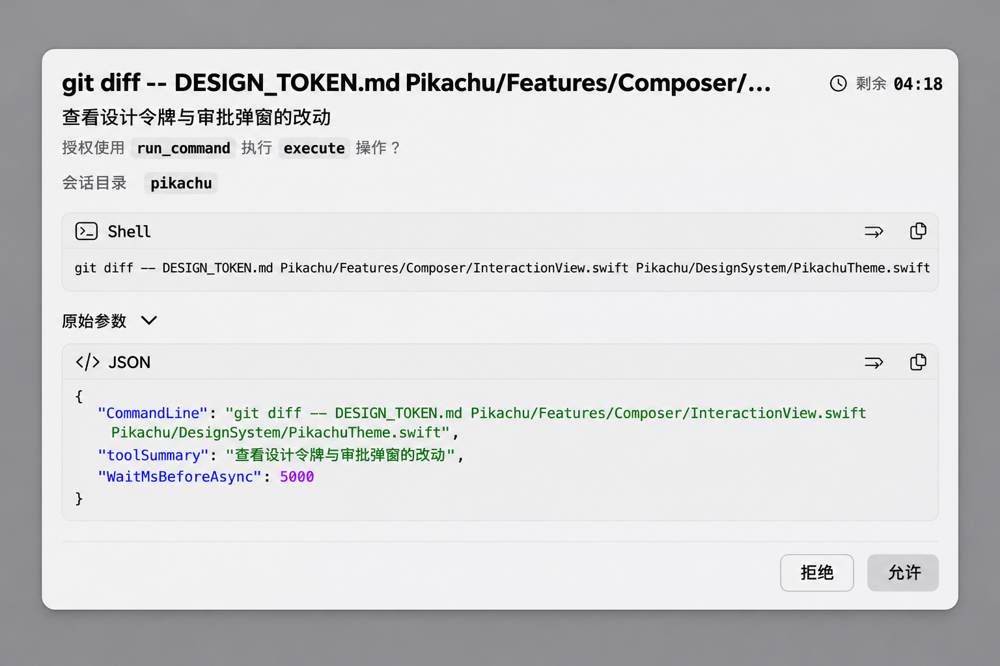
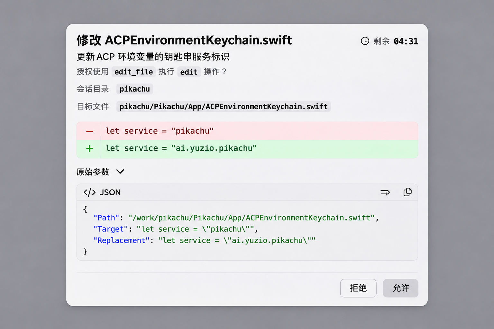
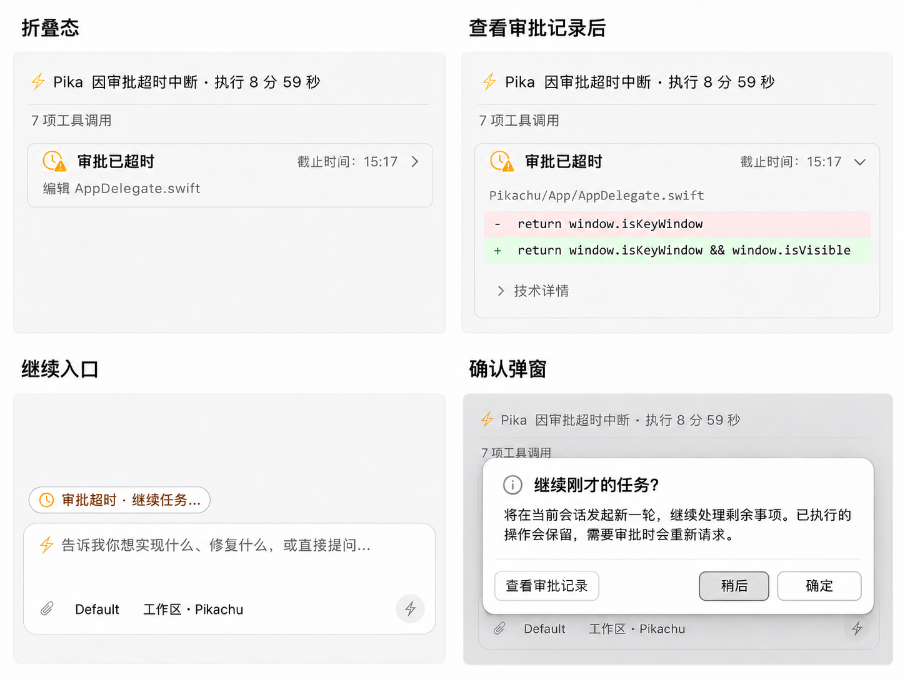

# 工具审批弹窗

**设计已定稿** · 2026-11-27 · r08

采用范围为 macOS 工作台的执行命令（`execute`）和修改文件（`edit`）操作审批。两类弹窗统一为 **Approval（操作审批）** 六段平铺结构，复用 `ZivviSpacing` 与四档 `ZivviTypography`，仅在核心内容区切换 `Shell` 命令或 `Diff` 视图。

> 历史对照：r07 两张静态稿保留在仓库中作为演进参考；r08 在代码实现与规范中统一收口了「操作意图唯一主标题、路径去胶囊、无边框内容块、Unified Diff 与字符级高亮、技术详情渐进披露、允许本次、30 秒倒计时警示与 80% 高度上限」。

## 布局与样式（r08）

| 区域 | 定稿规则 |
| --- | --- |
| 顶部 Header | 左侧展示 SF Symbol 与审批类型（「执行命令」/「修改文件」），右侧固定 `◷ MM:SS` 等宽倒计时（`caption` Regular，常态 `secondaryText`，最后 30 秒切换 `warningText`，无闪烁或呼吸动画）。弹窗打开期间发生超时时，切换为「已超时」警示态，保持上下文只读可见。 |
| 操作意图（Intent） | 作为唯一视觉主标题（`title2` Semibold，允许自然换行，不与倒计时争抢宽度）。优先取 `toolSummary` / `summary`，两者皆空且 `request.title` 不与下方命令/文件路径重复时使用 `request.title`，否则回退到「执行 Shell 命令」或「修改文件」。移除主界面的「授权使用 `<tool>` 执行 `<kind>` 操作？」说明行。 |
| 目标路径（Target） | 移除「会话目录」「目标文件」「涉及文件」文字前缀及灰色胶囊底色，改用文件夹/文件图标与无底色文字；支持文本选择、悬停 `.help` 完整绝对路径提示及复制完整绝对路径。命令审批在工作目录与会话目录不一致时显式展示实际执行目录，并按需列出涉及文件；修改文件按文件分组两级展示（项目内目录次级色 + 文件名 `.callout` Medium 主色；项目外保留绝对路径），超长路径自然换行。 |
| 命令（Shell） | 容器采用 `ZivviTheme.mutedSurface` + `8 pt` 圆角（提高对比度下保留 `1 pt` `border` 描边），移除标题栏分割线。左侧保留轻量 `Shell` 标识，右侧常显默认开启的自动换行开关与复制完整原始命令按钮；正文沿用与对话区一致的系统等宽纯文本，禁止省略号截断，超长内部滚动。 |
| 编辑差异（File Diff） | 按文件分组展示 Unified Diff。容器采用无边框 `mutedSurface` + `8 pt` 圆角（提高对比度保留描边），顶部栏左侧显示 `Diff`，右侧显示 `+N −M` 等宽统计及复制完整 Unified Diff 文本按钮。内容使用 `ToolEditDiff` 逐行差异（低饱和度行背景 + 正常 `primaryText` 代码文字 + 语义色 `−`/`+` 标识 + 成对增删行的行内字符级差异背景 + 行尾换行变化标注），无真实行号时不虚构行号，移除逐行分割线，超长支持内部垂直与横向滚动。 |
| 技术详情（Disclosure） | 默认折叠，标题统一为「技术详情」（复用 `FlatDisclosureStyle` 与 `FlatDisclosureChevron`），整行可点击并在折叠态保留悬停/焦点复制 JSON 按钮；展开/收起使用 `180 ms` 过渡（遵循「减少动态效果」）。展开后不套额外卡片，直接平铺 `Tool`、`Action`、`会话目录`、`执行超时`（如有）及语法高亮的 `JSON`（保留换行开关与复制）。 |
| 操作区（Footer） | 上方以 `subtleDivider` 分隔，右对齐原生控件尺寸按钮。标准二元选项呈现「拒绝」（绑定 `.cancelAction` / Esc）与「允许本次」（沿用 `FlatControlButtonStyle(.prominent)` 中性强调，不绑定 `.defaultAction`，避免输入时误触 Return 授权）；多选项平铺展示请求提供的选项。超时态仅展示「关闭」（Esc）。 |

## 路径与复制

| 路径 | 显示示例 |
| --- | --- |
| 会话目录为项目根目录 | `zivvi` |
| 会话目录为项目内的子目录 | `zivvi/Verification` |
| 文件在项目内（两级展示） | `zivvi / Zivvi / App` + `ACPEnvironmentKeychain.swift` |
| 文件在项目外 | `/private/tmp/approval-example/workspace` + `approval-probe.txt` |

「会话目录」取会话的 `cwd`。项目内的目录及文件以项目根目录名开头，后接相对该根目录的路径；项目外保留绝对路径，不简写为可能产生误解的相对路径。涉及文件读取各自的 `locations[].path`，目标文件读取所属差异的 `content[].path`。按路径的原始 UTF-8 字节分组和去重。

显式命令工作目录与会话目录的 UTF-8 字节不同时，活跃和过期审批都显式展示实际工作目录。相对文件路径以会话目录为基准；复制路径始终输出完整绝对路径。Shell 标题栏复制完整原始命令，Diff 标题栏复制完整 Unified Diff 文本，JSON 标题栏复制完整原始 JSON。

## 尺寸与组件

- 命令与文件编辑弹窗沿用 `640 pt`（常规）与 `700 pt`（长命令行/长路径）宽度档；工作台较窄时，宽度上限为可用宽度减去两侧各 `24 pt`。弹窗高度跟随内容，上限为 `min(可用高度 × 80%, 可用高度 - 48 pt)`，达到上限后正文内部滚动，底部操作区保持可见。 [ApprovalSheetLayout](../../../Zivvi/Features/Composer/InteractionView.swift) · [UnifiedApprovalSheet](../../../Zivvi/Features/Composer/UnifiedApprovalSheet.swift)
- 间距沿用 `ZivviSpacing`（`dialogSectionGap = 16 pt`、`dialogItemGap = 8 pt`、`dialogLabelGap = 4 pt`、`contentInset = 12 pt`），字号沿用四档 `ZivviTypography`。颜色使用 `pageBackground`、`mutedSurface`、`primaryText`、`secondaryText`、`subtleDivider`、`warningText`、`diffAddition` 与 `diffDeletion`。 [设计令牌](../../../DESIGN_TOKEN.md) · [主题](../../../Zivvi/DesignSystem/ZivviTheme.swift)
- 展开行复用 `FlatDisclosureStyle`，底部与工具栏按钮沿用 `FlatControlButtonStyle`。 [展开控件](../../../Zivvi/DesignSystem/FlatDisclosureStyle.swift) · [按钮样式](../../../Zivvi/DesignSystem/FlatControlButtonStyle.swift)

<details>
<summary>历史参考：r07 静态稿与布局说明（2026-11-27）</summary>





</details>

## 实施与验收

1. ACP 审批按 `ToolCallUpdate` 读取标准字段，忽略 `toolCall.args`。保留 `rawInput` 的完整 JSON。在同一会话内按 `toolCallId` 关联 `session/update`。命令审批收到 `execute` 和可显示的命令后启用允许选项。编辑审批收到带路径的差异后启用。类型缺失且只有原始参数时继续等待。选项、回复 ID 和截止时间来自当前请求。字符串请求 ID 按原始字节关联回复和取消。已展示的操作内容发生字节变化时取消旧审批。过期后保留最后显示的详情。 [ACP v1 审批请求](https://agentclientprotocol.com/protocol/v1/tool-calls#requesting-permission)
2. 工程验证覆盖命令和单文件编辑报文、仅含 `toolCallId` 的审批，以及省略 `locations` 的多文件差异。核对分批详情的到达顺序、请求 ID、目标变化、过期快照、摘要与命令顺序、目标路径和行尾标记。
3. 获得原生验收授权后，检查浅色、深色、窄窗和超大字号下的标题截断、倒计时、摘要、多文件差异、键盘焦点和底部选项。在 macOS 设为「始终显示滚动条」时，核对 Shell 和 JSON 隐藏滚动条且仍可滚动。确认长单行命令关闭换行时首行完整，两块换行状态独立，复制结果与源文本一致。

用户于 2026-11-27 确认采用 r07 两张静态稿。图稿由 Codex 使用 Vistra 和内置 ImageGen 制作。原生交互及无障碍行为以运行验收为准。

## 审批超时与继续任务

**设计已定稿** · 2026-11-27



- 回合确认因审批超时取消后，标题显示「因审批超时中断」和耗时。历史审批始终只读。图标与「审批已超时」共用一行，截止时间靠右。当天使用 24 小时制时分，跨天加月日，跨年加年月日。
- 折叠记录显示简短操作摘要。展开后先展示相对路径及差异，或完整命令。「技术详情」默认折叠，包含目录、原始参数与原选项。路径仍可复制。
- 同一连接内的最近一个超时中断回合可通过输入区上方的气泡续办。弹窗复用工作台的确认组件。「稍后」为默认操作。「查看审批记录」关闭弹窗并滚动到对应行，自动展开该行。「确定」发起同一会话的新一轮并保留输入区草稿。已有操作保留，新一轮沿用当前权限。

静态稿使用示例数据。核对窄窗布局、键盘焦点和 VoiceOver 需要原生验收。

## 历史版本

用户于 2026-11-25 确认采用 r06 的命令和文件编辑弹窗。 [r06 并排设计稿](approval-dialog-r06.png)

<details>
<summary>r06 生成提示词</summary>

```text
Use case: precise-object-edit. Make one tiny local visual edit to the supplied Zivvi macOS approval mockup. Keep the same image, geometry, copy, and pixel alignment. In both sheets only, remove the gray filled rounded rectangle behind each countdown and remove any shadow beneath each countdown. The pixels around those text and icon elements now have exactly the surrounding light sheet surface, with neither a badge outline nor a fill. Keep the same clock glyph, Chinese label 剩余, and DO NOT change the bold weight, dark color, size, or exact values of the monospaced time digits: 04:52 left and 04:31 right. Keep the countdowns aligned top right at the same coordinates. Repaint only these two small areas. Keep both outer sheet shadows and the other gray inline code backgrounds. Freeze every other item including title, unquoted subtitles, involved file immediately below session directory, command hover copy, compact two-line red minus/green plus diff, expanded correctly syntax-colored JSON, right-side raw JSON hover copy, both sets of buttons and the full complete sheet boundaries. No text outside the original image.
```

</details>
